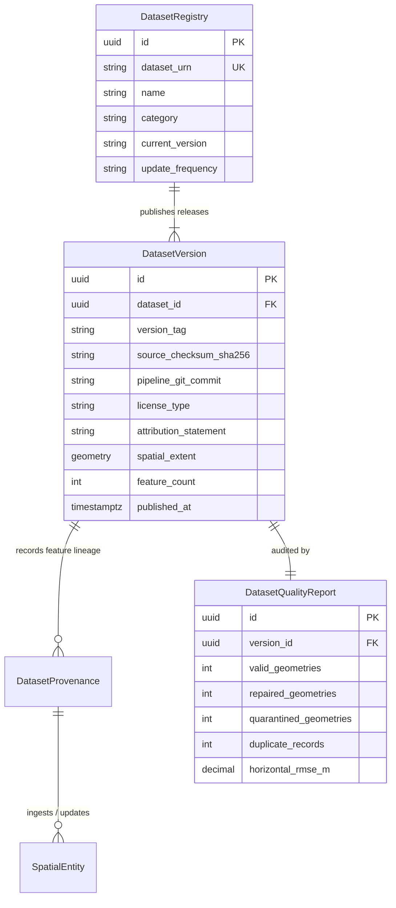

# GLITTERS GOD'S EYE — MILESTONE M3.2
## Spatial Database Foundation Implementation Plan (Amended Baseline)

**Document:** `M3_2_IMPLEMENTATION_PLAN.md`
**Classification:** Internal Technical Architecture & Engineering Implementation Plan
**Repository:** `~/Projects/glitters-core`
**Date:** 2026-11-14
**Author:** Principal Geospatial Architect & Core Engineering Review Board
**Status:** Amended Engineering Baseline — Ready for Architectural Gate Sign-Off

---

## 1. Executive Summary & Amendment Scope

Following architectural review of the Milestone M3.2 preflight plan, this amended specification formalizes seven mandatory engineering enhancements required prior to database implementation:
1. **Canonical Identity Stability**: Formal distinction between UUID generation, permanent canonical URNs, external provider mapping, entity merging, and historical lineage DAGs.
2. **Unified Base Entity Architecture**: A concrete `SpatialEntity` base table establishing unbreakable referential integrity for polymorphic external mappings without brittle generic foreign keys.
3. **Immutable Dataset Versioning**: Explicit four-tier dataset cataloging (`DatasetRegistry`, `DatasetVersion`, `DatasetProvenance`, `DatasetQualityReport`) with SHA-256 checksums, processing commit hashes, and immutable release history.
4. **Rigorous Vertical CRS Semantics**: Disambiguation of 2D `EPSG:4326`, 3D `EPSG:4979` (ellipsoidal height), orthometric height ($H = h - N$ via EGM2008), and local tidal datums (Kilindini Harbour).
5. **Database-Level Geometry Integrity**: PostGIS check constraints, pre-insert/update validation triggers, and an automated quarantine workflow preventing bulk operations from bypassing spatial sanity.
6. **Connection-Pool Safe Multi-Tenancy**: Application-layer QuerySet scoping anchored to `Organization`, with explicit connection lifecycle handlers (`RESET ALL`) for PgBouncer/Celery background workers.
7. **Disposable Migration & Rollback Protocol**: Fully automated two-way migration verification ensuring zero alteration or data loss in existing `property` and `organization` tables.

---

## 2. Canonical Spatial Identity Architecture

### 2.1 The Identity Lifecycle Standard

```
+---------------------------------------------------------------------------------------------------------+
|                                        SPATIAL IDENTITY LIFECYCLE                                       |
+---------------------+---------------------------------------------------------------+-------------------+
| Operation           | Mechanism                                                     | Permanence        |
+---------------------+---------------------------------------------------------------+-------------------+
| 1. Primary Key      | RFC 4122 UUIDv4 generated at entity instantiation             | Immutable         |
| 2. Canonical URN    | urn:glitters:spatial:{entity_type}:{uuid}                     | Immutable         |
| 3. External Mapping | Junction row in spatial_identity_mapping                      | Mutable / Many:1  |
| 4. Entity Merging   | Parent entities marked RETIRED; new child entity created      | Lineage Preserved |
| 5. Entity Lineage   | Directed acyclic graph row in spatial_entity_lineage          | Immutable Ledger  |
+---------------------+---------------------------------------------------------------+-------------------+
```

1. **UUID Creation**: Generated via `uuid.uuid4()` at record instantiation. Serves as the immutable database primary key.
2. **Canonical URN Generation**: Minted deterministically as `urn:glitters:spatial:{entity_type}:{uuid}`. Once minted, the canonical URN **never changes**. Even if an entity's physical geometry is refined, its name updated, or its ownership transferred, its canonical URN remains constant.
3. **External Identity Resolution**: Multiple external identifiers (OSM way/relation IDs, Overture GERS IDs, Ministry of Lands Cadastral numbers, Survey of Kenya beacon codes) resolve to a single canonical entity via the `SpatialIdentityMapping` table. External IDs may be added, updated, or deprecated without altering the canonical identity.
4. **Entity Merging and Subdivisions**:
   - When parcels or buildings merge or subdivide, the affected entities are never silently overwritten or deleted.
   - Predecessor entities transition to `lifecycle_status = 'SUPERSEDED'` with `valid_to = NOW()` and `superseded_by = <successor_uuid>`.
   - New successor entities are minted with fresh canonical URNs.
   - The historical relationship is permanently recorded in `spatial_entity_lineage`.

---

## 3. Unified Entity Architecture & Referential Integrity

### 3.1 Resolving the Polymorphic Foreign Key Dilemma
In relational databases, mapping an external identifier to multiple disparate tables (`Building`, `LandParcel`, `Road`) using Django's Generic Foreign Keys (`content_type_id`, `object_id`) breaks database-level referential integrity and foreign key cascading.

**Approved Solution**: The **Concrete Base Entity Pattern**.
Every spatial entity record must first exist in a unified concrete anchor table: `spatial_entity`.

```sql
-- Unified Base Spatial Entity Anchor
CREATE TABLE spatial.spatial_entity (
    id UUID PRIMARY KEY DEFAULT uuid_generate_v4(),
    canonical_urn VARCHAR(255) UNIQUE NOT NULL,
    entity_type VARCHAR(50) NOT NULL, -- 'BUILDING', 'LAND_PARCEL', 'ROAD', etc.
    organization_id UUID REFERENCES organizations.organization(id) ON DELETE SET NULL,
    dataset_version_id UUID NOT NULL, -- FK to dataset_version
    lifecycle_status VARCHAR(32) NOT NULL DEFAULT 'ACTIVE',
    valid_from TIMESTAMPTZ NOT NULL DEFAULT NOW(),
    valid_to TIMESTAMPTZ,
    superseded_by UUID REFERENCES spatial.spatial_entity(id) ON DELETE SET NULL,
    created_at TIMESTAMPTZ NOT NULL DEFAULT NOW(),
    updated_at TIMESTAMPTZ NOT NULL DEFAULT NOW()
);

-- External Identity Mapping with Strict Referential Integrity
CREATE TABLE spatial.identity_mapping (
    id UUID PRIMARY KEY DEFAULT uuid_generate_v4(),
    entity_id UUID NOT NULL REFERENCES spatial.spatial_entity(id) ON DELETE CASCADE,
    provider_name VARCHAR(50) NOT NULL, -- 'OSM', 'OVERTURE', 'KENYA_CADASTRE'
    provider_external_id VARCHAR(255) NOT NULL,
    confidence_score NUMERIC(3, 2) NOT NULL DEFAULT 1.00,
    created_at TIMESTAMPTZ NOT NULL DEFAULT NOW(),
    CONSTRAINT uq_spatial_provider_id UNIQUE (provider_name, provider_external_id)
);
CREATE INDEX idx_id_mapping_entity ON spatial.identity_mapping(entity_id);
```

Specialized domain tables (`spatial.building`, `spatial.land_parcel`, etc.) inherit the primary key:
```sql
CREATE TABLE spatial.building (
    entity_ptr_id UUID PRIMARY KEY REFERENCES spatial.spatial_entity(id) ON DELETE CASCADE,
    name VARCHAR(255),
    classification VARCHAR(50) NOT NULL,
    height_m NUMERIC(6, 2),
    levels_above_ground INT,
    roof_shape VARCHAR(50),
    geom GEOMETRY(MultiPolygon, 4326) NOT NULL
);
```

This guarantees:
- 100% database-enforced referential integrity.
- Immediate cascading deletion if a base entity is removed.
- Fast, indexed lookups from any external provider identifier directly to the base entity and specialized model.

---

## 4. Immutable Dataset Versioning Specification

Datasets undergo continuous refinement. Ingestion pipelines must never mutate historical dataset records.



- **`DatasetRegistry`**: Permanent catalog anchor representing the data product (e.g. `urn:glitters:dataset:ke:msa:osm-buildings`).
- **`DatasetVersion`**: Immutable historical release. Contains the cryptographic SHA-256 hash of the raw input file, the exact Git commit SHA of the processing pipeline, the legal license, and the spatial bounding envelope.
- **`DatasetQualityReport`**: Quantitative audit metrics (number of valid, repaired, duplicate, and quarantined records).

---

## 5. Vertical Coordinate Semantics (3D Geodesy)

### 5.1 The Fallacy of 2D EPSG:4326 in 3D Space
`EPSG:4326` is mathematically a 2D geographic coordinate system on the WGS 84 ellipsoid. When PostGIS stores 3D geometries (`PointZ`, `MultiPolygonZ`) under SRID 4326, the $Z$ coordinate is unconstrained and lacks an official vertical CRS datum.

### 5.2 Mandatory Vertical Reference Standard
For all 3D features (`SurveyObservation`, 3D Building Envelopes, Drone LiDAR flight points), the database must explicitly store the vertical reference metadata:

$$\text{Orthometric Height }(H) = \text{Ellipsoidal Height }(h) - \text{Geoid Undulation }(N)$$

1. **`elevation_orthometric_m` (Height Above Mean Sea Level)**:
   - Primary vertical metric for civil engineering, flood risk, and building storeys.
   - Derived from global geoid model **EGM2008** or local geodetic benchmarks.
2. **`elevation_ellipsoidal_m` (Raw GNSS Height)**:
   - Satellite height above the WGS 84 mathematical ellipsoid.
3. **`vertical_datum`**:
   - Enum: `EGM2008_GEOID`, `EGM96_GEOID`, `WGS84_ELLIPSOID`, `KILINDINI_CHART_DATUM`.

---

## 6. Database-Level Geometry Integrity & Quarantine

To guarantee that bulk operations (`COPY`, `bulk_create`, Martin direct queries) cannot bypass Django validation:

### 6.1 Database Check Constraints
Every table holding spatial geometries enforces:
```sql
ALTER TABLE spatial.building
    ADD CONSTRAINT chk_building_geom_valid CHECK (ST_IsValid(geom)),
    ADD CONSTRAINT chk_building_geom_srid CHECK (ST_SRID(geom) = 4326),
    ADD CONSTRAINT chk_building_geom_nonempty CHECK (NOT ST_IsEmpty(geom)),
    ADD CONSTRAINT chk_building_geom_bounds CHECK (
        ST_XMin(geom) >= -180 AND ST_XMax(geom) <= 180 AND
        ST_YMin(geom) >= -90 AND ST_YMax(geom) <= 90
    );
```

### 6.2 Pre-Insert Validation Trigger & Quarantine Workflow
A database trigger automatically inspects incoming geometry:
1. If valid $\rightarrow$ Accepted.
2. If invalid but repairable via `ST_MakeValid` $\rightarrow$ Sanitized, ring orientation normalized, and flagged as `repaired = true`.
3. If unrepairable $\rightarrow$ Insert intercepted, payload redirected to `spatial.spatial_quarantine` with exact error reason, preventing transaction abort during bulk loads.

---

## 7. Tenant Security & Connection-Pool Safety

### 7.1 Multi-Tenant Access Scopes
- **`PUBLIC`**: Read access for all authenticated users (e.g. OSM baseline, gazetted county boundaries).
- **`ORGANIZATION_INTERNAL`**: Anchored to `organization_id`. Read/write access strictly limited to active members of that organization holding `property.view` or `property.manage` permissions.
- **`RESTRICTED_SURVEY`**: Access restricted to registered surveyors or designated compliance administrators.

### 7.2 Connection Pooling & Background Worker Isolation
- **Risk**: PostgreSQL Row-Level Security (RLS) policies relying on `SET LOCAL app.current_organization` will leak across requests if Django's persistent database connections (`CONN_MAX_AGE=60`) or Celery worker processes fail to execute clean session teardowns.
- **Enforcement Architecture**:
  1. **Primary Security**: Django QuerySet filtering via `OrganizationQuerySet.for_organization(request.organization)` in application services.
  2. **Celery Worker Tasks**: All spatial background jobs require explicit `organization_id` parameters and initialize tenancy context explicitly.
  3. **Database RLS Safety**: If RLS is enabled, every database connection must bind to Django's `connection_created` and `request_finished` signals, issuing `DISCARD ALL` or `RESET ALL` upon connection return.

---

## 8. Disposable Migration & Rollback Verification Protocol

To ensure 100% non-destructive execution against existing core tables:
1. **Pre-Migration Integrity Snapshot**: Record row counts and checksums across `property`, `property_location`, `address`, `country`, and `organization`.
2. **Migration Forward**: Execute `python manage.py migrate spatial`.
3. **Schema Verification**: Assert existence of all 11 spatial tables, GiST indexes, foreign keys, and check constraints.
4. **Rollback Verification**: Execute `python manage.py migrate spatial zero`.
5. **Post-Rollback Integrity Check**: Assert that all spatial tables are cleanly dropped and core tables match the pre-migration checksums exactly.
6. **Re-Apply Migration**: Re-execute `python manage.py migrate spatial` to establish the validated operational schema.

---

## 9. Final Approval & Sign-Off Checklist

```
[ ] 1. Canonical Identity: Opaque URNs, UUIDv4 primary keys, and lineage DAG verified.
[ ] 2. Base Entity Pattern: Concrete spatial_entity table resolves polymorphic mapping integrity.
[ ] 3. Dataset Versioning: Immutable releases with SHA-256 hashes and quality reports approved.
[ ] 4. Vertical Datums: Explicit orthometric (EGM2008) and ellipsoidal Z semantics defined.
[ ] 5. Geometry Integrity: Database-level ST_IsValid check constraints and quarantine table established.
[ ] 6. Multi-Tenancy: Organization scoping and connection pooling safety protocols approved.
[ ] 7. Migration Safety: Disposable migration test and core table non-interference guaranteed.
```

*Implementation begins only after explicit stakeholder sign-off on this checklist.*
