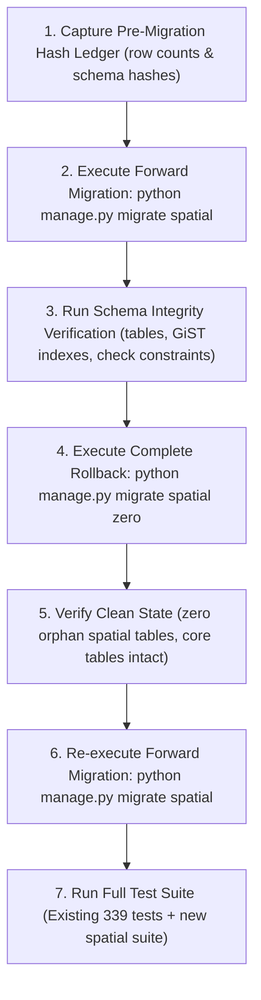

# GLITTERS GOD'S EYE — MILESTONE M3.2
## Spatial Database Migration & Rollback Strategy

**Document:** `M3_2_MIGRATION_STRATEGY.md`
**Classification:** Internal Technical Architecture & Engineering Baseline
**Repository:** `~/Projects/glitters-core`
**Date:** 2026-11-14
**Author:** Principal Geospatial Architect & Core Engineering Review Board
**Status:** Approved Migration Specification

---

## 1. Migration Safety Principles & Objectives

The introduction of spatial tables into `glitters-core` must adhere to strict non-destructive standards:
1. **Zero Core Table Regression**: Existing commercial tables (`public.property`, `public.property_location`, `public.administrative_area`, `public.organization`, `public.identity_user`) must not be altered, migrated, dropped, or locked during the spatial migration.
2. **Deterministic Two-Way Reversibility**: The migration `apps/spatial/migrations/0001_initial.py` must support forward execution (`migrate spatial`) and backward rollback (`migrate spatial zero`) with zero residual artifacts or broken constraints.
3. **Strict Ingestion Isolation**: The 72,864 Mombasa OSM building footprints will **not** be ingested during Milestone M3.2. This milestone is dedicated solely to establishing and verifying the operational database schema.

---

## 2. Disposable Test Execution Protocol

Before executing the migration in any shared or staging environment, a disposable verification test is conducted:



### 2.1 Pre-Migration Integrity Ledger
Before running `migrate spatial`, the testing harness records row counts and table hashes across core relations:
```sql
SELECT
    'property' AS tbl, COUNT(*) AS count, MD5(COALESCE(STRING_AGG(id::text, '' ORDER BY id), 'empty')) AS hash
FROM public.property
UNION ALL
SELECT
    'property_location', COUNT(*), MD5(COALESCE(STRING_AGG(id::text, '' ORDER BY id), 'empty'))
FROM public.property_location
UNION ALL
SELECT
    'organization', COUNT(*), MD5(COALESCE(STRING_AGG(id::text, '' ORDER BY id), 'empty'))
FROM public.organization
UNION ALL
SELECT
    'administrative_area', COUNT(*), MD5(COALESCE(STRING_AGG(id::text, '' ORDER BY id), 'empty'))
FROM public.administrative_area;
```

### 2.2 Forward Migration Verification (`0001_initial.py`)
Executes:
```bash
uv run python manage.py migrate spatial
```
Verification checks:
- Schema `spatial` exists.
- All 15 spatial tables exist:
  `dataset_registry`, `dataset_version`, `dataset_quality_report`, `spatial_entity`, `identity_mapping`, `entity_lineage`, `land_parcel`, `building`, `road`, `construction_site`, `survey_observation`, `infrastructure_asset`, `administrative_boundary`, `property_parcel_association`, `building_parcel_intersection`, `property_building_association`, `spatial_quarantine`.
- GiST spatial indexes are active on all geometry columns.
- Check constraints `chk_*_geom_valid` and `chk_*_geom_srid` are active.

### 2.3 Rollback Verification (`migrate spatial zero`)
Executes:
```bash
uv run python manage.py migrate spatial zero
```
Verification checks:
- All tables in schema `spatial` are cleanly dropped.
- Core table ledger is re-evaluated: **Row counts and MD5 hashes must match the pre-migration ledger exactly (100% parity)**.
- `django_migrations` table contains 0 records for app `spatial`.

### 2.4 Final Re-Application
Executes:
```bash
uv run python manage.py migrate spatial
```
Leaves the system in the verified, operational spatial schema state.

---

## 3. Disaster Recovery & Fallback Runbook

If any step fails during the migration in development or staging:
1. **Immediate Abort**: Migration is wrapped in an atomic transaction; PostgreSQL automatically rolls back on DDL error.
2. **Manual Cleanup**:
   ```sql
   DROP SCHEMA IF EXISTS spatial CASCADE;
   DELETE FROM django_migrations WHERE app = 'spatial';
   ```
3. **State Re-verification**: Assert that `public` schema relations remain completely unaffected.

---
*Ready for Architectural Review and Stakeholder Approval.*
