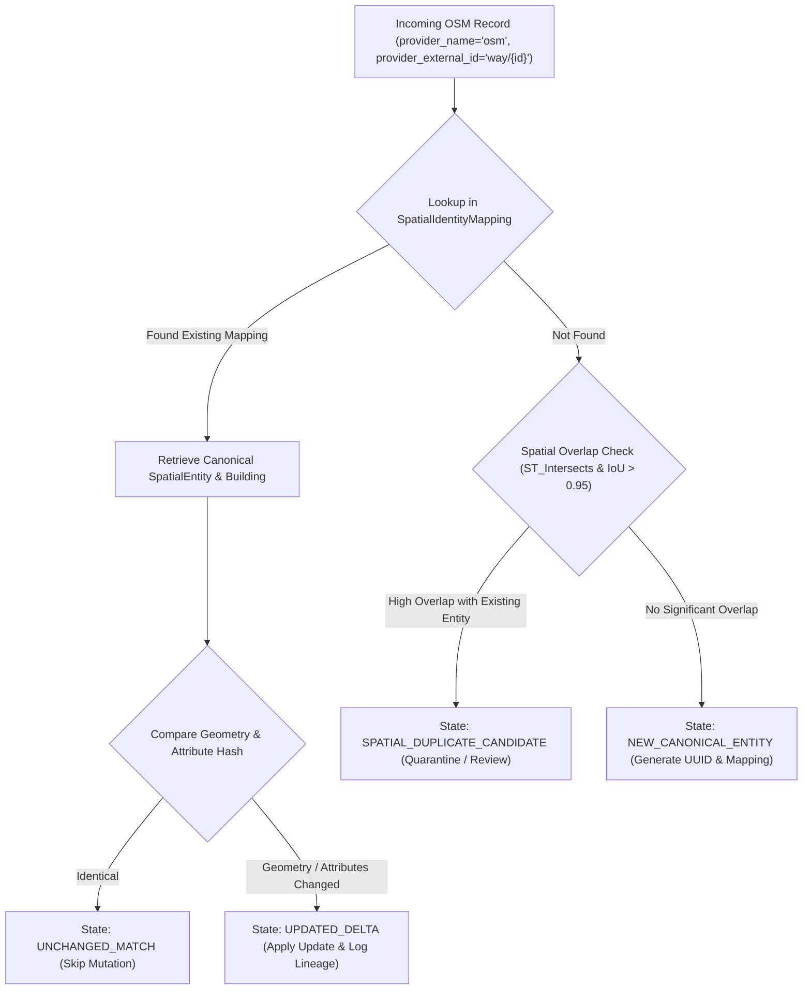

# GLITTERS CORE — MILESTONE M3.3
## Spatial Identity Resolution & Reconciliation Specification

**Document:** `M3_3_IDENTITY_RESOLUTION_SPEC.md`
**Classification:** Technical Architecture Specification
**Repository:** `~/Projects/glitters-core`
**Date:** 2026-11-14
**Author:** Principal Geospatial Architect & Core Engineering Review Board
**Status:** Approved for Planning — Pre-Ingestion Architecture Gate

---

## 1. Core Principles of Spatial Identity

Spatial identity in GLITTERS is governed by four strict architectural axioms:

1. **Decoupled Identity:** An entity's internal canonical identity (`canonical_urn`) is strictly separated from external provider identities (`osm_id`, `gers_id`, cadastre parcel numbers).
2. **Opaque & Immutable Canonical URN:** Canonical identities follow the format:
   $$\text{urn:glitters:spatial:building:}\{\text{uuid4}\}$$
   No administrative geography, names, or coordinates are encoded in the canonical URN. Once issued, a canonical URN never mutates.
3. **Deterministic Idempotency:** Ingesting the same external record multiple times must resolve to the identical canonical entity without generating duplicates, creating orphaned child rows, or generating spurious lineage history.
4. **Zero Legal Inference:** OpenStreetMap data is strictly observational open spatial baseline data. Under no circumstances may cadastral boundaries, land titles, leases, ownership, or legal property rights be inferred from OSM building footprints.

---

## 2. Identity Resolution Pipeline

For every incoming record during ingestion, the identity resolution engine evaluates candidate identities according to the following resolution cascade:

---

## 3. Detailed Reconciliation Behavior Matrices

### Scenario 1: Exact Re-Ingestion (Idempotency)
- **Condition:** Input record has `(provider_name='osm', provider_external_id='way/88207728')`, and an existing mapping points to `SpatialEntity` $E_1$. The input geometry and attributes match the stored record.
- **Action:**
  - Zero database writes to `SpatialEntity`, `Building`, or `SpatialIdentityMapping`.
  - Increment dry-run / audit counter `matched_unchanged_count`.
  - Invariant preserved: Zero duplicate entities or mappings created.

### Scenario 2: OSM Feature Modifies Footprint Geometry
- **Condition:** An existing OSM way changes geometry in a new dataset release (e.g. building extension or more accurate survey).
- **Resolution Strategy:**
  - If the planar area changes by $\le 5\%$ and centroid shifts by $< 2\text{ meters}$, update `Building.geom` in-place, update `footprint_area_sqm`, and touch `updated_at`.
  - If the geometry change is significant ($> 5\%$ area change or $> 2\text{ meters}$ shift):
    1. Mark existing entity $E_1$ with `lifecycle_status = LifecycleStatus.SUPERSEDED`, setting `valid_to = NOW()`.
    2. Mint new canonical entity $E_2$ with updated geometry.
    3. Update `SpatialIdentityMapping` to point to $E_2$.
    4. Insert record into `EntityLineage`:
       - `predecessor_urn = E_1.canonical_urn`
       - `successor_urn = E_2.canonical_urn`
       - `lineage_type = LineageType.REDEVELOPMENT`
       - `effective_date = CURRENT_DATE`

### Scenario 3: OSM Feature Disappears in Subsequent Extract
- **Condition:** An OSM building was deleted upstream (e.g. demolished or removed as erroneous).
- **Resolution Strategy:**
  - GLITTERS never hard-deletes spatial entities from the canonical ledger.
  - Entity $E_1$ is marked with `lifecycle_status = LifecycleStatus.DEMOLISHED` or `RETIRED`.
  - `valid_to` is populated with the release timestamp of the new dataset version.
  - Existing external identity mapping is retained for historical traceability.

### Scenario 4: An Existing Building is Split Upstream (Subdivision)
- **Condition:** A single previous OSM footprint `way/100` is replaced by two distinct footprints `way/101` and `way/102`.
- **Resolution Strategy:**
  1. Retire predecessor entity $E_0$ (`lifecycle_status = SUPERSEDED`).
  2. Mint two new canonical entities $E_1$ and $E_2$.
  3. Create two lineage records:
     - `EntityLineage(predecessor=E_0, successor=E_1, lineage_type=SUBDIVISION)`
     - `EntityLineage(predecessor=E_0, successor=E_2, lineage_type=SUBDIVISION)`
  4. Map `way/101` $\rightarrow E_1$ and `way/102` $\rightarrow E_2$.

### Scenario 5: Multiple Source Records Represent One Physical Building (Amalgamation)
- **Condition:** Multiple adjacent OSM ways represent parts of a single continuous building complex.
- **Resolution Strategy:**
  - By default in automated ingestion, each distinct OSM way is ingested as a distinct canonical building footprint.
  - If human survey or automated topology merges them into a unified building:
    - Predecessors $E_1, E_2$ are marked `SUPERSEDED`.
    - Unified building $E_3$ is created.
    - Create lineage records with `lineage_type = LineageType.AMALGAMATION`.
    - Both provider IDs (`way/201`, `way/202`) are re-mapped to $E_3$ in `SpatialIdentityMapping`.

### Scenario 6: Conflict Between OSM and Authoritative Survey
- **Condition:** An OSM footprint intersects or conflicts with a licensed cadastral boundary or high-precision survey observation.
- **Resolution Strategy:**
  - Spatial entities are assigned a `legal_authority_level`:
    - Cadastral / Deed Plan: `LegalAuthorityLevel.STATUTORY_AUTHORITATIVE`
    - Licensed Survey: `LegalAuthorityLevel.LICENSED_SURVEY`
    - OSM Building Footprint: `LegalAuthorityLevel.OPEN_DATA`
  - In spatial queries and analytical evaluations, `STATUTORY_AUTHORITATIVE` and `LICENSED_SURVEY` entities take absolute precedence over `OPEN_DATA`.
  - OSM building footprints never overwrite, modify, or constrain authoritative parcel boundaries.
  - Relationships between buildings and parcels are maintained exclusively through the decoupled junction table `BuildingParcelIntersection` with calculated spatial overlap percentages.
