# GLITTERS CORE — MILESTONE M3.3
## Controlled Mombasa OSM Ingestion Implementation Plan

**Document:** `M3_3_IMPLEMENTATION_PLAN.md`
**Classification:** Technical Implementation Plan & Execution Roadmap
**Repository:** `~/Projects/glitters-core`
**Date:** 2026-11-14
**Author:** Principal Geospatial Architect & Core Engineering Review Board
**Status:** Approved for Planning — Pre-Ingestion Architecture Gate

---

## 1. Objective & Sequencing Overview

Milestone M3.3 delivers the production-ready, idempotent ingestion pipeline for the 72,864 Mombasa OSM building footprints.

The execution sequence is strictly staged to ensure zero data corruption, complete dry-run validation, and full auditability before any database writes are committed:

```mermaid
flowchart LR
    Step1["Step 1: Schema Migration (raw_metadata)"] --> Step2["Step 2: Classification Taxonomy Mapper"]
    Step2 --> Step3["Step 3: Two-Stage MTI Bulk Insert Service"]
    Step3 --> Step4["Step 4: Streaming Ingestion & Dry-Run Engine"]
    Step4 --> Step5["Step 5: Ingestion Management CLI"]
    Step5 --> Step6["Step 6: Unit & Integration Test Suite"]
    Step6 --> Step7["Step 7: Full Dry-Run Acceptance Gate"]
```



---

## 2. Detailed Implementation Phases

### Phase 1: Schema Migration — Raw Provider Metadata Retention
- **Target File:** `apps/spatial/models.py`
- **Change:** Add `raw_metadata = models.JSONField(default=dict, blank=True)` to `SpatialIdentityMapping`.
- **Migration:** Generate and apply migration `apps/spatial/migrations/0002_add_raw_metadata_to_identity_mapping.py`.
- **Safeguard:** Run `python manage.py makemigrations --check --dry-run` to ensure zero drift.

### Phase 2: Classification Taxonomy Engine
- **Target File:** `apps/spatial/domain.py`
- **Function:** `map_osm_building_classification(tags: dict) -> str`
- **Mapping Logic:**
  - `residential`, `apartments`, `house`, `detached`, `dormitory`, `terrace` $\rightarrow$ `RESIDENTIAL`
  - `commercial`, `retail`, `office`, `supermarket`, `hotel`, `bank` $\rightarrow$ `COMMERCIAL`
  - `industrial`, `warehouse`, `factory`, `hangar`, `storage_tank` $\rightarrow$ `INDUSTRIAL`
  - `school`, `university`, `college`, `hospital`, `clinic`, `kindergarten` $\rightarrow$ `INSTITUTIONAL`
  - `civic`, `government`, `public`, `courthouse`, `police`, `townhall` $\rightarrow$ `CIVIC`
  - `yes`, `roof`, unclassified $\rightarrow$ `OTHER`
- **Fallback:** Returns `BuildingClassification.OTHER` for unknown tokens.

### Phase 3: Two-Stage Polymorphic Bulk Insert Service
- **Target File:** `apps/spatial/services/ingestion.py`
- **Problem Solved:** Django Multi-Table Inheritance (MTI) requires inserting into both `spatial_entity` and `spatial_building`.
- **Implementation Design:**
  ```python
  def bulk_insert_buildings(
      records: list[BuildingCandidate],
      dataset_version: DatasetVersion,
  ) -> int:
      with transaction.atomic():
          # 1. Prepare and insert parent SpatialEntity rows
          parent_entities = [
              SpatialEntity(
                  id=rec.entity_uuid,
                  canonical_urn=rec.canonical_urn,
                  entity_type=EntityType.BUILDING,
                  organization=None,
                  dataset_version=dataset_version,
                  lifecycle_status=LifecycleStatus.ACTIVE,
              )
              for rec in records
          ]
          SpatialEntity.objects.bulk_create(parent_entities, batch_size=2000)

          # 2. Prepare and insert child Building rows
          child_buildings = [
              Building(
                  spatialentity_ptr_id=rec.entity_uuid,
                  name=rec.name,
                  classification=rec.classification,
                  height_m=rec.height_m,
                  levels_above_ground=rec.levels_above_ground,
                  roof_shape=rec.roof_shape,
                  facade_material=rec.facade_material,
                  footprint_area_sqm=rec.footprint_area_sqm,
                  legal_authority_level=LegalAuthorityLevel.OPEN_DATA,
                  horizontal_rmse_m=1.000,
                  is_human_verified=False,
                  geom=rec.geom,
              )
              for rec in records
          ]
          Building.objects.bulk_create(child_buildings, batch_size=2000)

          # 3. Prepare and insert identity mappings
          mappings = [
              SpatialIdentityMapping(
                  entity_id=rec.entity_uuid,
                  provider_name="osm",
                  provider_external_id=rec.provider_external_id,
                  confidence_score=1.00,
                  raw_metadata=rec.raw_tags,
              )
              for rec in records
          ]
          SpatialIdentityMapping.objects.bulk_create(mappings, batch_size=2000)

      return len(records)
  ```

### Phase 4: Streaming Parser & Dry-Run Engine
- **Target File:** `apps/spatial/services/ingestion.py`
- **Capabilities:**
  - Chunked streaming parser reading GeoJSON `FeatureCollection` incrementally without buffering entire file in memory.
  - Checksum calculation and validation against expected digest.
  - Rigorous metric tracking enforcing the accounting equation:
    $$\mathbf{INPUT} = \mathbf{VALID} + \mathbf{REPAIRED} + \mathbf{DEDUPLICATED} + \mathbf{QUARANTINED}$$
  - Dry-run mode (`dry_run=True`): Executes 100% of schema parsing, GEOS validation, CRS transformation, and identity matching without executing database commits.

### Phase 5: Django Ingestion Management CLI
- **Target File:** `apps/spatial/management/commands/ingest_spatial_dataset.py`
- **CLI Options:**
  - `--source-file`: Path to the source GeoJSON (default: `/home/mr-robot/data/glitters-osm/processed/mombasa-buildings.geojson`).
  - `--dataset-urn`: Canonical dataset URN (`urn:glitters:dataset:ke:msa:osm:buildings`).
  - `--version-tag`: Version identifier (default: `2026.11-v1`).
  - `--dry-run`: Flag to simulate ingestion and print comprehensive reconciliation statistics.
  - `--batch-size`: Batch size for chunked transactions (default: `2000`).

### Phase 6: Automated Verification Suite
- **Target Files:**
  - `tests/unit/test_spatial_ingestion.py`: Tests for taxonomy mapper, geometry healing, dry-run accounting, and MTI batching.
  - `tests/integration/test_spatial_ingestion.py`: End-to-end dry-run execution against sample extract.

---

## 3. Acceptance Gate Criteria for M3.3 Implementation

The pipeline will be certified and accepted only when all of the following gates pass:

1. **Deterministic Checksum Match:** Source file SHA-256 matches `953ad716384f772639ce0f04a32a0dff0a712bb9f7f345782924ee8bdb63a5fb`.
2. **Reconciliation Invariant Verified:**
   $$\mathbf{INPUT} = \mathbf{VALID} + \mathbf{REPAIRED} + \mathbf{DEDUPLICATED} + \mathbf{QUARANTINED} = 72,864$$
3. **100% Geometric Validity:** Zero invalid geometries committed to the database.
4. **Idempotency Confirmed:** Running the ingestion twice yields `0` new canonical entities and `72,864` deduplicated matches on the second run.
5. **Full Test Suite Clean:** Existing 361 tests + new spatial ingestion tests pass with zero regressions.
6. **Worktree Intact:** Branch and uncommitted files preserved without resets or stashes.
