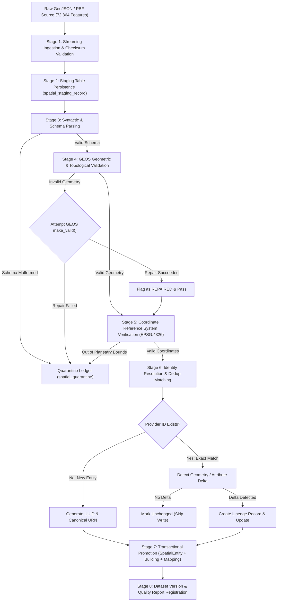

# GLITTERS CORE — MILESTONE M3.3
## Mombasa OSM Spatial Data Ingestion Architecture

**Document:** `M3_3_INGESTION_ARCHITECTURE.md`
**Classification:** Technical Architecture Specification
**Repository:** `~/Projects/glitters-core`
**Date:** 2026-11-14
**Author:** Principal Geospatial Architect & Core Engineering Review Board
**Status:** Approved for Planning — Pre-Ingestion Architecture Gate

---

## 1. Executive Summary & Mission Scope

Milestone M3.3 establishes the canonical spatial ingestion pipeline that transitions the GLITTERS ecosystem from static GeoJSON files to a resilient, versioned, database-backed spatial intelligence repository in PostgreSQL 16 / PostGIS 3.5.

The primary target dataset is the curated Mombasa Building Footprint inventory comprising **72,864 building footprints** derived from OpenStreetMap (ODbL 1.0).

```
+---------------------------------------------------------------------------------------+
|                                    INGESTION PIPELINE                                 |
|                                                                                       |
|   +-----------------------+     +-----------------------+     +-------------------+   |
|   | 1. Source Extract     | --> | 2. Staging Layer      | --> | 3. Validation &   |   |
|   |    GeoJSON / PBF      |     |    Raw Staging Table  |     |    Repair Filter  |   |
|   +-----------------------+     +-----------------------+     +-------------------+   |
|                                                                         |             |
|                                                                         v             |
|   +-----------------------+     +-----------------------+     +-------------------+   |
|   | 6. Reporting & Ledger | <-- | 5. Canonical Database | <-- | 4. Identity       |   |
|   |    Quality & Audit    |     |    Entities & Maps    |     |    Resolution     |   |
|   +-----------------------+     +-----------------------+     +-------------------+   |
+---------------------------------------------------------------------------------------+
```

---

## 2. End-to-End Pipeline Architecture

The ingestion pipeline is designed as an idempotent, multi-stage state machine that operates either in **DRY-RUN** simulation mode or **COMMITTED** transactional execution mode.



---

## 3. Stage-by-Stage Operational Specification

### Stage 1: Source Discovery & Provenance Verification
1. Compute SHA-256 cryptographic digest of the input file before opening.
2. Verify input checksum against the authoritative manifest (`953ad716384f772639ce0f04a32a0dff0a712bb9f7f345782924ee8bdb63a5fb`).
3. Verify file metadata: bounding box, feature count, license declaration (`ODbL 1.0`), and attribution statement (`© OpenStreetMap contributors`).

### Stage 2: Streaming Raw Staging
To avoid excessive memory pressure and safeguard against worker OOM, features are streamed using `ijson` or chunked JSON generators and inserted into an unlogged staging table `spatial_staging_record`:
- `staging_id`: UUID primary key.
- `dataset_version_id`: Target dataset version UUID.
- `source_record_id`: Provider ID (e.g. `way/88207728`).
- `raw_geojson`: Raw JSON representation of geometry and properties.
- `status`: `STAGED`, `VALIDATED`, `REPAIRED`, `PROMOTED`, `QUARANTINED`.

### Stage 3: Schema & Attribute Parsing
Extract structured building attributes from raw OSM tags:
- **Identifier**: `osm_type` + `osm_id` (e.g., `way:88207728`).
- **Name**: `tags.name` or `tags["name:en"]` (default empty string).
- **Classification**: Normalization of OSM `building=*` tags to canonical `BuildingClassification` enums:
  - `residential`, `apartments`, `house`, `detached` $\rightarrow$ `RESIDENTIAL`
  - `commercial`, `retail`, `office`, `supermarket` $\rightarrow$ `COMMERCIAL`
  - `industrial`, `warehouse`, `factory` $\rightarrow$ `INDUSTRIAL`
  - `school`, `university`, `hospital`, `clinic`, `kindergarten` $\rightarrow$ `INSTITUTIONAL`
  - `civic`, `government`, `public` $\rightarrow$ `CIVIC`
  - `yes`, `roof`, unclassified $\rightarrow$ `OTHER`
- **Levels**: Integer parsing of `tags["building:levels"]` (positive integers; malformed text rejected to `null`).
- **Height**: Decimal parsing of `tags.height` (meters; strip trailing 'm' units; negative/zero rejected to `null`).
- **Roof Shape & Facade**: `tags["roof:shape"]`, `tags["building:material"]`.

### Stage 4: Geometric & Topological Validation
1. Construct GEOS `MultiPolygon` with SRID 4326.
2. Single `Polygon` instances are automatically upgraded to `MultiPolygon` (`MultiPolygon([polygon])`).
3. Call `geom.valid`. If invalid:
   - Call `try_repair_geometry(geom)` utilizing GEOS `make_valid()`.
   - If repaired geometry is a `MultiPolygon` or `Polygon` and is valid, promote with `repaired = True`.
   - If repair collapses geometry into lines/points, or fails, divert to `SpatialQuarantine`.

### Stage 5: Planar Calculations & Coordinate Bounds
1. Verify extent bounds within Mombasa County operational envelope:
   $\text{Lon} \in [39.40, 39.95], \quad \text{Lat} \in [-4.30, -3.75]$
2. Transform geometry to optimal local projected coordinate system:
   $\text{EPSG:32737 (UTM Zone 37S)}$
3. Compute planar surface area in square meters using `calculate_planar_area_utm_sqm(geom)`.

### Stage 6: Identity Resolution & Deduplication
1. Query `SpatialIdentityMapping` for `provider_name='osm'` and `provider_external_id='way/{osm_id}'`.
2. If match found:
   - Compare existing `geom.wkb` and attribute hash with candidate record.
   - If identical: Record as duplicate / unchanged match (no database write).
   - If geometry changed: Evaluate area delta. If significant ($>5\%$), update geometry and record lineage.
3. If no match found:
   - Query spatial index for spatial overlap ($ST\_Intersects$) with existing canonical buildings where $IoU > 0.95$.
   - If high overlap detected: Mark as spatial duplicate candidate for human review or consolidation.
   - Otherwise: Mark as new canonical building candidate.

### Stage 7: High-Throughput Transactional Promotion
Because `Building` uses multi-table inheritance inheriting from `SpatialEntity`:
1. Chunk candidate records into batches of 2,000 entities.
2. In a single database transaction:
   - Bulk insert parent `SpatialEntity` instances with pre-generated UUIDs and canonical URNs:
     `urn:glitters:spatial:building:{uuid}`
   - Bulk insert child `Building` instances referencing `spatialentity_ptr_id`.
   - Bulk insert `SpatialIdentityMapping` instances linking `(osm, way/{osm_id})` to the entity UUID.
3. Commit transaction per batch.

### Stage 8: Dataset Versioning & Quality Reporting
1. Register/verify root `DatasetRegistry` (`urn:glitters:dataset:ke:msa:osm:buildings`).
2. Finalize `DatasetVersion` record with:
   - `source_checksum_sha256`: SHA-256 of source file.
   - `feature_count`: Total successfully ingested entities.
   - `spatial_extent`: Bounding box polygon of all ingested features.
   - `pipeline_git_commit`: Current git HEAD commit hash.
3. Create `DatasetQualityReport`:
   - `valid_geometries`: Count of valid input geometries.
   - `repaired_geometries`: Count of geometries repaired via `make_valid()`.
   - `quarantined_geometries`: Count of records diverted to quarantine.
   - `duplicate_records`: Count of duplicate source IDs.
   - `horizontal_rmse_m`: Standard baseline RMSE ($1.000\text{ m}$).

---

## 4. Pipeline Performance & Throughput Targets

| Metric | Target | Rationale |
| :--- | :--- | :--- |
| **Batch Chunk Size** | 2,000 records | Optimal balance between PostgreSQL transaction overhead and RAM buffer. |
| **Total Ingestion Time** | $\le 180\text{ seconds}$ | ~400 records/sec throughput across multi-table inheritance. |
| **Memory Footprint** | $\le 512\text{ MB}$ | Streaming GeoJSON parser avoids loading full 40MB tree into Python heap. |
| **Transaction Boundary** | Per 2,000-chunk | Prevents 72,864-row single lock while ensuring atomic chunk recovery. |
