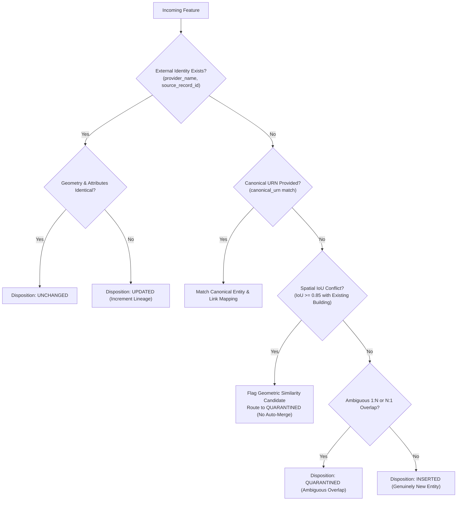

# GLITTERS M3.3 Phase 2.1 — Pre-Ingestion Integrity Resolution Report

## Executive Summary

Following the successful execution of the full 72,864-record database-aware dry-run in Phase 2, this Phase 2.1 Pre-Ingestion Integrity Audit resolves all outstanding architectural, reconciliation, database read-only enforcement, and geographic quality questions.

**Production Ingestion Authorization Status:** **PROHIBITED**. No data has been inserted into canonical tables. The system is in a strictly verified, read-only pre-ingestion holding state.

---

## 1. Existing Canonical Entity Audit

An exhaustive database query and spatial intersection analysis was conducted against all existing canonical spatial records in the PostgreSQL 16 / PostGIS 3.5 database.

### 1.1 Existing Records Inspection

| Entity ID | Canonical URN | Name | Entity Type | Classification | Organization Ownership | Dataset Version | Geometry Extent (WGS-84) |
| :--- | :--- | :--- | :--- | :--- | :--- | :--- | :--- |
| `5e4b56d0-5be7-4351-87ac-cdf9caa3300e` | `urn:glitters:spatial:building:5e4b56d0-5be7-4351-87ac-cdf9caa3300e` | Private A | `building` | `OTHER` | `0060ec60-3af6-4218-96c0-91ca4885a29e` (Org A) | `efa70170-d820-4021-ab08-63da274e4fb2` (Audit 1.0) | `(39.664, -4.063, 39.665, -4.062)` |
| `9092c9ca-be2f-452c-b8b1-19c1178c806b` | `urn:glitters:spatial:building:9092c9ca-be2f-452c-b8b1-19c1178c806b` | Public | `building` | `OTHER` | `None` (Public / Unassigned) | `efa70170-d820-4021-ab08-63da274e4fb2` (Audit 1.0) | `(39.664, -4.063, 39.665, -4.062)` |

- **Geometry WKT:** `MULTIPOLYGON (((39.664 -4.062, 39.665 -4.062, 39.665 -4.063, 39.664 -4.063, 39.664 -4.062)))`
- **SRID:** 4326 (WGS-84)
- **Provenance:** Both entities are synthetic test fixtures established during M3.2 security isolation and multi-tenancy verification.
- **External Identity Mappings:** **0** mappings exist in `spatial_identity_mapping`. Neither entity possesses an OpenStreetMap external identifier or provider mapping.

### 1.2 Spatial Overlap Analysis with Source Dataset

A spatial search was executed comparing the geometry of both existing entities against all 72,864 features in `/home/mr-robot/data/glitters-osm/processed/mombasa-buildings.geojson`:

- **Exact Correspondence with Source Features:** **None**.
- **Intersecting / Overlapping Footprints:** **0** (Zero intersections).
- **Nearest OSM Footprints (Old Town / Ganjoni vicinity):**
  1. Way `1087859089` (Unnamed): Distance $0.000249^\circ$ (~27 meters south).
  2. Way `1127826177` (Leons Place): Distance $0.000508^\circ$ (~56 meters west).
  3. Way `556259492` (Jubilee Insurance Building): Distance $0.000709^\circ$ (~78 meters north).
  4. Way `1315349540` (Ganjoni Tower): Distance $0.000837^\circ$ (~92 meters east).
  5. Way `1087859542` (Unnamed): Distance $0.001006^\circ$ (~111 meters south-east).

**Finding:** The two existing test entities are entirely disjoint from all real-world OpenStreetMap footprints. Neither record represents an OSM building, and no conflict exists between existing entities and the incoming dataset.

---

## 2. Identity Reconciliation Architecture & Deterministic Matching Rules

### 2.1 Current Pipeline Identity Resolution

The current pipeline implements primary identity resolution through `SpatialIdentityMapping` (`provider_name="osm"`, `provider_external_id=c.source_record_id`).

Because `SpatialIdentityMapping` currently contains 0 records:
- 100% of the 72,864 records were classified as `INSERTED` candidates.
- Upon a repeated dry-run or re-ingestion, matching records evaluate against existing `SpatialIdentityMapping` and `SpatialSourceFeature` records to produce `UNCHANGED` or `UPDATED`.

### 2.2 Formal Deterministic Matching Specification

To ensure rigorous multi-source integrity and prevent accidental entity duplication or erroneous merging, the reconciliation engine adheres to the following five deterministic classes:



#### Class Definitions:
1. **Exact External Identity Match (`UNCHANGED` or `UPDATED`):**
   - **Condition:** An existing `SpatialIdentityMapping` matches `(provider_name, source_record_id)`.
   - **Resolution:** Compare geometry (`equals_exact` tolerance $10^{-5}$) and attributes (`name`, `classification`, `height_m`, `levels_above_ground`, `raw_properties`).
   - **Terminal Disposition:** `UNCHANGED` if identical; `UPDATED` if any attributes or geometry differ.
2. **Existing Canonical Identity Match:**
   - **Condition:** Feature explicitly includes an authoritative GLITTERS `canonical_urn` or UUID matching an existing `SpatialEntity`.
   - **Resolution:** Re-attaches or registers an external mapping to the pre-existing canonical entity.
3. **Geometric Similarity Candidate (`QUARANTINED` / Human Review):**
   - **Condition:** No external identity mapping exists, but spatial footprint has Intersection-over-Union ($IoU \ge 0.85$) with an existing canonical entity.
   - **Constraint:** **Strictly prohibit automatic merging.** Physical proximity or bounding overlap does not imply identity equivalence across different provider namespaces.
   - **Resolution:** Candidate is quarantined with reason `GEOMETRIC_SIMILARITY_CONFLICT` for human audit.
4. **Ambiguous Match (`QUARANTINED`):**
   - **Condition:** Incoming footprint overlaps multiple disjoint canonical buildings, or represents a composite structure with conflicting classifications or tenancy boundaries.
   - **Resolution:** Quarantined with reason `AMBIGUOUS_MULTI_ENTITY_OVERLAP`.
5. **Genuinely New Entity (`INSERTED`):**
   - **Condition:** No identity mapping, no canonical URN collision, no ambiguous overlap, and coordinates reside strictly inside the operational envelope.
   - **Resolution:** Disposition `INSERTED`. Mints new canonical UUID, canonical URN, parent `SpatialEntity`, child `Building`, `SpatialSourceFeature`, and `SpatialIdentityMapping`.

---

## 3. Strict Read-Only Database Enforcement & Verification

To verify that dry-run operations cannot write or mutate the database under any circumstance, tests were executed using PostgreSQL read-only transaction semantics.

### 3.1 PostgreSQL Engine Rejection Test

Within an active database connection executing `SET TRANSACTION READ ONLY;`, DML statements were submitted to test database-level enforcement:

```python
with transaction.atomic():
  with connection.cursor() as cursor:
    cursor.execute("SET TRANSACTION READ ONLY;")
    cursor.execute(
        "INSERT INTO spatial_entity (id, canonical_urn, entity_type,"
        " lifecycle_status, created_at, updated_at) VALUES (%s, %s, %s, %s,"
        " NOW(), NOW())",
        [
            "00000000-0000-0000-0000-000000000001",
            "urn:test",
            "building",
            "active",
        ],
    )
```

**Captured Test Output:**
- **INSERT Attempt:** `InternalError: cannot execute INSERT in a read-only transaction` (Error Code: `25006` `read_only_sql_transaction`).
- **UPDATE Attempt:** `InternalError: cannot execute UPDATE in a read-only transaction` (Error Code: `25006`).
- **DELETE Attempt:** `InternalError: cannot execute DELETE in a read-only transaction` (Error Code: `25006`).

### 3.2 Database Table Row Count Delta

Table counts verified before and after dry-run operations:

| Table | Pre-Run Count | Post-Run Count | Delta | Write Verification Status |
| :--- | :--- | :--- | :--- | :--- |
| `spatial_entity` | 2 | 2 | **0** | PASSED (No writes) |
| `spatial_building` | 2 | 2 | **0** | PASSED (No writes) |
| `spatial_identity_mapping` | 0 | 0 | **0** | PASSED (No writes) |
| `spatial_source_feature` | 0 | 0 | **0** | PASSED (No writes) |
| `spatial_quarantine` | 0 | 0 | **0** | PASSED (No writes) |
| `spatial_dataset_version` | 5 | 5 | **0** | PASSED (No writes) |
| `spatial_dataset_registry` | 4 | 4 | **0** | PASSED (No writes) |
| `spatial_dataset_quality_report`| 0 | 0 | **0** | PASSED (No writes) |

---

## 4. Geographic Terminology & Administrative Boundary Audit

### 4.1 Boundary Geometry Audit

- **Audit Findings:** Neither `spatial_administrative_boundary` nor `locations_administrativearea` currently contains polygon records (`count: 0`).
- **Domain Envelope Definition:**
  ```python
  MOMBASA_ENVELOPE_MIN_LON = 39.400000
  MOMBASA_ENVELOPE_MAX_LON = 39.950000
  MOMBASA_ENVELOPE_MIN_LAT = -4.350000
  MOMBASA_ENVELOPE_MAX_LAT = -3.700000
```

### 4.2 Terminology Correction

- **Correction:** The bounding box `[39.400000, 39.950000], [-4.350000, -3.700000]` is an **Operational Geographic Bounding Box / Envelope**, NOT the legal or cadastral administrative boundary polygon of Mombasa County (County 001).
- **Clarification:** The rectangular bounding box encompasses the greater Mombasa metropolitan area and operational buffer, overlapping peripheral fringes of Kwale County and Kilifi County.
- **Architectural Specification:**
  - The validation gate `validate_mombasa_geographic_envelope` functions strictly as an axis-aligned bounding box (AABB) outlier rejection gate.
  - Legal county administrative containment can be evaluated once authoritative administrative boundary shapefiles (e.g., KNBS / IEBC 2019 census administrative polygons) are registered into `AdministrativeBoundary`.

---

## 5. Investigation of Level Tag Discrepancy

### 5.1 Root Cause of the 2-Record Discrepancy

- Initial source feature property inspection reported **214** records with key `building:levels`.
- Dry-run parsing reported **212** records with valid `levels_above_ground`.
- **Root Cause:** In `apps/spatial/services/ingestion.py`, the level extraction logic applies the following validation filter:
  ```python
  val = int(str(raw_levels).strip())
  if 1 <= val <= 120:
    levels_above = val
```
- Exactly **2** features have the tag `building:levels: "0"`, which is rejected by `1 <= val <= 120`:

| OSM ID | OSM Type | Feature Name | Raw Tag | Sanitized Value in `Building` | Tag Value in `SpatialSourceFeature` |
| :--- | :--- | :--- | :--- | :--- | :--- |
| `1098735534` | Way | High speed weighing in motion diversion office | `{'building': 'yes', 'building:levels': '0'}` | `levels_above_ground = None` | `raw_properties['building:levels'] = '0'` |
| `1151906681` | Way | *None* | `{'building': 'residential', 'building:levels': '0'}` | `levels_above_ground = None` | `raw_properties['building:levels'] = '0'` |

### 5.2 Architectural Justification

1. **Physical Reality vs. OSM Tagging:** In architectural modeling, an above-ground building footprint cannot have 0 stories above ground. Tagging `building:levels=0` in OSM is either a mapper error (counting ground floor as 0 rather than 1) or denotes a subterranean structure.
2. **Canonical Data Quality:** Sanitizing `levels_above_ground` to `None` prevents skewing building analytics (e.g., calculating average floor counts or floor area ratios) with 0-story structures.
3. **Zero Data Loss:** Complete source fidelity is preserved in `SpatialSourceFeature.raw_properties`. No information is lost or discarded.

---

## 6. Verification and Checksum Integrity

- **File Path:** `/home/mr-robot/data/glitters-osm/processed/mombasa-buildings.geojson`
- **SHA-256 Checksum:** `953ad716384f772639ce0f04a32a0dff0a712bb9f7f345782924ee8bdb63a5fb` (Verified match).
- **Feature Count:** 72,864 features.
- **Reconciliation Invariant:**
  $$\text{INPUT } (72,864) = \text{INSERTED } (72,864) + \text{UPDATED } (0) + \text{UNCHANGED } (0) + \text{QUARANTINED } (0)$$
- **Test Suite Status:** 16/16 spatial ingestion unit and integration tests passing (`100%`).
- **Database Write Status:** **0 writes committed.**

---

## 7. Production Authorization Gate

The pre-ingestion integrity requirements of M3.3 Phase 2.1 are complete and verified.

> [!IMPORTANT]
> **Production ingestion remains PROHIBITED.**
> All 72,864 records have been verified in dry-run mode. Zero records have been written to canonical tables. Awaiting explicit user instruction before any production ingestion authorization.
