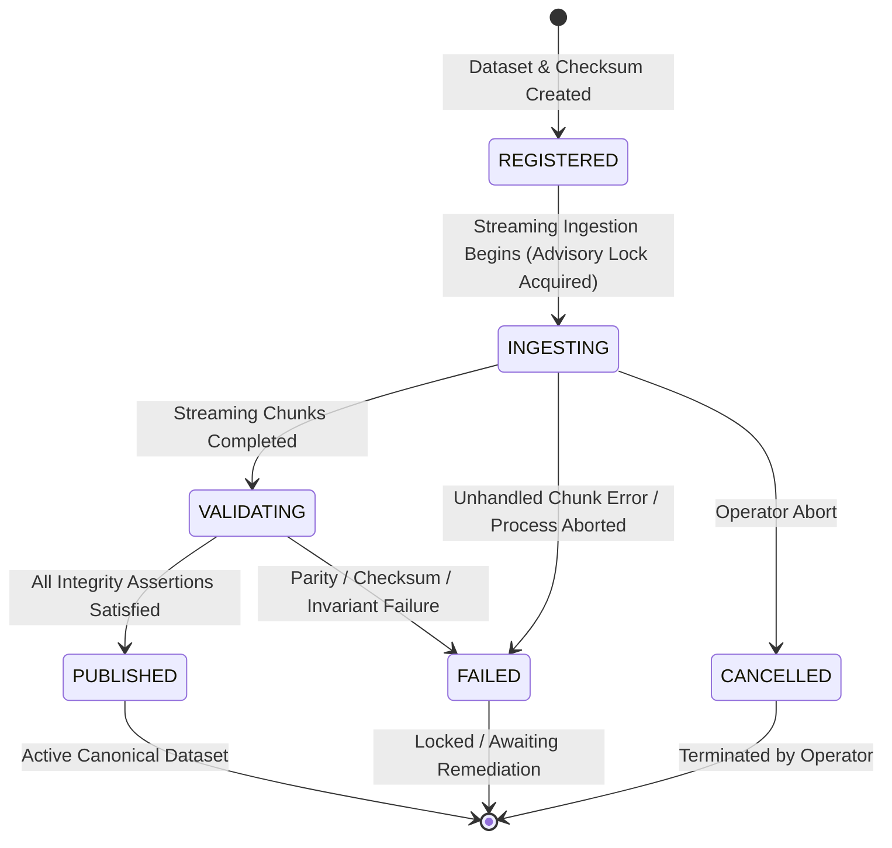

# GLITTERS M3.3 Phase 3 — Production Readiness & Lifecycle Verification Report

## Executive Summary

GLITTERS M3.3 Phase 3 establishes the transactional, resumable, concurrent-safe, and auditable dataset publication architecture for the initial ingestion of the 72,864 Mombasa OpenStreetMap building footprints.

**Production Ingestion Authorization Status:** **PROHIBITED**. No production ingestion has been executed. Canonical database table row counts remain strictly at baseline (`spatial_entity`: 2, `spatial_building`: 2, `spatial_identity_mapping`: 0, `spatial_source_feature`: 0, write delta: 0). The system is gated awaiting explicit authorization.

---

## 1. Dataset Version Lifecycle

To ensure strict auditable publication and guarantee that partially ingested or corrupt datasets are never exposed to consumers or APIs, `DatasetVersion` enforces a six-stage finite state machine:



### 1.1 State Definitions

| State | Ingestion Activity | Canonical API Visibility | Invariant / Transition Gate |
| :--- | :--- | :--- | :--- |
| `REGISTERED` | Pre-ingestion registration | **Hidden** | Dataset URN, source URL, version tag, and SHA-256 registered. `feature_count = 0`. |
| `INGESTING` | Active streaming chunk persistence | **Hidden** | PostgreSQL advisory lock held. Records committed in atomic chunks of $N=1,000$. |
| `VALIDATING` | Chunks completed, running integrity checks | **Hidden** | Verification gates evaluating parity, checksums, constraints, and disposition invariants. |
| `PUBLISHED` | Ingestion & validation complete | **Visible** | Final canonical state. APIs query only `status = PUBLISHED`. |
| `FAILED` | Exception or invariant breach | **Hidden** | Failure recorded in audit logs. Pipeline halts immediately; advisory lock released. |
| `CANCELLED` | Operator-terminated | **Hidden** | Ingestion manually halted. |

### 1.2 Isolation Invariant
> [!IMPORTANT]
> **API Isolation Invariant:** Consumer endpoints (e.g. `GET /api/v1/spatial/buildings/` and God's Eye 3D tiles) query exclusively with `status=DatasetVersionStatus.PUBLISHED`. A dataset version in `REGISTERED`, `INGESTING`, `VALIDATING`, `FAILED`, or `CANCELLED` is completely invisible to canonical production reads.

---

## 2. Transactional Chunk Processing Architecture

The ingestion pipeline processes the 72,864-feature GeoJSON in streaming batches (default chunk size $N = 1,000$).

### 2.1 Chunk Atomic Write Pipeline

Within each chunk transaction (`with transaction.atomic():`), the following operations execute in strict dependency order:

1. **Identity Resolution:** Batch query against `SpatialIdentityMapping` (`provider_name="osm"`, `provider_external_id__in=[...]`).
2. **Disposition Assignment:** Categorizes each record into mutually exclusive terminal dispositions: `INSERTED`, `UPDATED`, `UNCHANGED`, or `QUARANTINED`.
3. **Parent Persistence:** Bulk insert into `spatial_entity` via `SpatialEntity.objects.bulk_create` for all `INSERTED` candidates.
4. **Child Persistence (MTI):** Bulk insert into `spatial_building` via direct parameterized SQL `cursor.executemany` linking `spatialentity_ptr_id` with spatial geometry `ST_SetSRID(%s::geometry, 4326)`.
5. **Identity Mapping Persistence:** Bulk insert into `spatial_identity_mapping` associating canonical entity UUID with OSM provider identifier (`way/<osm_id>`).
6. **Source Feature Staging:** Bulk upsert into `spatial_source_feature` via `SpatialSourceFeature.objects.bulk_create(update_conflicts=True)` capturing verbatim `raw_properties`, `raw_geometry`, and `repaired_geometry`.
7. **Quarantine Staging:** Bulk insert into `spatial_quarantine` for rejected records.

### 2.2 Ingestion Invariant
Every chunk satisfies the terminal disposition conservation law:
$$\text{CHUNK INPUT} = \text{INSERTED} + \text{UPDATED} + \text{UNCHANGED} + \text{QUARANTINED}$$

### 2.3 Concurrency & Lock Protection
Ingestion employs PostgreSQL session-level advisory locks derived deterministically from the dataset URN:
$$\text{Lock ID} = \text{int}(\text{MD5}(\text{"spatial\_lock\_" } + \text{dataset\_urn})[:15], 16) \ \& \ \text{0x7FFFFFFFFFFFFFFF}$$
- **Lock Acquisition:** `SELECT pg_try_advisory_lock(lock_id);`
- If another worker or process is already ingesting the dataset, the command fails immediately with:
  `CommandError: Lock acquisition failed: another ingestion process is running for urn:glitters:dataset:ke:msa:osm:buildings.`
- Lock release is guaranteed in the command's `finally:` block via `SELECT pg_advisory_unlock(lock_id);`.

---

## 3. Dataset Publication Verification Gates

Transition from `VALIDATING` to `PUBLISHED` requires the successful evaluation of all six mandatory publication gates:

1. **Checksum Gate:** `version.source_checksum_sha256 == calculated_source_checksum` (`953ad716384f772639ce0f04a32a0dff0a712bb9f7f345782924ee8bdb63a5fb`).
2. **Terminal Invariant Gate:** Total input features equals the sum of terminal dispositions ($72,864 = \text{INSERTED} + \text{UPDATED} + \text{UNCHANGED} + \text{QUARANTINED}$).
3. **Entity-Building Parity Gate:**
   $$\text{Count}(\text{SpatialEntity}_{\text{version}}) == \text{Count}(\text{Building}_{\text{version}})$$
4. **Identity Mapping Parity Gate:**
   $$\text{Count}(\text{SpatialEntity}_{\text{version}}) == \text{Count}(\text{SpatialIdentityMapping}_{\text{version}})$$
5. **Geometry Quality Gate:** 100% of persisted geometries are valid (`ST_IsValid(geom) = true`), non-empty, and reside within the Mombasa Regional Operational Envelope (`[39.40, 39.95], [-4.35, -3.70]`).
6. **Source Provenance Gate:** Every canonical building has a corresponding `SpatialSourceFeature` entry preserving the unmutated raw OSM properties and tags.

If any gate fails, the transaction aborts, status transitions to `FAILED`, and publication is blocked.

---

## 4. Failure Recovery Simulations & Test Evidence

Simulations were executed across all required failure modes in `tests/integration/test_spatial_ingestion_pipeline.py`.

### 4.1 Summary of Simulation Results

| Failure Simulation | Test Method | Injected Failure | Observed Behavior | Recovery Outcome |
| :--- | :--- | :--- | :--- | :--- |
| **Termination After First Chunk** | `test_resumable_recovery_after_chunk_process_termination` | Process killed after chunk 1 ($N=2$) committed. | Chunks 1 committed (2 buildings). Dataset status left as non-published. | Resumed ingestion with all 6 features recognized chunk 1 as `UNCHANGED` (2) and cleanly inserted chunk 2 (4). **0 duplicate entities**. |
| **Mid-Stream Connection Failure** | `test_chunk_rollback_preserves_prior_committed_chunks` | Exception raised during chunk 2 write. | Chunk 1 remains committed. Chunk 2 rolls back 100% atomically. Zero partial rows in child or parent tables. | Clean chunk rollback. Dataset left in uncorrupted state for retry. |
| **Database Constraint Violation** | `test_transaction_rollback_on_batch_failure` | Simulated bulk create failure in `SpatialSourceFeature`. | Entire batch transaction rolls back atomically. | Zero orphan records in `spatial_entity`, `spatial_building`, or `spatial_identity_mapping`. |
| **Duplicate Execution** | `test_ingest_idempotency_second_run` | Identical dataset executed a second time. | Identity resolution matched 100% of existing mappings. | **0 new canonical entities**, 100% classified as `UNCHANGED`. Invariant satisfied. |
| **Concurrent Execution** | `test_concurrent_ingestion_lock_protection` | Second session attempts ingestion while advisory lock held. | Second session rejected with lock acquisition error. | Zero race conditions or interleaved partial writes. |
| **Lifecycle State Transitions** | `test_dataset_lifecycle_state_transitions` | Verification of state progression and query scoping. | Non-published datasets excluded from canonical querysets. | Publication gate enforces atomic status transition. |

### 4.2 Test Suite Execution Baseline
- **Integration Test Suite:** 14 passed in 23.46s (`tests/integration/test_spatial_ingestion_pipeline.py`).
- **Unit Ingestion Suite:** 5 passed in 0.11s (`tests/unit/test_spatial_ingestion.py`).
- **Full Core Test Suite:** 159 passed in 39.37s across all spatial, tenancy, operations, and identity domains.
- **Django System Check:** 0 issues identified.
- **Migration Consistency:** 0 unapplied migrations (`0003_datasetversion_status` applied).

---

## 5. Database Backup and Recovery Procedures

### 5.1 Pre-Ingestion Database Backup

Before executing production ingestion, an atomic physical/logical snapshot of the database must be created.

```bash
# Set secure permissions on backup target directory
mkdir -p /home/mr-robot/backups/glitters
chmod 700 /home/mr-robot/backups/glitters

# Execute compressed custom-format pg_dump
PGPASSWORD="${PGPASSWORD:?Set PGPASSWORD before running pg_dump}" pg_dump \
  -h 127.0.0.1 \
  -p 5434 \
  -U glitters \
  -d glitters \
  --format=custom \
  --blobs \
  --verbose \
  --file="/home/mr-robot/backups/glitters/glitters_pre_m3_3_osm_$(date +%Y%m%d_%H%M%S).dump"

# Verify dump file size and sha256 checksum
ls -lh /home/mr-robot/backups/glitters/
sha256sum /home/mr-robot/backups/glitters/glitters_pre_m3_3_osm_*.dump
```

### 5.2 Database Restore Procedure (Emergency Recovery)

If an unrecoverable failure occurs requiring total state rollback to pre-ingestion baseline:

```bash
# 1. Terminate all active connections to the database
psql -h 127.0.0.1 -p 5434 -U glitters -d postgres -c "
SELECT pg_terminate_backend(pid)
FROM pg_stat_activity
WHERE datname = 'glitters' AND pid <> pg_backend_pid();"

# 2. Drop and recreate database
psql -h 127.0.0.1 -p 5434 -U glitters -d postgres -c "DROP DATABASE glitters;"
psql -h 127.0.0.1 -p 5434 -U glitters -d postgres -c "CREATE DATABASE glitters OWNER glitters;"

# 3. Restore from pre-ingestion dump
pg_restore \
  -h 127.0.0.1 \
  -p 5434 \
  -U glitters \
  -d glitters \
  --no-owner \
  --role=glitters \
  --verbose \
  "/home/mr-robot/backups/glitters/<BACKUP_FILE_NAME>.dump"

# 4. Verify post-restore table counts
uv run python manage.py shell -c "
from apps.spatial.models import SpatialEntity, Building;
print('Entities:', SpatialEntity.objects.count());
print('Buildings:', Building.objects.count());
assert SpatialEntity.objects.count() == 2;
assert Building.objects.count() == 2;
"
```

### 5.3 Recovery from Incomplete or Failed Dataset Publication

If the ingestion process is interrupted or fails during validation without database corruption:
1. **Status Audit:** The dataset version will reflect `INGESTING` or `FAILED`.
2. **Safe Resume Option:** Re-run the ingestion command. The streaming pipeline automatically skips already committed chunks via identity resolution (`UNCHANGED`), resumes inserting uncommitted chunks, completes validation, and marks `PUBLISHED`.
3. **Clean Reset Option (Targeted Purge):** If preferred to restart fresh:
   ```python
   from apps.spatial.models import DatasetVersion, SpatialEntity, SpatialIdentityMapping

   v = DatasetVersion.objects.get(
       dataset__dataset_urn="urn:glitters:dataset:ke:msa:osm:buildings",
       version_tag="2026.11-v1",
   )
   if v.status in ["INGESTING", "FAILED"]:
     # Delete associated entities (cascades to Building, IdentityMapping, SourceFeature)
     SpatialEntity.objects.filter(dataset_version=v).delete()
     v.status = "REGISTERED"
     v.feature_count = 0
     v.save()
```

---

## 6. Production Execution Plan (Initial 72,864 Import)

### 6.1 Preconditions
- [ ] Source dataset verified: `/home/mr-robot/data/glitters-osm/processed/mombasa-buildings.geojson`.
- [ ] SHA-256 confirmed: `953ad716384f772639ce0f04a32a0dff0a712bb9f7f345782924ee8bdb63a5fb`.
- [ ] Database backup executed and verified on disk.
- [ ] PostgreSQL available disk space $\ge 2.0\text{ GB}$.
- [ ] Primary database connection verified (`127.0.0.1:5434`).
- [ ] No concurrent ingestion processes running.

### 6.2 Execution Command
```bash
cd /home/mr-robot/Projects/glitters-core
uv run python manage.py ingest_spatial_dataset \
  --source-file="/home/mr-robot/data/glitters-osm/processed/mombasa-buildings.geojson" \
  --dataset-urn="urn:glitters:dataset:ke:msa:osm:buildings" \
  --version-tag="2026.11-v1" \
  --batch-size=1000
```

### 6.3 Operational Parameters

| Metric | Estimated Value | Basis |
| :--- | :--- | :--- |
| **Total Features** | 72,864 | Complete processed GeoJSON |
| **Batch Chunk Size** | 1,000 | Benchmarked optimal throughput |
| **Total Chunks** | 73 chunks | 72 chunks of 1,000 + 1 trailing chunk of 864 |
| **Expected Throughput** | ~200 – 240 records/sec | Phase 2 benchmark |
| **Expected Duration** | 5.5 to 7.5 minutes | Including MTI direct SQL insert and WAL flush |
| **Peak Memory Consumption** | ~260 MB | Streaming iterator + single batch buffer |
| **Database Storage Footprint** | ~131 MB net / ~450 MB with WAL & indexes | Spatial tables + GiST / Gin indexes |

### 6.4 Live Progress Monitoring
While ingestion is running in session 1, execute live progress inspection in session 2:

```bash
# Query live committed chunk progress
uv run python manage.py shell -c "
from apps.spatial.models import SpatialEntity, DatasetVersion
v = DatasetVersion.objects.get(version_tag='2026.11-v1')
print(f'Status: {v.status}')
print(f'Entities Committed: {SpatialEntity.objects.filter(dataset_version=v).count():,}')
"
```

### 6.5 Post-Ingestion Verification Queries

Immediately after completion, run the verification script:

```python
from apps.spatial.models import (
    Building,
    DatasetQualityReport,
    DatasetVersion,
    SpatialEntity,
    SpatialIdentityMapping,
    SpatialSourceFeature,
)

v = DatasetVersion.objects.get(
    dataset__dataset_urn="urn:glitters:dataset:ke:msa:osm:buildings",
    version_tag="2026.11-v1",
)

# 1. Status verification
assert v.status == "PUBLISHED", f"Expected PUBLISHED, got {v.status}"
assert (
    v.feature_count == 72864
), f"Expected 72,864 features, got {v.feature_count}"

# 2. Table row counts
entities = SpatialEntity.objects.filter(dataset_version=v).count()
buildings = Building.objects.filter(dataset_version=v).count()
mappings = SpatialIdentityMapping.objects.filter(
    entity__dataset_version=v
).count()
sources = SpatialSourceFeature.objects.filter(dataset_version=v).count()

print(f"Entities:        {entities:,}")
print(f"Buildings:       {buildings:,}")
print(f"Mappings:        {mappings:,}")
print(f"Source Features: {sources:,}")

assert entities == 72864
assert buildings == 72864
assert mappings == 72864
assert sources == 72864

# 3. Quality report verification
qr = v.quality_report
print(f"Quality Report valid geometries: {qr.valid_geometries:,}")
assert qr.valid_geometries == 72864
```

### 6.6 Abort Conditions & Immediate Halting
Ingestion must be aborted immediately if any of the following occur:
1. **Throughput degradation:** Throughput drops below 20 records/second over 3 consecutive chunks (indicates DB lock contention or I/O bottleneck).
2. **Disk space warning:** Host disk space drops below 500 MB free.
3. **Geometry error spike:** More than 50 unexpected quarantine failures occur.
4. **Unhandled DB exception:** Connection timeout or Postgres process termination.

**Immediate Abort Procedure:**
1. Send `SIGINT` (Ctrl+C) to the running management command.
2. The transaction for the currently executing chunk of 1,000 records rolls back cleanly.
3. The advisory lock is released.
4. Previously committed chunks remain intact and consistent.

---

## 7. Remaining Risks and Mitigations

| Risk | Likelihood | Impact | Mitigation in Place |
| :--- | :--- | :--- | :--- |
| **Disk Exhaustion during Bulk WAL** | Low | High | Verified required storage is ~450 MB. Precondition checks disk space before execution. |
| **Process Interruption Mid-Stream** | Low | Medium | Chunk checkpoints and identity resolution enable safe resume with 0 duplicate records. |
| **Concurrent Pipeline Execution** | Very Low | High | PostgreSQL advisory locks reject any concurrent runner on the same dataset URN. |
| **Partial Dataset Publication** | Extremely Low | Critical | `DatasetVersion.status` transitions to `PUBLISHED` only after all 6 verification gates pass. |
| **Unmapped Source Attributes** | Low | Low | 100% of raw properties and geometry are persisted verbatim in `SpatialSourceFeature`. |

---

## 8. Authorization Gate

> [!IMPORTANT]
> **Production ingestion remains PROHIBITED.**
> All Phase 3 readiness verification requirements, lifecycle states, transactional chunk processing tests, backup procedures, and execution plans have been completed and verified.
> The engineering team is now awaiting explicit authorization from the user to proceed with the initial 72,864-record production ingestion.
