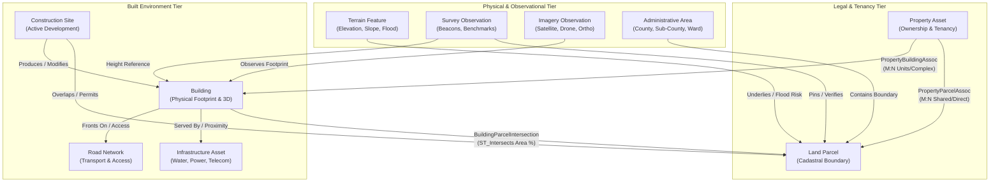

# GLITTERS M4 — Advanced Spatial Intelligence & Digital Twin Architecture
## Document 1: Unified Spatial Knowledge Model

**Classification:** Strategic Architectural Specification
**Milestone:** GLITTERS / GOD'S EYE M4
**Date:** 2026-11-14
**Status:** Approved Architectural Blueprint

---

## 1. Executive Vision & Core Philosophy

The physical built environment is not an isolated collection of polygons on a basemap. It is an interconnected, dynamic, multi-layered system comprising land tenure, physical structures, civil infrastructure, ecological terrain, ongoing construction activity, and verified observations.

The objective of GLITTERS M4 is to transform **GOD'S EYE** from an interactive geospatial map into an **intelligent spatial knowledge operating system**—a unified digital representation of the physical world that models physical, legal, temporal, and operational relationships between geospatial entities.



---

## 2. Canonical Spatial Knowledge Ontology

GLITTERS models all real-world spatial phenomena as specializations of a single polymorphic parent: `SpatialEntity`.

### 2.1 The Core Polymorphic Hierarchy

Every spatial entity in GLITTERS inherits the unified spatial foundation:
1. **Immutable Global Identifier:** 128-bit UUID primary key.
2. **Deterministic Canonical URN:** Opaque, format-validated uniform resource name (`urn:glitters:spatial:<entity_type>:<uuid>`).
3. **Multi-Tenant Ownership:** Optional ForeignKey to `Organization`. Baseline public open data is explicitly `organization = NULL`.
4. **Source Dataset Provenance:** Foreign key to `DatasetVersion` tracking origin snapshot, license, and ingestion commit.
5. **Bi-Temporal Validity:** `valid_from`, `valid_to`, `created_at`, `updated_at`.
6. **Supersession Lineage:** Self-referential `superseded_by` pointer for split/merge/re-survey tracking.

```
                           +------------------------+
                           |     SpatialEntity      |
                           +------------------------+
                           | id: UUID (PK)          |
                           | canonical_urn: VARCHAR |
                           | entity_type: VARCHAR   |
                           | organization: FK(Org)  |
                           | dataset_version: FK    |
                           | lifecycle_status: ENUM |
                           | valid_from / valid_to  |
                           | superseded_by: FK      |
                           +-----------+------------+
                                       |
    +-----------------+----------------+----------------+-----------------+
    |                 |                |                |                 |
+---+----+       +----+---+       +----+---+       +----+----+       +----+---+
|Building|       |Land    |       |  Road  |       |Infrastr.|       |Const-  |
|        |       |Parcel  |       |        |       |Asset    |       |ruction |
+--------+       +--------+       +--------+       +---------+       +--------+
```

### 2.2 Specialization Entities & Physical Schemas

| Entity Type | Physical Model | Geometry Type | Key Domain Attributes |
| :--- | :--- | :--- | :--- |
| **Building** | `spatial_building` | `MultiPolygon (4326)` | Name, classification, height, stories above/below, roof shape, facade, footprint area. |
| **Land Parcel** | `spatial_land_parcel` | `Polygon / MultiPolygon` | Cadastral ID, title number, registry section, tenure type, registered vs computed area. |
| **Road Network** | `spatial_road` | `MultiLineString / LineString` | Road name, highway classification, surface material, carriageway width, right-of-way width. |
| **Infrastructure**| `spatial_infrastructure_asset` | `Point / Line / Polygon` | Asset type (water, power, telecom, sewer), network name, operator, depth, capacity. |
| **Construction** | `spatial_construction_site` | `Polygon` | Project name, permit number, contractor, development phase, hazard buffer radius. |
| **Survey Point** | `spatial_survey_observation`| `PointZ (4326 + Ortho H)` | Beacon code, benchmark type, vertical datum, orthometric & ellipsoidal elevation, RMSE. |
| **Terrain** | `spatial_terrain_feature` | `Polygon / MultiPolygon` | Feature type, base elevation, slope gradient percentage, flood risk category. |
| **Imagery** | `spatial_imagery_observation`| `Polygon (Footprint)` | Sensor platform, capture timestamp, GSD (cm/px), altitude, STAC ID, Cloud-Optimized GeoTIFF URI. |
| **Admin Area** | `spatial_administrative_boundary`| `MultiPolygon` | Boundary name, administrative level (County, Sub-County, Ward), authority reference. |

---

## 3. Decoupled Topological & Domain Relationships

A fundamental architectural failure of legacy GIS is equating spatial intersection with legal ownership. In GLITTERS:
- **Spatial intersection is an empirical observation computed via computational geometry.**
- **Legal association is a statutory, authenticated claim backed by provenance.**

### 3.1 Mathematical Spatial Relationships
PostGIS Dimensionally Extended 9-Intersection Model (DE-9IM) functions define empirical geometric relationships:

$$\begin{aligned}
\text{Intersects}(A, B) &\iff \neg \text{Disjoint}(A, B) \\
\text{Contains}(A, B) &\iff B \subset A \\
\text{Within}(A, B) &\iff A \subset B \\
\text{Overlaps}(A, B) &\iff \dim(I(A) \cap I(B)) = \dim(A) = \dim(B) \land A \not\subset B \land B \not\subset A \\
\text{Adjacent}(A, B, d) &\iff \text{ST\_DWithin}(A, B, d) \land \text{Disjoint}(A, B)
\end{aligned}$$

### 3.2 Explicit Domain Relationship Models

#### 1. Building-to-Parcel Intersections (`BuildingParcelIntersection`)
A building may physically straddle parcel boundaries (e.g. encroaching structures or consolidated compound developments).
```sql
CREATE TABLE spatial_building_parcel_intersection (
    id UUID PRIMARY KEY DEFAULT gen_random_uuid(),
    building_id UUID NOT NULL REFERENCES spatial_building(spatialentity_ptr_id) ON DELETE CASCADE,
    parcel_id UUID NOT NULL REFERENCES spatial_land_parcel(spatialentity_ptr_id) ON DELETE CASCADE,
    intersection_area_sqm NUMERIC(10, 2) NOT NULL,
    percentage_of_building NUMERIC(5, 2) NOT NULL,
    is_primary_parcel BOOLEAN NOT NULL DEFAULT FALSE,
    created_at TIMESTAMPTZ NOT NULL DEFAULT NOW(),
    CONSTRAINT uq_building_parcel_intersection UNIQUE (building_id, parcel_id)
);
```

#### 2. Property-to-Building Associations (`PropertyBuildingAssociation`)
Connects business real estate assets (listings, tenancy units, commercial portfolios) to physical spatial structures:
- `SOLE_OCCUPANT`: Entire building is occupied by the property.
- `MULTI_TENANT_FLOOR`: Specific vertical floors.
- `STRATA_UNIT`: Sectional title / apartment unit.
- `CAMPUS_STRUCTURE`: One of multiple buildings in a commercial/industrial complex.

#### 3. Property-to-Parcel Associations (`PropertyParcelAssociation`)
Connects business properties to legal cadastral land parcels:
- `FULL_PARCEL`: Property owns/occupies the complete parcel.
- `UNDIVIDED_SHARE`: Strata / sectional title share ($\text{undivided\_share\_ratio} = 0.05$).
- `GROUND_LEASE`: Commercial tenant holding a long-term ground lease.

---

## 4. Relationship Provenance & Confidence Metrics

Every relationship between spatial entities retains a strict provenance envelope:

| Attribute | Type | Description |
| :--- | :--- | :--- |
| `relationship_type` | VARCHAR | Spatial (`CONTAINS`, `INTERSECTS`) or Domain (`STRATA_UNIT`, `ENCROACHMENT`). |
| `derivation_method` | ENUM | `GEOMETRIC_CALCULATION`, `SURVEYOR_ATTESTATION`, `GOVERNMENT_REGISTRY`, `AI_INFERRED`. |
| `confidence_score` | DECIMAL(3, 2) | Confidence bound ($0.00$ to $1.00$). Machine inference $\le 0.85$; survey verified $= 1.00$. |
| `verified_by` | FK(User) | Licensed professional surveyor or authorized registry auditor. |
| `verification_date`| TIMESTAMPTZ | Timestamp of human corroboration. |
| `legal_authority` | ENUM | `OPEN_DATA`, `COMMERCIAL_CLAIM`, `STATUTORY_AGENCY`, `SURVEYOR_VERIFIED`, `LANDS_OFFICE`. |

---

## 5. Architectural Invariants

1. **Geometry-Cadastre Separation:** An OpenStreetMap building footprint intersecting a cadastral parcel polygon shall never automatically assert property title ownership.
2. **Bi-Temporal Decoupling:** Entity lifecycle changes (`valid_to` set upon demolition) shall never delete historical relationship associations.
3. **Coordinate Precision:** All planar intersections and area calculations shall be executed in Kenya Official Projected Coordinate Systems (EPSG:21097 UTM Zone 37S for Mombasa) to prevent geographic distortion errors associated with planar operations on WGS-84 spheroids.
