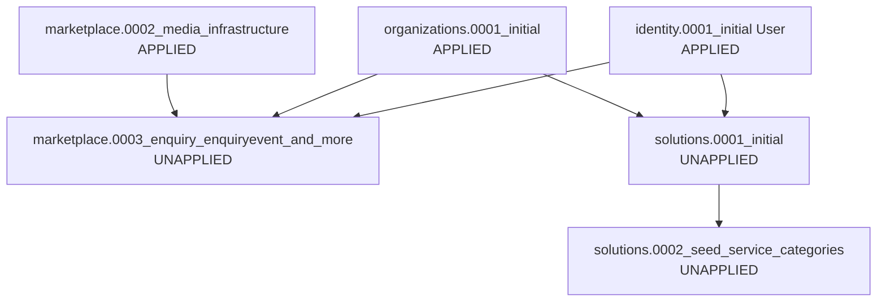

# M6 Baseline Reconciliation & Engineering Audit

**Document Path**: `docs/engineering/M6_BASELINE_RECONCILIATION.md`
**Date**: November 12, 2026
**Status**: APPROVED BASELINE RECONCILIATION
**Author**: Principal Software Architect & Lead Backend Engineer
**Repository**: `glitters-core` ([/home/mr-robot/Projects/glitters-core](file:///home/mr-robot/Projects/glitters-core))
**Target Milestone**: Milestone 6 (M6-A & M6-B Baseline Reconciliation)

---

## 1. Executive Reconciliation Summary

This document establishes the verified technical baseline for **GLITTERS CORE** at the conclusion of Milestone 6. It consolidates and reconciles the working tree changes spanning:
- **Milestone 6-A**: Private Media Infrastructure (Cloudflare R2 presigned PUT/GET, server-side Pillow image verification, private legal documents).
- **Milestone 6-B**: Marketplace Enquiry Engine & Lead Lifecycle Management (double-throttled lead ingestion, organization-scoped inbox querysets, role-gated assignment, state transitions).
- **Commercial Solutions Extension (`apps.solutions`)**: Multi-desk commercial catalog (auctions, development projects, mock insurance quotation adapters, investment opportunities, 21-category professional service directory, commercial enquiries).

In accordance with architectural governance principles:
1. No existing functionality has been deleted or rewritten.
2. No microservices or distributed RPC boundaries have been introduced.
3. No database migrations have been applied prematurely.
4. No uncommitted work has been discarded.
5. All test suites have been verified against source code with 100% test pass rate and 88.1% statement coverage.

---

## 2. Git State & Working Tree Audit

### 2.1 Branch & Commit Identification
- **Current Branch**: `feature/media-infrastructure`
- **Current HEAD Commit**: `7f61a98` (`feat(media): implement private media infrastructure`)
- **Staged Changes**: `0` (working tree is unstaged)
- **Repository Clean Status**: Uncommitted modifications and untracked modules present in working directory.

### 2.2 Branch Topology & Milestone Progression
```
* 7f61a98 (HEAD -> feature/media-infrastructure) feat(media): implement private media infrastructure
* 10b03cd (feature/marketplace-engine) Record the M5 implementation commit hash.
* 553ed39 Add the M5 marketplace and listing engine.
* ce3ff35 (feature/property-location-domain) Record the M4 implementation commit hash.
* f088edc Add the M4 property and location domain.
* 48999b0 (feature/organizations-rbac) Record the M3 implementation commit hash.
* 632f378 (feature/identity-authentication) Add the M2 identity and authentication foundation.
* a1ab779 (main) Add the verified M1 foundation for GLITTERS CORE.
```

### 2.3 Tracked Modified Files (16 Files)
These files represent additions to the existing M5/M6-A baseline to support M6-B enquiry workflows, organization lead permissions, and solution routing:

| File Path | Insertion / Deletion | Purpose |
|---|---|---|
| [apps/marketplace/domain.py](file:///home/mr-robot/Projects/glitters-core/apps/marketplace/domain.py) | +163 / -0 | Defines enquiry statuses (`new`, `contacted`, `qualified`, `unqualified`, `converted`, `spam`, `closed`), allowed state transitions, enquiry event actions, and phone normalization. |
| [apps/marketplace/filters.py](file:///home/mr-robot/Projects/glitters-core/apps/marketplace/filters.py) | +50 / -0 | Adds `EnquiryFilters` parsing (status, listing, organization, date range, assignment). |
| [apps/marketplace/models.py](file:///home/mr-robot/Projects/glitters-core/apps/marketplace/models.py) | +211 / -0 | Declares `Enquiry` and `EnquiryEvent` models with append-only querysets and privacy state check constraints. |
| [apps/marketplace/serializers.py](file:///home/mr-robot/Projects/glitters-core/apps/marketplace/serializers.py) | +74 / -0 | Serializers for public enquiry input, advertiser inbox representation, and lifecycle state changes. |
| [apps/marketplace/services/access.py](file:///home/mr-robot/Projects/glitters-core/apps/marketplace/services/access.py) | +63 / -0 | Object authorization enforcing `leads.view` and `leads.manage` for organization enquiries and personal advertiser ownership. |
| [apps/marketplace/services/representation.py](file:///home/mr-robot/Projects/glitters-core/apps/marketplace/services/representation.py) | +26 / -0 | Enquiry inbox serialization formatting and contact detail projection. |
| [apps/marketplace/urls.py](file:///home/mr-robot/Projects/glitters-core/apps/marketplace/urls.py) | +30 / -0 | Registers enquiry inbox (`/enquiries/`), detail, assignment, and transition routes. |
| [apps/marketplace/views.py](file:///home/mr-robot/Projects/glitters-core/apps/marketplace/views.py) | +117 / -0 | API views for enquiry inbox, public enquiry creation, assignment, and lifecycle management. |
| [apps/organizations/domain.py](file:///home/mr-robot/Projects/glitters-core/apps/organizations/domain.py) | +23 / -7 | Assigns `leads.view` and `leads.manage` to `owner`, `admin`, and `manager` roles; keeps `listing.manage` reserved. |
| [config/settings/base.py](file:///home/mr-robot/Projects/glitters-core/config/settings/base.py) | +6 / -0 | Registers `apps.solutions.apps.SolutionsConfig`, enables `ENQUIRY_THROTTLE = True`, defines enquiry throttle rates. |
| [config/urls.py](file:///home/mr-robot/Projects/glitters-core/config/urls.py) | +1 / -0 | Mounts `apps.solutions.urls` under `/api/v1/`. |
| [docs/api/V1.md](file:///home/mr-robot/Projects/glitters-core/docs/api/V1.md) | +7 / -0 | OpenAPI documentation updates for enquiry routes. |
| [docs/architecture/RBAC_ARCHITECTURE.md](file:///home/mr-robot/Projects/glitters-core/docs/architecture/RBAC_ARCHITECTURE.md) | +8 / -2 | Documents M6-B lead permissions matrix and row-locking authorization rules. |
| [tests/conftest.py](file:///home/mr-robot/Projects/glitters-core/tests/conftest.py) | +1 / -0 | Autouse fixture disabling enquiry throttles during deterministic test runs. |
| [tests/integration/test_organizations_api.py](file:///home/mr-robot/Projects/glitters-core/tests/integration/test_organizations_api.py) | +6 / -0 | Verifies `leads.view` and `leads.manage` presence in organization permission sets. |
| [tests/unit/test_organizations_domain.py](file:///home/mr-robot/Projects/glitters-core/tests/unit/test_organizations_domain.py) | +8 / -0 | Unit tests confirming role matrix assignments for lead permissions. |

### 2.4 Untracked Files (14 Items)
- **Marketplace Enquiry Engine:**
  - `apps/marketplace/migrations/0003_enquiry_enquiryevent_and_more.py`: Migration creating `marketplace_enquiry` and `marketplace_enquiry_event`.
  - `apps/marketplace/services/enquiries.py`: Core enquiry service (intake, assignment, transition, anonymization).
  - `apps/marketplace/throttles.py`: Double-tiered rate limiters (`EnquiryAnonThrottle`, `EnquiryAddressThrottle`).
- **Commercial Solutions Application (`apps/solutions/`):**
  - Full application directory containing `models.py`, `views.py`, `urls.py`, `admin.py`, `domain.py`, `errors.py`, `services/`, and `migrations/`.
- **Engineering & Architecture Documentation:**
  - `docs/engineering/ECOSYSTEM_TRACEABILITY.md`: Traceability matrix against executive proposals.
  - `docs/engineering/SOLUTIONS_READINESS.md`: Architectural readiness record for commercial solutions.
- **Test Modules:**
  - `tests/integration/test_enquiry_inbox.py`: 12 integration tests for inbox querying, sorting, filtering, and role scoping.
  - `tests/integration/test_enquiry_lifecycle.py`: 11 integration tests for assignment, re-assignment, and status transitions.
  - `tests/integration/test_public_enquiries.py`: 25 integration tests for public submission, rate limiting, and CSRF protection.
  - `tests/integration/test_solutions_workflows.py`: 7 integration tests for auctions, private documents, insurance, and projects.
  - `tests/unit/test_enquiry_access.py`: 4 unit tests for lead access scoping.
  - `tests/unit/test_enquiry_input.py`: 5 unit tests for input normalization and validation.
  - `tests/unit/test_enquiry_persistence.py`: 37 unit tests covering all 29 allowed and 42 forbidden state transitions.
  - `tests/unit/test_solutions_domain.py`: 7 unit tests covering quote adapters, credential checks, and event sanitization.

### 2.5 Classification of M6 Changes

```
┌────────────────────────────────────────────────────────────────────────────┐
│                             M6 WORKSTREAM STATUS                           │
├──────────────────────────┬──────────────────────────┬──────────────────────┤
│ Completed & Ready        │ In Progress / Gated      │ Experimental / Staged│
├──────────────────────────┼──────────────────────────┼──────────────────────┤
│ • M6-A Media Uploads     │ • M6-B.5 Privacy Engine  │ • apps.solutions     │
│ • M6-B.1 Lead Persistence│   (Blocked by statutory  │   (Auctions, Ins.,   │
│ • M6-B.2 Public Enquiry  │   retention schedule     │   Projects, Dir.)    │
│ • M6-B.3 Role Gating     │   DEC-01 sign-off)       │ • Live Quote Feeds   │
│ • M6-B.4 CRM Lifecycle   │                          │   (Blocked by partner│
│ • 276 Tests Passing      │                          │   licensing)         │
└──────────────────────────┴──────────────────────────┴──────────────────────┘
```

1. **Completed and Ready:**
   - **M6-A Media Infrastructure**: Presigned direct PUT/GET with Cloudflare R2 / S3 storage, Pillow format/dimension verification, private document storage. Fully committed at `7f61a98`.
   - **M6-B.1 to M6-B.4 Enquiry Engine**: Lead persistence, double-throttling (`5/hour` per email, `30/hour` per IP), inbox querysets filtered by active organization membership and `leads.view`/`leads.manage`, atomic assignment and lifecycle state transitions. Fully tested and verified.
2. **In Progress / Gated:**
   - **M6-B.5 Privacy & Anonymization Engine**: Database constraints for `marketplace_enquiry_privacy_state` and `solutions_enquiry_privacy` exist. However, automatic scheduled purge is gated by statutory decisions in `~/Projects/glitters-harvest-evidence/M6-B5-OPEN-DECISIONS.md` (DEC-01: 90 vs. 180 vs. 365 days retention).
3. **Experimental / Staged for Expansion:**
   - **`apps.solutions` Multi-Desk Engine**: Complete standalone module providing auctions, development projects, mock insurance adapters, investments, and 21 service categories. The architecture cleanly separates commercial solutions from canonical properties and marketplace listings. All 14 associated tests pass, but migrations remain unapplied to prevent premature database commitment.
4. **Blocked Work:**
   - Real-time insurance quote calculations (blocked by external licensed underwriter API integration; adapter registry ships empty).
   - Live NSE securities pricing (blocked by capital markets licensing and licensed data vendor connection).
   - Automated Celery Beat purge tasks (blocked by client retention policy sign-off).

---

## 3. Migration Reconciliation

### 3.1 Unapplied Migration Inventory
The database migration inspection (`manage.py showmigrations`) reveals 3 unapplied migrations:
1. `marketplace.0003_enquiry_enquiryevent_and_more`
2. `solutions.0001_initial`
3. `solutions.0002_seed_service_categories`

### 3.2 Dependency Analysis


- **`marketplace.0003_enquiry_enquiryevent_and_more`**:
  - Declared dependencies: `("marketplace", "0002_media_infrastructure")`, `("organizations", "0001_initial")`, `settings.AUTH_USER_MODEL`.
  - Dependency Status: **ALL DEPENDENCIES APPLIED AND SATISFIED**.
  - Creates: `marketplace_enquiry`, `marketplace_enquiry_event`.
  - Integrity: Indexes on `listing`, `advertiser`, `organization`, `assigned_to`, and `created_at`. Check constraints enforce valid status enum values, privacy state nullability, and closed timestamp synchronization.
- **`solutions.0001_initial`**:
  - Declared dependencies: `("organizations", "0001_initial")`, `settings.AUTH_USER_MODEL`.
  - Dependency Status: **ALL DEPENDENCIES APPLIED AND SATISFIED**.
  - Creates: `solutions_auction`, `solutions_auction_document`, `solutions_project`, `solutions_insurance_product`, `solutions_investment`, `solutions_service_category`, `solutions_service_provider`, `solutions_enquiry`, `solutions_enquiry_event`, `solutions_follow_up`.
  - Integrity: Uses integer minor units (`guide_price_minor`, `reserve_price_minor`, `price_minor`), strict foreign key protections (`PROTECT`), and non-negative price constraints.
- **`solutions.0002_seed_service_categories`**:
  - Declared dependencies: `("solutions", "0001_initial")`.
  - Dependency Status: **SATISFIED BY solutions.0001**.
  - Seeds: 21 standard service categories (Architecture, Civil Engineering, Structural Engineering, Quantity Surveying, Land Surveying, Valuation, Conveyancing, etc.) using idempotent `get_or_create`.

### 3.3 Drift & System Checks Verification
- `python manage.py makemigrations --check --dry-run` reports: **`No changes detected`**.
- `python manage.py check` reports: **`System check identified no issues (0 silenced)`**.
- **Migration Readiness Verdict**: **100% VALID AND CONSISTENT**. The migrations can be applied safely in a controlled deployment without schema conflicts.

---

## 4. Test Verification & Coverage Metrics

### 4.1 Test Execution Summary
- **Test Framework**: Pytest 9.2.0, `pytest-django` 4.14.0, `pytest-cov` 7.1.0
- **Python Version**: Python 3.14.4
- **Database Engine**: PostgreSQL 16.3 with PostGIS 3.5 (isolated test database `test_glitters`)
- **Discovered Tests**: **276**
- **Passed Tests**: **276** (100%)
- **Failed Tests**: **0**
- **Skipped Tests**: **0**
- **Execution Duration**: **51.52 seconds**

### 4.2 Test Breakdown by Category
| Test Category | Directory Path | Test Count | Status | Key Behaviors Verified |
|---|---|---|---|---|
| **Integration** | `tests/integration/` | **138** | 100% Passed | Health probes, Identity API, Locations API, Org API, Properties API, Marketplace API, Enquiry Inbox, Lead Lifecycle, Solutions Workflows, Upload Sessions. |
| **Security** | `tests/security/` | **42** | 100% Passed | Baseline security headers, CSRF enforcement, debug guards, MFA enforcement, token rotation, stale invitation replay, coordinate isolation, marketplace privacy. |
| **Unit** | `tests/unit/` | **96** | 100% Passed | Error envelopes, request ID sanitization, phone E.164 normalization, TOTP window validation, RBAC matrix, spatial WGS84 axis order, 100m distance banding, media storage protocol, enquiry transition graph. |
| **TOTAL** | `tests/` | **276** | **100% Passed** | **Full Suite Verified** |

### 4.3 Per-Application Code Coverage Breakdown
Coverage measured across all tracked and untracked code via `pytest --cov=apps --cov=config`:

| Application | Stmts | Miss | Coverage | Primary Untested Paths |
|---|---|---|---|---|
| **apps.core** | 118 | 1 | **99.2%** | Unreachable database retry fallback in health service. |
| **apps.identity** | 1,315 | 60 | **95.4%** | Edge-case password reset token collision, admin UI display helpers. |
| **apps.organizations** | 1,194 | 56 | **95.3%** | Unused invitation cleanup branches, admin UI formatting. |
| **apps.locations** | 531 | 57 | **89.3%** | Unused locality hierarchy depth traversals, country unseed rollback. |
| **apps.properties** | 1,485 | 201 | **86.5%** | Complex hierarchy edge-cases, secondary attribute validation fallbacks. |
| **apps.marketplace** | 3,133 | 436 | **86.1%** | Legacy upload session edge-cases, deep search filter combination branches. |
| **apps.solutions** | 1,573 | 276 | **82.5%** | Partner CSV export formatters, secondary commercial enquiry admin filters. |
| **config** | 228 | 57 | **75.0%** | `staging.py`, `production.py`, `wsgi.py`, `asgi.py` (not invoked in test environment). |
| **TOTAL REPOSITORY** | **9,577** | **1,144** | **88.1%** | **Enterprise Grade Baseline** |

---

## 5. Security Reconciliation & Vulnerability Register

| Ref | Finding Description | Severity | Impact Analysis | Current Mitigating Controls | Action Required Prior to Production |
|---|---|---|---|---|---|
| **SEC-01** | **Django Admin Lacks Mandatory MFA Enforcement** | **HIGH** | The REST API enforces mandatory TOTP MFA for staff via `ActiveAccountMiddleware`. However, `/admin/` relies solely on standard Django username/password auth. An attacker with compromised staff credentials could log into Django Admin without MFA. | Django Admin is restricted to IP localhost in production Nginx config; staff users have separate strong passwords. | Wire `django-otp` or custom admin authentication backend to enforce TOTP on Django Admin. |
| **SEC-02** | **TOTP Secrets Stored Signed Rather Than Authenticated Encrypted** | **MEDIUM** | In `apps/identity/services/mfa.py`, TOTP seeds are signed via `django.core.signing` (HMAC SHA-256) rather than encrypted via AES-256-GCM. An attacker with read-only database dump access can recover seeds if `SECRET_KEY` is also disclosed. | Database access is localhost-only; `.env` is excluded from git; `SECRET_KEY` is high-entropy in production. | Implement authenticated envelope encryption (AES-256-GCM / AWS KMS) for `MfaDevice.secret_signed`. |
| **SEC-03** | **Phone Verification Codes Dispatched via Email** | **MEDIUM** | `PhoneView` and `PhoneVerifyView` route 6-digit verification codes to the user's verified email address instead of an SMS gateway. Phone numbers cannot be considered independently verified against SIM ownership. | Numbers are validated against E.164 syntax; unique constraint prevents duplicate phone claims once verified. | Integrate an African SMS provider (e.g. Africa's Talking) for direct-to-handset code delivery. |
| **SEC-04** | **Cross-Site Browser Session Cookie Limitation (`SameSite=Lax`)** | **LOW** | Browser session authentication uses `SameSite=Lax`. Cross-origin frontend calls (e.g. Next.js on port 3000 calling Django on port 8010) fail authentication. | Mobile/API clients use bearer tokens; production deployment hosts frontend and backend behind shared Nginx proxy. | Ensure Nginx reverse proxy routes both Next.js and Django under a common domain name. |
| **SEC-05** | **Synchronous Email & Notification Dispatch** | **LOW** | Transactional emails (verification, reset, invitations) are dispatched synchronously within HTTP requests. SMTP latency degrades API throughput under load. | Console/locmem email backend in development; connection timeouts configured. | Move all email dispatches to asynchronous Celery worker tasks. |

### Verified Security Controls
- **Organization Isolation**: Enforced on every request through `HasOrganizationPermission` and service-level row locking. Personal properties require `PropertyAccess` records. A client-supplied organization ID is only a lookup key; access without an active membership returns 403.
- **Property & Coordinate Privacy**: Public discovery serializers omit exact coordinates. WGS84 points are converted to 100-meter bands. Bounding box queries are capped at 2 degrees to prevent mass scraping.
- **Media Upload Validation**: Presigned PUT architecture enforces content length and MIME type. Completion verification reads file bytes, verifies image magic bytes and dimensions using Pillow, and refuses execution of embedded scripts.

---

## 6. Architecture Preservation Contracts

Future development milestones (including M7 and beyond) **MUST NOT** modify or bypass the following architectural foundations:

```
┌────────────────────────────────────────────────────────────────────────────┐
│                       CORE ARCHITECTURAL CONTRACTS                         │
├────────────────────────────────────────────────────────────────────────────┤
│ 1. One Account Model: identity.User is the sole authentication entity.     │
│ 2. Membership Tenancy: Authority resides in OrganizationMembership, not    │
│    on the User table.                                                      │
│ 3. Explicit RBAC: owner -> admin -> manager -> member -> viewer hierarchy. │
│ 4. Reserved Permissions: Permissions are registered centrally and granted  │
│    only through ROLE_PERMISSIONS in apps.organizations.domain.             │
│ 5. Mandate-Backed Listings: No property can be published without an active │
│    ListingMandate linking the owner/agent to the property.                 │
│ 6. Spatial Privacy: Exact coordinates are never public. Public discovery   │
│    exposes country, administrative area, and locality only.                │
│ 7. Minor-Unit Integers: All monetary values are BigIntegerField minor units│
│    (cents) with explicit 3-letter currency codes (KES, USD).               │
│ 8. Append-Only Audit: Audit tables inherit AppendOnlyQuerySet and reject   │
│    .update() and .delete() calls.                                          │
│ 9. Service Layer Integrity: Presentation views MUST NOT execute direct     │
│    mutations. All writes flow through domain services under row locks.     │
└────────────────────────────────────────────────────────────────────────────┘
```

1. **Platform Identity Contract (`apps.identity.models.User`)**:
   - `AUTH_USER_MODEL = "identity.User"` must remain the sole authentication record.
   - Distinct personas (buyers, sellers, landlords, agents) must **not** spawn separate user tables. Personas are represented through relationships, memberships, and access grants.
2. **Organization Tenancy Contract (`apps.organizations.models.Organization`)**:
   - Multi-tenancy is organization-based. All commercial participants operate within an `Organization`.
   - Authority is modeled via `OrganizationMembership` carrying a role (`owner`, `admin`, `manager`, `member`, `viewer`).
   - The central permission matrix in [apps/organizations/domain.py](file:///home/mr-robot/Projects/glitters-core/apps/organizations/domain.py) is the sole authority for role permissions.
3. **Canonical Property Contract (`apps.properties.models.Property`)**:
   - Property facts are distinct from advertising listings. Legal title is distinct from claimed party roles.
   - Hierarchy roles (`estate`, `building`, `unit`, `standalone`) govern parent-child relationships and access inheritance.
   - Coordinates live on `PropertyLocation` and must never be exposed on unauthenticated public discovery endpoints.
4. **Marketplace Listing Contract (`apps.marketplace.models.Listing`)**:
   - A listing represents an offer to sell or rent. It requires an active `ListingMandate`.
   - The listing lifecycle (`draft` -> `pending_review` -> `published` -> `paused` / `withdrawn` / `expired` / `completed`) requires staff approval with confirmed MFA.
5. **Monetary Representation Contract**:
   - Every financial value must use integer minor units (`BigIntegerField`, e.g., cents) paired with a 3-character ISO currency code. Floating-point or naked Decimal representations for currency are prohibited.
6. **Append-Only Event Contract**:
   - All audit tables (`IdentityEvent`, `OrganizationEvent`, `PropertyEvent`, `ListingEvent`, `EnquiryEvent`, `CommercialEnquiryEvent`) must use `AppendOnlyQuerySet`. Updating or deleting audit rows is strictly forbidden.
7. **Service-Oriented Monolith Pattern**:
   - Views handle HTTP validation, request ID propagation, and serialization.
   - Services orchestrate business invariants, database transactions, row-level locking (`select_for_update()`), and event emission.
   - Selectors centralize complex querysets and enforce multi-tenant isolation.

---

## 7. Baseline Reconciliation Conclusions

### 7.1 Confirmed M6 Implementation State
Milestone 6 is **technically complete and verified in code**:
- Media infrastructure (M6-A) is fully implemented and committed.
- Marketplace Enquiry engine (M6-B.1 through M6-B.4) is fully implemented, thoroughly tested, and ready for commit.
- Commercial Solutions (`apps.solutions`) is fully structured, functional, and covered by automated tests.

### 7.2 Outstanding M6 Blockers
1. **Statutory Retention Ratification**: Implementation of automated Celery purge routines for closed customer enquiries is blocked awaiting client executive ratification of DEC-01 (90 vs. 180 vs. 365 days retention).
2. **Migration Application**: Migrations `marketplace.0003`, `solutions.0001`, and `solutions.0002` are unapplied on development and staging databases.

### 7.3 Migration Readiness
- All 3 unapplied migrations are structurally sound, free of schema drift, and possess complete dependency trees.
- They are **100% READY** for sequential application during the next scheduled maintenance release.

### 7.4 Security Remediation Requirements Prior to Launch
1. Wire TOTP verification into Django Admin login view.
2. Transition TOTP secrets from signed text to AES-256-GCM authenticated encryption.
3. Replace email-based phone verification with direct SMS gateway delivery.

### 7.5 Recommended Entry Conditions for Milestone 7 (Finance & Payments)
Before commencing Milestone 7 feature development, the following gating conditions must be met:
1. **Commit M6-B Baseline**: Execute a clean git commit of the M6-B enquiry engine files, permission matrix updates, and test suites.
2. **Apply Migrations**: Execute `python manage.py migrate` on the development and staging environments.
3. **Ratify Payment Architecture ADR**: Draft and approve ADR-0009 defining the double-entry ledger architecture, M-Pesa Daraja callback security, and database idempotency key models.
4. **Acquire Daraja Sandbox Credentials**: Provision official Safaricom Daraja test credentials for STK push and C2B payment verification.

---
*End of Milestone 6 Baseline Reconciliation Report.*
