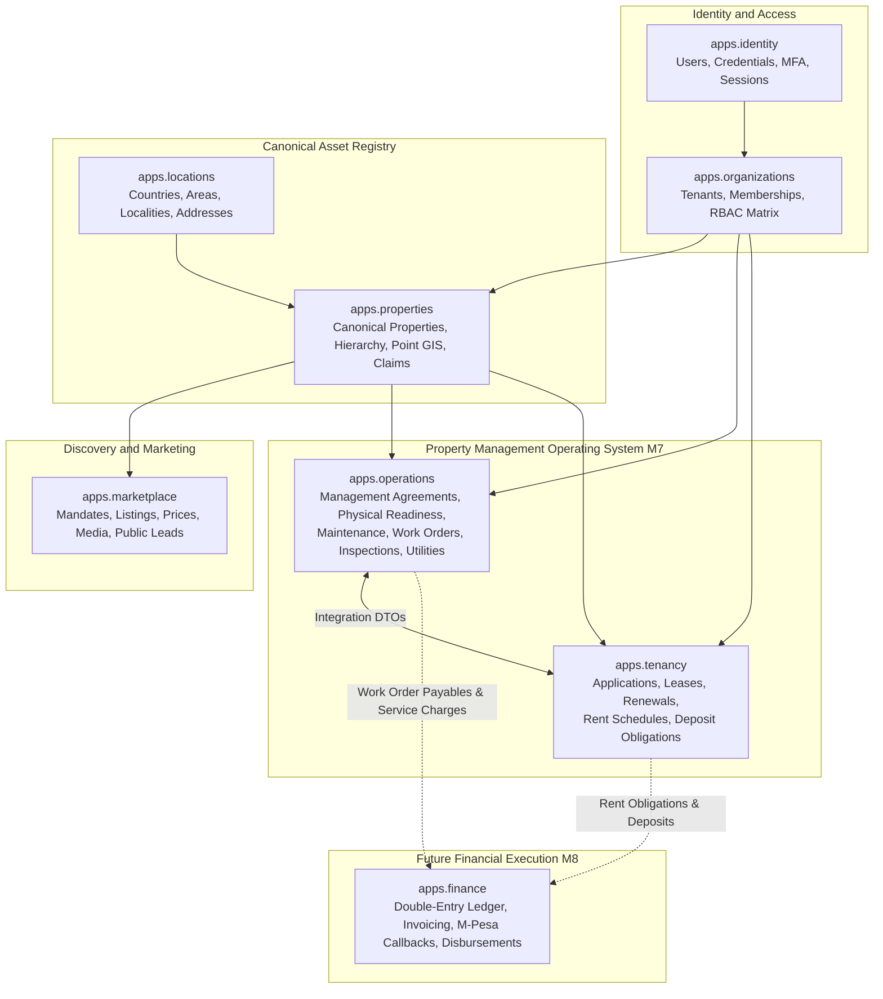
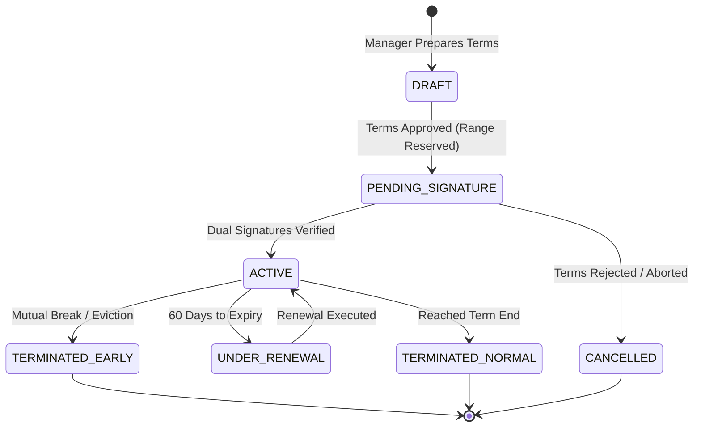
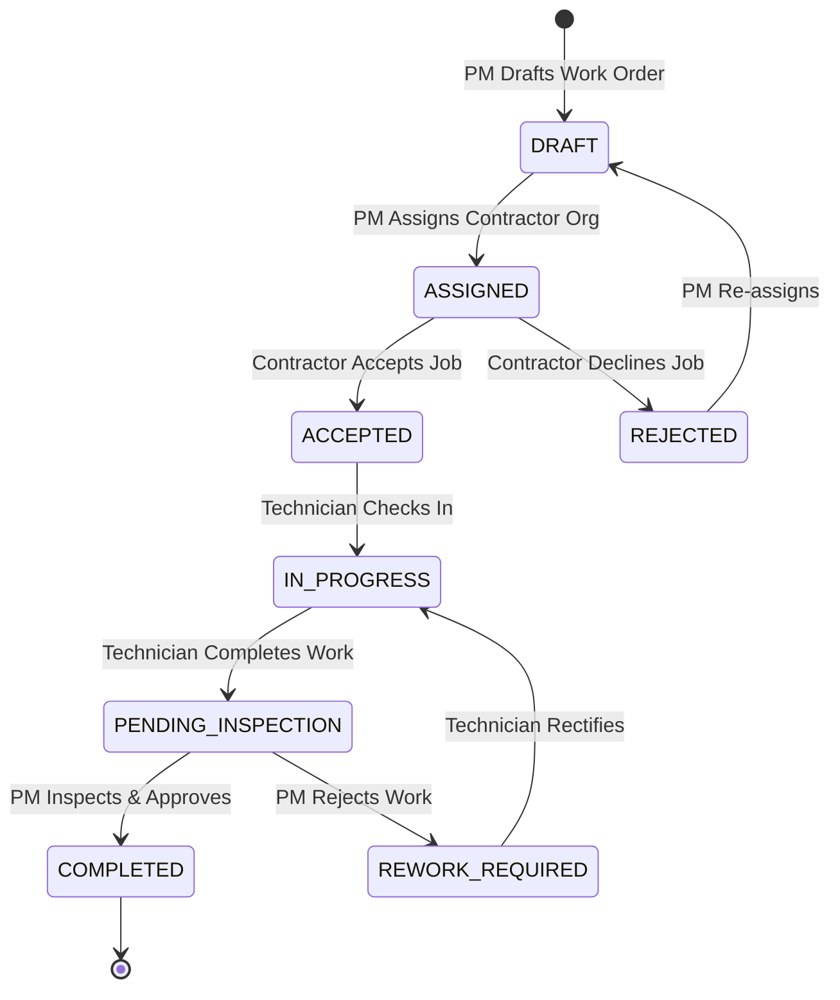

# M7 — Property Management Operating System: Approved Architecture

**Document Path**: `docs/engineering/M7_APPROVED_ARCHITECTURE.md`
**Milestone**: Milestone 7 (M7 Final Architectural Specification)
**Date**: November 12, 2026
**Status**: APPROVED IMPLEMENTATION SPECIFICATION
**Author**: Principal Software Architect & Lead Backend Engineer
**Repository**: `glitters-core` ([/home/mr-robot/Projects/glitters-core](file:///home/mr-robot/Projects/glitters-core))
**Supersedes**: `docs/engineering/M7_PROPERTY_MANAGEMENT_ARCHITECTURE.md`
**Reconciles**: `docs/engineering/M7_ARCHITECTURE_CHALLENGE.md`
**Implementation Mode**: STRICTLY ARCHITECTURAL SPECIFICATION (No Application Code Modified)

---

## 1. Executive Reconciliation Summary

This document establishes the definitive, implementation-ready architectural specification for **GLITTERS CORE Milestone 7: Property Management Operating System (PMOS)**. It reconciles the initial proposal in [M7_PROPERTY_MANAGEMENT_ARCHITECTURE.md](file:///home/mr-robot/Projects/glitters-core/docs/engineering/M7_PROPERTY_MANAGEMENT_ARCHITECTURE.md) with the adversarial findings in [M7_ARCHITECTURE_CHALLENGE.md](file:///home/mr-robot/Projects/glitters-core/docs/engineering/M7_ARCHITECTURE_CHALLENGE.md).

All architectural blockers and vulnerabilities identified during review have been comprehensively resolved:
1. **Lease Temporal Integrity**: Solved using PostgreSQL `daterange` GiST exclusion constraints with half-open `[start_date, effective_end_date)` intervals, natively supporting pre-leasing, renewals, early terminations, and open-ended (periodic) tenancies without collision.
2. **Authority & Anti-Hijacking**: Delegated management authority requires a cryptographically verified two-sided handshake between the verified owner (`PropertyAccess(capability="manage")`) and the managing organization (`Organization(type="property_manager")`). Unverified `claimed` party roles are strictly barred from granting delegation.
3. **Occupancy vs. Readiness**: Single source of truth enforced. Contractual occupancy is an authoritative query over active `Lease` ranges in `apps.tenancy`. Physical readiness is an authoritative state machine in `apps.operations` (`UnitPhysicalState`). Denormalized occupancy columns are eliminated.
4. **Financial Separation**: `RentScheduleEntry` models contractual payment demands only. All cash settlement, receipting, ledger allocation, and arrears balances are decoupled into the future `apps.finance` domain.
5. **Contractor Data Minimization & Dual Tenancy**: Contractors access work orders through a strictly minimized, time-bounded `ContractorDispatchDTO`, with tenant PII masked. Shared work orders enforce distinct bilateral permissions for Client Organizations vs. Vendor Organizations.
6. **Preservation of M4 Immutability**: Canonical `Property.management_context` remains immutable. Management delegation operates via scoped `PropertyAccess` grants, never mutating canonical property context.

---

## 2. Domain Boundaries & Monolith Architecture

The modular monolith partitions property management into two new cohesive domain applications: `apps.operations` and `apps.tenancy`.



### Domain Boundary Allocations

| Application Domain | Authoritative Responsibilities | Invariants & Strict Boundaries |
|---|---|---|
| **`apps.properties`** *(Existing)* | Canonical physical assets (`estate` -> `building` -> `unit`), physical characteristics (`bedrooms`, `floor_area_sqm`), WGS84 point coordinates, claimed parties (`PropertyParty`), and access grants (`PropertyAccess`). | **Immutable physical reality.** Must not contain tenancy state, lease dates, tenant names, or maintenance tickets. `management_context` is immutable. |
| **`apps.organizations`** *(Existing)* | Multi-tenant company entities (property managers, landlords, contractors), membership lifecycles, cryptographic invitations, central RBAC permission matrix. | **Tenant governance.** Evaluates whether an actor has authority within a business. Must not hold property rows or lease terms directly. |
| **`apps.marketplace`** *(Existing)* | Advertising mandates, public listings, asking rental/sale prices, verified marketing photographs, public search discovery, and prospect inquiries. | **Public marketing.** When a vacancy is filled, the listing closes; the resulting lease belongs to Tenancy. |
| **`apps.operations`** *(New M7)* | Bilateral owner-management agreements (`ManagementAgreement`), unit physical readiness (`UnitPhysicalState`), maintenance requests, contractor work orders, condition inspections, utility metering, and service charge budgets. | **Physical plant operations & asset upkeep.** Governs physical asset readiness and vendor repair execution. Does not own lease terms or collect rent. |
| **`apps.tenancy`** *(New M7)* | Rental applications, tenant identity binding, bilateral lease contracts, move-in/move-out protocols, contractual rent obligation schedules, deposit liabilities, and contractual arrears tracking. | **Contractual & legal occupancy.** Governs the bilateral contract between landlord/manager and tenant. Decoupled from physical maintenance and cash ledgering. |
| **`apps.finance`** *(Future M8)* | Double-entry general ledgers, chart of accounts, tenant invoices, M-Pesa C2B/B2C callbacks, bank reconciliation, owner disbursement statements. | **Financial execution & custody of funds.** Neither `operations` nor `tenancy` directly handles bank APIs or balance calculations. They emit billing demands to Finance. |

---

## 3. Lease Temporal Integrity & Mathematical Semantics

### 3.1 Date Boundary Semantics: Half-Open Intervals
To prevent date collisions and enable same-day tenant turnover, all lease intervals use **half-open interval semantics**:
$$\text{Lease Term} = [\text{start\_date}, \text{effective\_end\_date})$$
- `start_date` is **inclusive** (tenant right of occupancy commences at 00:00:00 on `start_date`).
- `effective_end_date` is **exclusive** (tenant right of occupancy ceases at 00:00:00 on `effective_end_date`; outgoing tenant vacates by 23:59:59 on `effective_end_date - 1 day`).
- **Same-Day Turnover Guarantee**: If Lease A vacates on June 30 (`effective_end_date = 2026-07-01`), Lease B can commence on July 1 (`start_date = 2026-07-01`). The mathematical intersection is empty:
  $$[2026-01-01, 2026-07-01) \cap [2026-07-01, 2027-01-01) = \emptyset$$

### 3.2 Open-Ended (Periodic) Tenancies
- For month-to-month or periodic commercial leases without a fixed contractual end date:
  - `start_date` is recorded.
  - `effective_end_date` is stored as `NULL`.
  - In PostgreSQL, `daterange(start_date, NULL, '[)')` creates a right-unbounded range: $[\text{start\_date}, \infty)$.
  - The exclusion constraint guarantees that no future lease can be created on that property while the periodic lease is active.
  - When notice to quit is formally served and accepted (e.g. 30 days notice to vacate August 31), the service atomically mutates `effective_end_date` from `NULL` to `2026-09-01`. The range closes to $[\text{start\_date}, 2026-09-01)$, immediately freeing the property for pre-leasing starting September 1.

### 3.3 Pre-Leasing, Renewals, and Early Terminations


1. **Pre-Leasing Protection**: Leases in `PENDING_SIGNATURE` or `APPROVED` reserve their date range. If an incoming tenant is offered a lease, no competing lease can be drafted for that same date window.
2. **Early Termination**: When a lease terminates early (e.g., mutually agreed departure on March 15 for a lease scheduled to end December 31):
   - `term_end_date` preserves the historical contractual term (`2026-12-31`) for audit and contractual penalty claims.
   - `effective_end_date` is mutated to the actual departure date (`2026-03-16`).
   - The GiST exclusion range immediately contracts, permitting a new lease to be executed starting March 16.
3. **Cancellation**: If a lease in `PENDING_SIGNATURE` is cancelled, it moves to `CANCELLED`. The partial exclusion constraint ignores `CANCELLED` leases, instantly releasing the temporal reservation.

### 3.4 PostgreSQL GiST Exclusion Constraint Specification
The PostgreSQL `btree_gist` extension must be installed to index `UUID` with GiST equality.

```sql
-- Migration operation: apps/core/migrations/0002_enable_btree_gist.py
CREATE EXTENSION IF NOT EXISTS btree_gist;

-- Database constraint: apps/tenancy/models.py (Lease)
ALTER TABLE tenancy_lease
ADD CONSTRAINT exclude_overlapping_active_leases
EXCLUDE USING gist (
    property_id WITH =,
    daterange(start_date, effective_end_date, '[)') WITH &&
)
WHERE (status IN ('ACTIVE', 'PENDING_SIGNATURE', 'UNDER_RENEWAL'));
```

---

## 4. Management Authority & Anti-Hijacking Protocol

### 4.1 The Threat Model
In [apps/properties/models.py#L220-L250](file:///home/mr-robot/Projects/glitters-core/apps/properties/models.py#L220-L250), `PropertyParty.status` values include `claimed` and `pending_verification`. Anyone with an authenticated user account can create a party claim asserting they own a property. An unverified claim must **never** be capable of delegating management authority.

### 4.2 The Three Verification Tiers
1. **Tier 1: Identity Verification (`identity.User`)**: The user has verified their email address and phone number, and holds an `active` account status.
2. **Tier 2: Property Authority (`PropertyAccess`)**: The user holds an explicit `PropertyAccess(capability="manage", status="active")`. For personal properties, this authority is cryptographically created in the same atomic transaction that created the property.
3. **Tier 3: Corporate Ownership (`apps.organizations`)**: For properties managed in an organizational context, the granting entity must be an active `Organization` where the authorizing actor holds the role of `owner` or `admin`.

### 4.3 Bilateral Agreement Handshake State Machine
A `ManagementAgreement` cannot be activated unilaterally by either the owner or the property management firm.

```mermaid
sequenceDiagram
    autonumber
    actor Owner as Property Owner (Verified Authority)
    participant Core as apps.operations
    actor PM as Property Management Firm (Agent)

    alt Proposed by Property Manager
        PM->>Core: Propose ManagementAgreement(property, terms, spend_limit)
        Core->>Core: Validate Property Exists; status=PENDING_OWNER_ACCEPTANCE
        Owner->>Core: Accept & Cryptographically Sign Agreement
        Core->>Core: Verify Owner Holds Direct PropertyAccess(capability="manage")
        Core->>Core: status=ACTIVE; Emit AgreementActivatedEvent
        Core->>Core: Create Delegated PropertyAccess(user=PM, capability="manage", origin="agreement")
    else Proposed by Owner
        Owner->>Core: Draft ManagementAgreement(property, PM_org, terms)
        Core->>Core: Validate Owner Authority; status=PENDING_AGENT_ACCEPTANCE
        PM->>Core: Review & Accept Agreement Terms
        Core->>Core: status=ACTIVE; Emit AgreementActivatedEvent
        Core->>Core: Create Delegated PropertyAccess(user=PM, capability="manage", origin="agreement")
    end
```

### 4.4 Preservation of M4 Management Context Immutability
In [apps/properties/models.py#L103-L115](file:///home/mr-robot/Projects/glitters-core/apps/properties/models.py#L103-L115), `management_context` is **immutable**:
- `management_context="personal"` requires `managing_organization IS NULL`.
- `management_context="organization"` requires `managing_organization IS NOT NULL`.

**Architectural Invariant**: A `ManagementAgreement` must **not** mutate `Property.management_context` or attempt to write to `Property.managing_organization` on personal properties.
Instead, activating a `ManagementAgreement`:
1. Preserves `Property.management_context="personal"`.
2. Inserts an operational delegation record:
   `PropertyAccess.objects.create(property=prop, user=pm_user, capability="manage", origin="inherited")`.
3. Records the `agreement_id` in audit metadata.
4. Terminating the agreement atomically sets `PropertyAccess.status="revoked"`, terminating operational authority without altering canonical ownership.

---

## 5. Occupancy Consistency & Domain Coordination

### 5.1 Elimination of Denormalized Occupancy State
The antipattern of storing `occupancy_status="OCCUPIED"` and `current_lease_id` on `UnitOperationalProfile` is eliminated.

- **Authoritative Contractual Occupancy (`apps.tenancy`)**:
  Contractual occupancy is a deterministic query over active leases:
  ```python
  def is_contractually_occupied(property_id: UUID, target_date: date) -> bool:
      return Lease.objects.filter(
          property_id=property_id,
          status__in=[LeaseStatus.ACTIVE, LeaseStatus.UNDER_RENEWAL],
          start_date__lte=target_date,
      ).filter(
          Q(effective_end_date__isnull=True) | Q(effective_end_date__gt=target_date)
      ).exists()
  ```
- **Authoritative Physical Readiness (`apps.operations`)**:
  Governs whether a unit is physically suitable for human habitation via `UnitPhysicalProfile.physical_state`:
  - `READY_INSPECTED`: Cleaned, inspected, keys in lockbox, available for move-in.
  - `TURNOVER_PREPARATION`: Incumbent tenant vacated; cleaning and painting underway.
  - `REPAIR_HOLD`: Active maintenance work order blocking occupancy.
  - `STRUCTURAL_OFFLINE`: Major damage, flooding, or utility outage.
  - `OWNER_RESERVED`: Held for owner personal use.

### 5.2 Domain Coordination Rules
1. **Move-In Coordination**: A lease cannot transition to `ACTIVE` unless `UnitPhysicalProfile.physical_state == READY_INSPECTED` and a move-in `PropertyInspection` is signed.
2. **Move-Out Coordination**: When a lease transitions to `TERMINATED_NORMAL` or `TERMINATED_EARLY`, `apps.tenancy` emits a `LeaseTerminatedEvent`. `apps.operations` listens to this event and atomically mutates `UnitPhysicalProfile.physical_state` to `TURNOVER_PREPARATION`.
3. **Marketing Syndication Coordination**: `apps.marketplace` evaluates unit availability by verifying both domains:
   $$\text{Syndication Eligible} \iff (\text{physical\_state} = \text{READY\_INSPECTED}) \land \neg \text{is\_contractually\_occupied}(\text{property\_id}, \text{today})$$

---

## 6. Financial Integration & Contractual Separation

In strict compliance with ADR [0008-defer-channels-payments-and-domain-apps.md](file:///home/mr-robot/Projects/glitters-core/docs/decisions/0008-defer-channels-payments-and-domain-apps.md), `apps.tenancy` and `apps.operations` **do not execute financial transactions, store cash balances, or track payment settlements**.

### 6.1 Rent Schedules as Contractual Obligations
- `RentScheduleEntry` models **pure contractual payment demands**.
- **Fields Retained**: `id`, `lease`, `sequence_number`, `period_start`, `period_end`, `due_date`, `base_rent_minor`, `service_charge_minor`, `total_due_minor`, `currency`.
- **Fields Stripped**: `paid_amount_minor` and `settled_at` are **deleted**.
- **Schedule States**:
  - `SCHEDULED`: Generated future obligation.
  - `BILLED`: Demand has entered the billing window and emitted a contract to Finance.
  - `CANCELLED`: Lease was terminated early; future obligations cancelled.

### 6.2 Financial Integration Contracts (Data Transfer Objects)

```
┌────────────────────────────────────────────────────────────────────────────┐
│                    PROPERTY MANAGEMENT & TENANCY (M7)                      │
│                                                                            │
│  [Lease Activated]      [Rent Schedule Due]      [Work Order Completed]    │
└──────────┬───────────────────────┬─────────────────────────┬───────────────┘
           │                       │                         │
           ▼                       ▼                         ▼
┌────────────────────────────────────────────────────────────────────────────┐
│                       FINANCIAL INTEGRATION CONTRACTS                      │
│                                                                            │
│  DepositObligationContract  RentDemandContract    ContractorPayableContract│
│  - lease_id                 - rent_schedule_id    - work_order_id          │
│  - tenant_user_id           - tenant_user_id      - contractor_org_id      │
│  - amount_minor             - amount_minor        - approved_amount_minor  │
│  - currency: "KES"          - due_date            - expense_category       │
└──────────────────────────────────┬─────────────────────────────────────────┘
                                   │
                                   ▼
┌────────────────────────────────────────────────────────────────────────────┐
│                         FUTURE APPS.FINANCE (M8)                           │
│                                                                            │
│  • Double-Entry General Ledger (Debit Accounts Receivable / Credit Revenue)│
│  • Customer Invoicing & Automated M-Pesa STK Push Collection               │
│  • Escrow Deposit Liability Accounts                                       │
│  • Contractor Payouts & Net Owner Disbursement Statement Generation        │
└────────────────────────────────────────────────────────────────────────────┘
```

1. **`RentDemandContract`**: Emitted when a schedule entry enters the billing window (`schedule_id`, `lease_id`, `payer_user_id`, `payee_org_id`, `amount_minor`, `currency`, `due_date`, `breakdown`).
2. **`DepositObligationContract`**: Emitted upon lease execution (`lease_id`, `tenant_user_id`, `deposit_amount_minor`, `currency`, `escrow_type`).
3. **`DepositRefundAssessmentContract`**: Emitted upon move-out inspection (`lease_id`, `tenant_user_id`, `original_deposit_minor`, `deductions: [{reason, work_order_id, amount_minor}]`, `net_refund_authorized_minor`).
4. **`ContractorPayableContract`**: Emitted upon work order manager sign-off (`work_order_id`, `vendor_org_id`, `approved_cost_minor`, `tax_pin`, `service_trade`).

### 6.3 Real Arrears vs. Contractual Delinquency
- `apps.tenancy` calculates **Contractual Delinquency**:
  $$\text{Contractual Delinquency} = \sum_{\text{overdue schedules}} \text{total\_due\_minor}$$
- `apps.finance` (M8) calculates **Accounting Arrears**:
  $$\text{Reconciled Arrears} = \text{Debits (Invoices)} - \text{Credits (Cleared Payments + Deposits Applied)}$$
- Tenancy reports never assert legal cash arrears; they report "Unsettled Billed Demands".

---

## 7. Contractor Security & Multi-Tenant Data Minimization

### 7.1 Statutory Compliance (KDPA Section 3 & 29)
External trade contractors (plumbers, electricians, roofers) must never receive access to tenant financial data, lease terms, tenant email addresses, or property owner identities.

### 7.2 Data-Minimized Contractor Dispatch DTO
When a contractor inspects an assigned work order, the API serializes a sanitized DTO:

```python
@dataclass(frozen=True)
class ContractorDispatchDTO:
    work_order_id: UUID
    work_order_reference: str
    property_address_label: str  # e.g., "Kilimani Heights, Unit 4B, Wood Avenue"
    trade: str
    priority: str
    issue_title: str
    issue_description: str
    scheduled_window_start: datetime
    scheduled_window_end: datetime
    on_site_contact_name: str    # First name only (e.g., "Jane")
    on_site_contact_phone: str   # Operational contact phone for access
    # STRICTLY EXCLUDED: tenant_email, rent_amount, deposit, lease_id, owner_name, owner_id
```

### 7.3 Bilateral State Machine & Time-Bounded Access
A work order bridges two distinct multi-tenant organizations:
1. **Client Organization**: Property Management Company (`managing_organization`).
2. **Vendor Organization**: Contractor Firm (`contractor_organization`).



- **Permission Segregation**:
  - Client Org staff hold `maintenance.manage` and `workorders.assign`. They can create, dispatch, approve, and cancel work orders.
  - Vendor Org staff hold `workorders.execute`. They can only `ACCEPT`, `REJECT`, `CHECK_IN`, submit completion notes, and upload repair photos.
- **Time-Bounded Access Invalidation**:
  The contractor's access token to view the work order and contact phone is strictly valid from `scheduled_window_start - 2 hours` until `scheduled_window_end + 48 hours`. Once `status == COMPLETED`, contact details are completely masked.

---

## 8. Audit Event Architecture & Idempotency

Both `apps.operations` and `apps.tenancy` enforce the platform's immutable audit standard:

```python
class AppendOnlyQuerySet(models.QuerySet):
    def update(self, **kwargs):
        raise ValueError("Audit events are strictly append-only.")
    def delete(self):
        raise ValueError("Audit events are strictly append-only.")
```

### 8.1 Idempotent Event Emission
To guarantee that Celery Beat retries or network replays never generate duplicate audit events or duplicate billing contracts, every event table enforces an **Idempotency Hash Unique Constraint**:
$$\text{idempotency\_key} = \text{SHA-256}(\text{action} + \text{object\_type} + \text{object\_id} + \text{request\_id\_or\_schedule\_seq})$$

```python
class OperationsEvent(models.Model):
    id = models.UUIDField(primary_key=True, default=uuid.uuid4, editable=False)
    idempotency_key = models.CharField(max_length=64, unique=True)
    actor = models.ForeignKey(settings.AUTH_USER_MODEL, null=True, on_delete=models.SET_NULL)
    property = models.ForeignKey("properties.Property", on_delete=models.CASCADE)
    organization = models.ForeignKey("organizations.Organization", on_delete=models.CASCADE)
    action = models.CharField(max_length=64)
    object_type = models.CharField(max_length=64)
    object_id = models.CharField(max_length=36)
    request_id = models.CharField(max_length=128, blank=True, default="")
    metadata = models.JSONField(default=dict)
    created_at = models.DateTimeField(auto_now_add=True)
    objects = AppendOnlyQuerySet.as_manager()
```

---

## 9. Corrected Relational Database Design

```
┌────────────────────────────────────────────────────────────────────────────┐
│                    CORRECTED M7 RELATIONAL SCHEMA MAP                      │
├─────────────────────────────────────┬──────────────────────────────────────┤
│ apps.operations                     │ apps.tenancy                         │
├─────────────────────────────────────┼──────────────────────────────────────┤
│ • ManagementAgreement               │ • RentalApplication                  │
│ • UnitPhysicalProfile               │ • Lease                              │
│ • PropertyInspection                │ • LeaseAmendment                     │
│ • InspectionItem                    │ • RentScheduleEntry                  │
│ • MaintenanceRequest                │ • HandoverProtocol                   │
│ • WorkOrder                         │ • TenancyEvent (Append-only)         │
│ • UtilityMeter                      │                                      │
│ • MeterReading                      │                                      │
│ • ServiceChargeBudget               │                                      │
│ • OperationsEvent (Append-only)     │                                      │
└─────────────────────────────────────┴──────────────────────────────────────┘
```

### 9.1 Database Models Specification (`apps.operations`)

#### `ManagementAgreement`
- `id`: UUID (PK)
- `reference`: CharField(16, unique=True) (e.g. `PMA-2026-0001`)
- `property`: ForeignKey(`properties.Property`, on_delete=PROTECT)
- `managing_organization`: ForeignKey(`organizations.Organization`, on_delete=PROTECT)
- `granting_user`: ForeignKey(settings.AUTH_USER_MODEL, on_delete=PROTECT) (Must hold direct `PropertyAccess`)
- `spend_limit_minor`: BigIntegerField(default=1000000) (KES 10,000 threshold)
- `commission_basis_points`: PositiveIntegerField(default=800) (8.00%)
- `valid_from`: DateField()
- `valid_until`: DateField(null=True, blank=True)
- `status`: CharField(choices=[`DRAFT`, `PENDING_OWNER_ACCEPTANCE`, `PENDING_AGENT_ACCEPTANCE`, `ACTIVE`, `TERMINATED`, `EXPIRED`], default=`DRAFT`)
- `accepted_by_owner_at`: DateTimeField(null=True, blank=True)
- `accepted_by_agent_at`: DateTimeField(null=True, blank=True)
- `terminated_at`: DateTimeField(null=True, blank=True)
- `created_at`, `updated_at`: DateTimeField()
- **Constraints**:
  - `CheckConstraint(valid_until IS NULL OR valid_until >= valid_from)`
  - `CheckConstraint(spend_limit_minor >= 0)`

#### `UnitPhysicalProfile`
- `id`: UUID (PK)
- `property`: OneToOneField(`properties.Property`, on_delete=CASCADE, related_name="physical_profile")
- `physical_state`: CharField(choices=[`READY_INSPECTED`, `TURNOVER_PREPARATION`, `REPAIR_HOLD`, `STRUCTURAL_OFFLINE`, `OWNER_RESERVED`], default=`TURNOVER_PREPARATION`)
- `target_rent_minor`: BigIntegerField(null=True, blank=True)
- `target_currency`: CharField(max_length=3, default="KES")
- `ready_at`: DateTimeField(null=True, blank=True)
- `updated_at`: DateTimeField(auto_now=True)

#### `MaintenanceRequest`
- `id`: UUID (PK)
- `reference`: CharField(16, unique=True)
- `property`: ForeignKey(`properties.Property`, on_delete=PROTECT)
- `managing_organization`: ForeignKey(`organizations.Organization`, on_delete=PROTECT)
- `reported_by`: ForeignKey(settings.AUTH_USER_MODEL, on_delete=PROTECT)
- `trade`: CharField(choices=[`PLUMBING`, `ELECTRICAL`, `HVAC`, `STRUCTURAL`, `CARPENTRY`, `APPLIANCE`, `GENERAL`])
- `priority`: CharField(choices=[`EMERGENCY`, `URGENT`, `ROUTINE`, `SCHEDULED`])
- `title`: CharField(max_length=200)
- `description`: TextField()
- `status`: CharField(choices=[`REPORTED`, `TRIAGED`, `OWNER_APPROVAL_REQUIRED`, `DISPATCHED`, `COMPLETED`, `CANCELLED`], default=`REPORTED`)
- `created_at`, `updated_at`: DateTimeField()
- **Indexes**: `Index(fields=["managing_organization", "status", "priority", "created_at"])`

#### `WorkOrder`
- `id`: UUID (PK)
- `reference`: CharField(16, unique=True)
- `maintenance_request`: ForeignKey(`MaintenanceRequest`, on_delete=PROTECT, related_name="work_orders")
- `managing_organization`: ForeignKey(`organizations.Organization`, on_delete=PROTECT, related_name="dispatched_work_orders")
- `contractor_organization`: ForeignKey(`organizations.Organization`, on_delete=PROTECT, related_name="received_work_orders")
- `assigned_technician`: ForeignKey(settings.AUTH_USER_MODEL, null=True, blank=True, on_delete=PROTECT)
- `scheduled_window_start`: DateTimeField()
- `scheduled_window_end`: DateTimeField()
- `estimated_cost_minor`: BigIntegerField(default=0)
- `actual_cost_minor`: BigIntegerField(null=True, blank=True)
- `currency`: CharField(max_length=3, default="KES")
- `status`: CharField(choices=[`DRAFT`, `ASSIGNED`, `ACCEPTED`, `REJECTED`, `IN_PROGRESS`, `PENDING_INSPECTION`, `COMPLETED`, `REWORK_REQUIRED`, `CANCELLED`], default=`DRAFT`)
- `on_site_contact_name`: CharField(max_length=80)
- `on_site_contact_phone`: CharField(max_length=32)
- `completion_notes`: TextField(blank=True)
- `completed_at`: DateTimeField(null=True, blank=True)
- **Constraints**:
  - `CheckConstraint(scheduled_window_end >= scheduled_window_start)`
  - `CheckConstraint(estimated_cost_minor >= 0)`
  - `CheckConstraint(actual_cost_minor IS NULL OR actual_cost_minor >= 0)`
- **Indexes**: `Index(fields=["contractor_organization", "status"])`

---

### 9.2 Database Models Specification (`apps.tenancy`)

#### `Lease`
- `id`: UUID (PK)
- `reference`: CharField(16, unique=True) (e.g. `LSE-2026-0042`)
- `property`: ForeignKey(`properties.Property`, on_delete=PROTECT, related_name="leases")
- `managing_organization`: ForeignKey(`organizations.Organization`, on_delete=PROTECT)
- `tenant_user`: ForeignKey(settings.AUTH_USER_MODEL, on_delete=PROTECT, related_name="leases")
- `lease_type`: CharField(choices=[`RESIDENTIAL_FIXED`, `RESIDENTIAL_PERIODIC`, `COMMERCIAL_GROSS`, `COMMERCIAL_NET`])
- `start_date`: DateField()
- `term_end_date`: DateField(null=True, blank=True) (Contractual term end; NULL for periodic)
- `effective_end_date`: DateField(null=True, blank=True) (Actual end date; mutated on early termination)
- `rent_amount_minor`: BigIntegerField()
- `rent_currency`: CharField(max_length=3, default="KES")
- `deposit_amount_minor`: BigIntegerField(default=0)
- `service_charge_minor`: BigIntegerField(default=0)
- `payment_due_day`: PositiveSmallIntegerField(default=1)
- `grace_period_days`: PositiveSmallIntegerField(default=5)
- `status`: CharField(choices=[`DRAFT`, `PENDING_SIGNATURE`, `ACTIVE`, `UNDER_RENEWAL`, `TERMINATED_NORMAL`, `TERMINATED_EARLY`, `CANCELLED`], default=`DRAFT`)
- `signed_by_tenant_at`: DateTimeField(null=True, blank=True)
- `signed_by_lessor_at`: DateTimeField(null=True, blank=True)
- `activated_at`: DateTimeField(null=True, blank=True)
- `superseded_by_lease`: ForeignKey("self", null=True, blank=True, on_delete=SET_NULL)
- `created_at`, `updated_at`: DateTimeField()
- **Exclusion & Check Constraints**:
  - `CheckConstraint(effective_end_date IS NULL OR effective_end_date > start_date)`
  - `CheckConstraint(rent_amount_minor > 0)`
  - `CheckConstraint(payment_due_day >= 1 AND payment_due_day <= 28)`
  - GiST Exclusion Constraint on `daterange(start_date, effective_end_date, '[)')` for active/pending leases.

#### `RentScheduleEntry`
- `id`: UUID (PK)
- `lease`: ForeignKey(`Lease`, on_delete=PROTECT, related_name="rent_schedules")
- `sequence_number`: PositiveSmallIntegerField()
- `period_start`: DateField()
- `period_end`: DateField()
- `due_date`: DateField()
- `base_rent_minor`: BigIntegerField()
- `service_charge_minor`: BigIntegerField(default=0)
- `total_due_minor`: BigIntegerField()
- `currency`: CharField(max_length=3, default="KES")
- `status`: CharField(choices=[`SCHEDULED`, `BILLED`, `CANCELLED`], default=`SCHEDULED`)
- `billed_at`: DateTimeField(null=True, blank=True)
- **Constraints**:
  - `UniqueConstraint(fields=["lease", "sequence_number"], name="rent_schedule_seq_unique")`
  - `CheckConstraint(period_end >= period_start)`
  - `CheckConstraint(total_due_minor == base_rent_minor + service_charge_minor)`
- **Indexes**: `Index(fields=["lease", "due_date", "status"])`

---

## 10. Corrected API Design & Workspace Endpoints

All endpoints require authentication, enforce tenant isolation, and return standardized JSON envelopes with `request_id`.

### 10.1 Operations Endpoints (`/api/v1/operations/`)

| Method | Route | Controller | Permission | Description |
|---|---|---|---|---|
| `GET, POST` | `agreements/` | `ManagementAgreementCollectionView` | `operations.manage` | List/propose owner-management agreements. |
| `POST` | `agreements/<id>/accept/` | `ManagementAgreementAcceptView` | `IsAuthenticated` (Verified Owner) | Cryptographic owner sign-off. |
| `POST` | `agreements/<id>/terminate/` | `ManagementAgreementTerminateView` | `operations.manage` / Owner | Formal agreement cancellation. |
| `GET, PATCH` | `units/<property_id>/physical-profile/` | `UnitPhysicalProfileView` | `operations.view` / `manage` | Manage physical turnover/readiness state. |
| `GET, POST` | `maintenance/requests/` | `MaintenanceRequestCollectionView` | `IsAuthenticated` | Tenant logs request; manager triages. |
| `GET, PATCH` | `maintenance/requests/<id>/` | `MaintenanceRequestDetailView` | `maintenance.view` / `manage` | SLA priority triage and status progression. |
| `POST` | `maintenance/requests/<id>/owner-approval/`| `MaintenanceOwnerApprovalView` | `IsAuthenticated` (Verified Owner) | Authorize expense exceeding spend limit. |
| `GET, POST` | `work-orders/` | `WorkOrderCollectionView` | `workorders.assign` / Contractor | Dispatch jobs; contractors view assigned jobs. |
| `GET` | `work-orders/<id>/` | `WorkOrderDetailView` | Client Org or Contractor Org | Returns sanitized `ContractorDispatchDTO` to vendor. |
| `POST` | `work-orders/<id>/accept/` | `WorkOrderAcceptView` | `workorders.execute` (Contractor) | Contractor accepts dispatched job. |
| `POST` | `work-orders/<id>/complete/` | `WorkOrderSubmitCompletionView` | `workorders.execute` (Contractor) | Logs technician hours and repair photos. |
| `POST` | `work-orders/<id>/sign-off/` | `WorkOrderSignOffView` | `maintenance.manage` (Manager) | Manager approves completion; emits payable. |
| `GET, POST` | `inspections/` | `InspectionCollectionView` | `inspections.execute` | Schedule and browse condition inspections. |
| `GET` | `inspections/<id>/` | `InspectionDetailView` | `inspections.view` (Tenant/Manager) | Read-only checklist inspection view. |
| `POST` | `inspections/<id>/sign/` | `InspectionSignView` | `IsAuthenticated` (Tenant/Inspector)| Dual move-in/out digital sign-off. |
| `POST` | `utilities/readings/` | `MeterReadingCreateView` | `utilities.manage` | Log sequential utility meter reading. |

### 10.2 Tenancy Endpoints (`/api/v1/tenancy/`)

| Method | Route | Controller | Permission | Description |
|---|---|---|---|---|
| `GET, POST` | `applications/` | `RentalApplicationCollectionView` | `IsAuthenticated` / `tenants.vet` | Submit and review rental applications. |
| `POST` | `applications/<id>/vet/` | `RentalApplicationVetView` | `tenants.vet` | Manager approves/rejects application. |
| `GET, POST` | `leases/` | `LeaseCollectionView` | `leases.view` / `leases.manage` | List/create draft leases. |
| `GET, PATCH` | `leases/<id>/` | `LeaseDetailView` | `leases.view` / `leases.manage` | Inspect terms and draft edits. |
| `POST` | `leases/<id>/approve/` | `LeaseApproveView` | `leases.manage` | Manager/Landlord term approval. |
| `POST` | `leases/<id>/sign/` | `LeaseSignView` | `IsAuthenticated` (Tenant/Lessor) | Digital signature execution. |
| `POST` | `leases/<id>/activate/` | `LeaseActivateView` | `leases.manage` | Activates lease; generates rent schedules. |
| `POST` | `leases/<id>/terminate/` | `LeaseTerminateView` | `leases.manage` | Early/normal lease termination. |
| `GET` | `leases/<id>/schedules/` | `RentScheduleListView` | `leases.view` (Tenant/Manager) | List contractual rent obligations. |
| `GET` | `reports/delinquency/` | `DelinquencyReportView` | `leases.view` | Unsettled billed demand report. |

---

## 11. Final Architectural Review & Approval Directives

### 11.1 Resolved Architectural Blockers
1. **Lease Overlap & Pre-Leasing**: Resolved via PostgreSQL `daterange` GiST exclusion constraints with half-open intervals.
2. **Management Authority Hijacking**: Resolved via two-sided cryptographic agreement handshake requiring verified owner `PropertyAccess`.
3. **Split-Brain Occupancy**: Resolved by deriving contractual occupancy from `Lease` and reserving `UnitPhysicalProfile` strictly for physical readiness.
4. **Shadow General Ledger**: Resolved by deleting cash settlement fields from Tenancy; rent schedules model contractual demands only.
5. **Contractor PII Exposure**: Resolved via data-minimized `ContractorDispatchDTO` and time-bounded access token invalidation.
6. **M4 Immutability Violation**: Resolved by preserving canonical `management_context` and delegating operational authority through scoped `PropertyAccess` grants.

### 11.2 Database Prerequisites
- Prepare migration `apps.core.migrations.0002_enable_btree_gist.py` using `django.contrib.postgres.operations.BtreeGistExtension()`.
- Run migration test verifying `btree_gist` installation before creating `apps.tenancy` models.

### 11.3 Security Prerequisites
- Enforce mandatory TOTP MFA for all staff accessing `/api/v1/operations/*` and `/api/v1/tenancy/*`.
- Apply `ActiveAccountMiddleware` on every tenancy and operations endpoint.
- Mask all tenant contact details in contractor dispatch responses.

### 11.4 Readiness for Milestone 7-A
The architectural specification is **100% complete, verified against existing codebase contracts, and approved for implementation planning**.

---
*End of Milestone 7 Approved Architecture Specification.*
