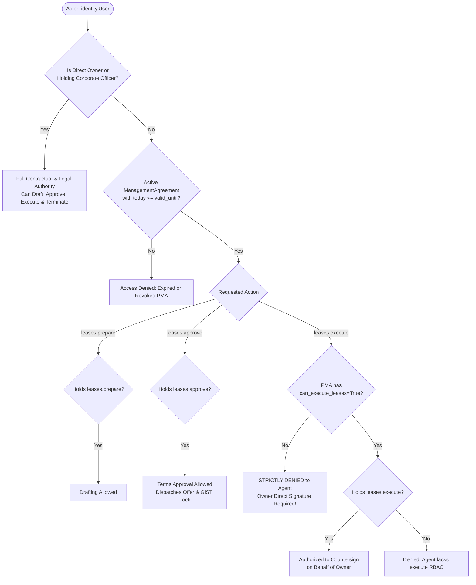
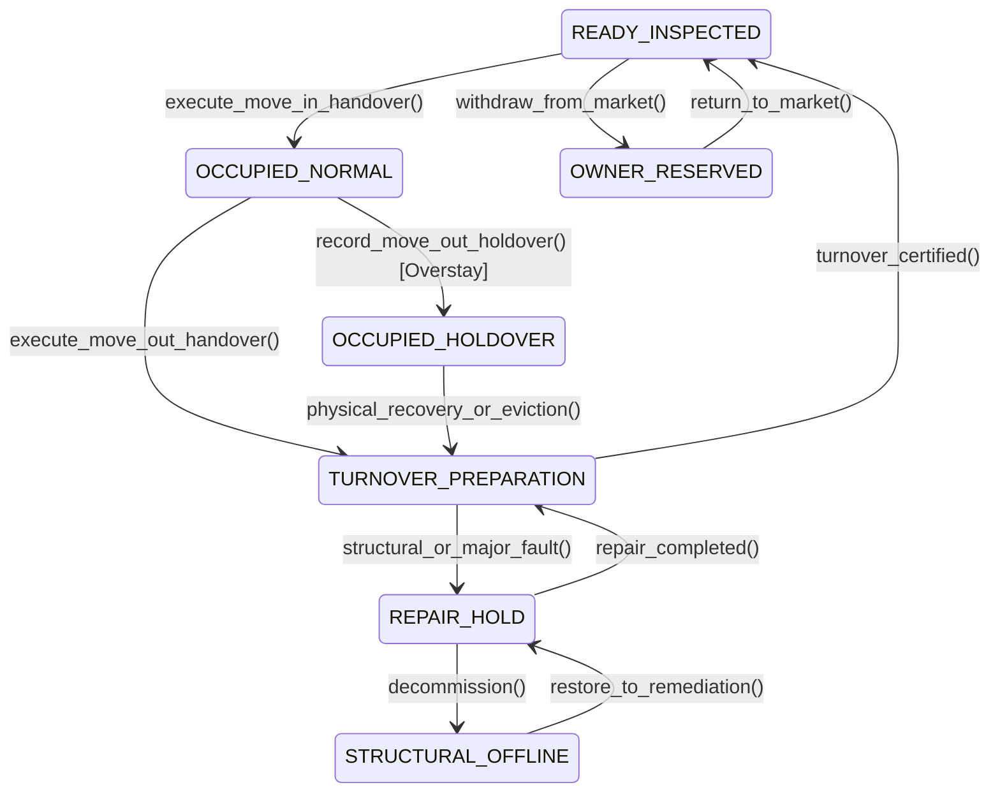
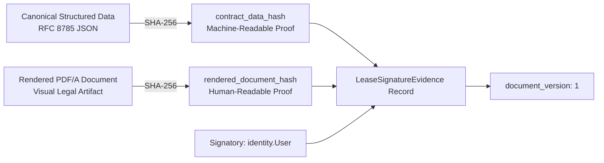

# GLITTERS CORE — Milestone M7-B Architecture Specification: Tenancy Domain & Temporal Lease Engine

**Document Path**: `docs/engineering/M7_B_APPROVED_ARCHITECTURE.md`
**Milestone**: Milestone 7-B (Tenancy Domain & Temporal Occupancy Engine)
**Status**: APPROVED SPECIFICATION (FINAL CONSISTENCY CERTIFICATION)
**Date**: November 12, 2026
**Author**: Principal Software Architect, Senior Database Architect & Lead Application Security Auditor
**Repository**: `glitters-core` ([/home/mr-robot/Projects/glitters-core](file:///home/mr-robot/Projects/glitters-core))
**Companion Documents**:
- [M7_B_IMPLEMENTATION_PLAN.md](file:///home/mr-robot/Projects/glitters-core/docs/engineering/M7_B_IMPLEMENTATION_PLAN.md)
- [M7_B_ARCHITECTURE_CHALLENGE.md](file:///home/mr-robot/Projects/glitters-core/docs/engineering/M7_B_ARCHITECTURE_CHALLENGE.md)
- [M7_A_SECURITY_REMEDIATION_REPORT.md](file:///home/mr-robot/Projects/glitters-core/docs/engineering/M7_A_SECURITY_REMEDIATION_REPORT.md)

---

## 1. Executive Summary & Core Architectural Invariants

Milestone **M7-B** establishes the contractual tenancy domain and temporal occupancy engine for the GLITTERS Property Management Operating System (PMOS). Built as a new modular monolith application (`apps.tenancy`), it provides:

1. **Strict Decoupling of Contractual Execution from Physical Possession**: Execution of future-dated leases occurs independently of unit physical readiness, permitting pre-leasing while an incumbent tenant occupies the unit. Physical possession is governed by the Move-In `HandoverProtocol` only when the unit is certified `READY_INSPECTED`.
2. **Reconciled Authority Separation (Platform Permissions vs. Legally Sufficient Agency)**: Operational management (`operations.manage`) and term approval (`leases.approve`) are distinguished from contractual lease execution (`leases.execute`). Managing agents cannot execute leases on behalf of owners unless the underlying bilateral `ManagementAgreement` explicitly grants `can_execute_leases=True`.
3. **Complete Physical Occupancy State Taxonomy**: Fully accounts for vacant readiness, normal tenant possession (`OCCUPIED_NORMAL`), physical holdovers (`OCCUPIED_HOLDOVER`), turnover, maintenance holds, structural outages, and owner reserves in `UnitPhysicalProfile`, with zero duplication of contractual dates.
4. **Deterministic Temporal Exclusion Engine**: Enforces half-open interval occupancy `[start_date, effective_end_date)` via PostgreSQL `btree_gist` composite indexing (`property_id WITH =, daterange(...) WITH &&`). Supports same-day turnover, open-ended periodic leases, early terminations, and automated signature reservation expiry.
5. **Dual-Evidence Signature Verification**: Digital execution records immutable SHA-256 hashes of both the RFC 8785 canonical structured data (`contract_data_hash`) and the exact rendered legal document artifact (`rendered_document_hash`).
6. **Deadlock-Free Reservation Concurrency**: Deterministic pre-reservation scans expire stale overlapping proposals ordered by `id ASC` under row locks before acquiring GiST exclusion slots, with the PostgreSQL GiST exclusion constraint serving as the final immutable kernel safeguard.

---

## 2. Reconciled Lease Authority Matrix: Agency Law vs. Platform RBAC

Operational property management does **not** confer legal authority to bind property owners to contractual leases.

### 2.1 The Two-Tiered Authority Gate
To execute actions in `apps.tenancy`, an actor must satisfy both:
1. **Tier 1: Legal Agency Mandate (`ManagementAgreement.can_execute_leases`)**: Does the bilateral agreement signed by the verified property owner explicitly grant legal Power of Attorney to execute and terminate leases on the owner's behalf?
2. **Tier 2: Platform RBAC Permission (`apps.organizations`)**: Does the individual user's active membership in the managing firm include the specific granular permission?



### 2.2 Authority Matrix by Operation

| Tenancy Operation | Direct Property Owner | Corporate Holding Officer | Standard Managing Agent (`can_execute_leases=False`) | Mandated Managing Agent (`can_execute_leases=True`) | Tenant |
| :--- | :---: | :---: | :---: | :---: | :---: |
| **Vet Applications (`tenants.vet`)** | Allowed | Allowed | Allowed (if member has `tenants.vet`) | Allowed (if member has `tenants.vet`) | Denied |
| **Prepare / Draft Lease (`leases.prepare`)** | Allowed | Allowed | Allowed (if member has `leases.prepare`) | Allowed (if member has `leases.prepare`) | Denied |
| **Approve Proposed Terms (`leases.approve`)** | Allowed | Allowed | **Allowed** (if member has `leases.approve`) | **Allowed** (if member has `leases.approve`) | Denied |
| **Execute Lease on Owner Behalf (`leases.execute`)** | Allowed (Self) | Allowed (Corporate) | **STRICTLY DENIED** *(Owner must sign directly)* | **Allowed** (if member has `leases.execute`) | Denied |
| **Sign as Tenant** | Denied | Denied | Denied | Denied | **Allowed (Self)** |
| **Propose Lease Amendment (`leases.amend`)** | Allowed | Allowed | Allowed (if member has `leases.amend`) | Allowed (if member has `leases.amend`) | Denied |
| **Execute Lease Amendment (`leases.amend_execute`)** | Allowed | Allowed | **STRICTLY DENIED** *(Owner must sign directly)* | **Allowed** (if member has `leases.execute`) | Denied |
| **Terminate Lease (`leases.terminate`)** | Allowed | Allowed | Denied *(Requires Owner concurrence)* | **Allowed** (if member has `leases.terminate`) | Denied |

### 2.3 Clarification of `leases.approve` vs. `leases.execute`
- **Approving Terms (`leases.approve`)**: A standard managing agent holding `leases.approve` **can** approve draft terms to set the `signature_deadline`, acquire the temporary GiST reservation lock, and dispatch the offer to the prospective tenant.
- **Executing Contracts (`leases.execute`)**: Approving terms does **not** execute the contract. When the tenant signs, the landlord countersignature can only be executed by the managing agent if `can_execute_leases == True`. If `can_execute_leases == False`, the platform routes the countersigning request directly to the Property Owner.

---

## 3. Complete Physical Occupancy Taxonomy (`UnitPhysicalProfile`)

To maintain complete physical separation from contractual tenancy while representing all real-world property states, `UnitPhysicalProfile.physical_state` supports seven exhaustive states:



### 3.1 Physical State Definitions

| Physical State Code | Display Name | Physical Condition & Operational Meaning | Move-In Allowed? |
| :--- | :--- | :--- | :---: |
| **`READY_INSPECTED`** | Ready / Inspected | Vacant, fully cleaned, repairs completed, turnover checklist certified. | **YES** |
| **`OCCUPIED_NORMAL`** | Occupied (Normal) | Tenant holds physical keys and resides in unit following Move-In handover. | **NO** |
| **`OCCUPIED_HOLDOVER`** | Occupied (Holdover) | Contractual lease has ended/terminated, but tenant has failed/refused to return keys. | **NO** |
| **`TURNOVER_PREPARATION`** | Turnover Preparation | Vacant post-tenancy; maintenance, repainting, deep cleaning, or lock-changing in progress. | **NO** |
| **`REPAIR_HOLD`** | Repair Hold | Temporarily offline due to plumbing, electrical, or appliance failures. | **NO** |
| **`STRUCTURAL_OFFLINE`** | Structural Offline | Major renovation, structural damage, water ingress, or uninhabitable condition. | **NO** |
| **`OWNER_RESERVED`** | Owner Reserved | Withdrawn from rental pool for owner private use, staging, or family stay. | **NO** |

### 3.2 Schema Migration (`operations.0002_add_physical_occupancy_states`)
- Updates `PhysicalState` in `apps/operations/domain.py`.
- Migration `0002_add_physical_occupancy_states.py` in `apps.operations`:
  1. Alters check constraint `operations_physical_state_valid` on `operations_unit_physical_profile` to include `OCCUPIED_NORMAL` and `OCCUPIED_HOLDOVER`.
  2. Adds `can_execute_leases = models.BooleanField(default=False)` to `ManagementAgreement`.
- `apps/tenancy/migrations/0001_initial.py` explicitly lists `('operations', '0002_add_physical_occupancy_states')` in its dependencies.

---

## 4. Finalized Reservation Expiry Concurrency & GiST Safeguards

### 4.1 Pre-Reservation Scan & Cleanup
Before acquiring a GiST exclusion slot for a new lease reservation in $[T_{\text{start}}, T_{\text{end}})$:
```python
def clean_stale_reservations_and_reserve(property_record, start_date, effective_end_date):
    with transaction.atomic():
        # 1. Lock overlapping stale pending proposals ordered by ID to prevent deadlocks
        stale_leases = (
            Lease.objects.select_for_update()
            .filter(
                property=property_record,
                status=LeaseStatus.PENDING_SIGNATURE,
                signature_deadline__lte=timezone.now(),  # Exact deadline boundary
            )
            .extra(
                where=["daterange(start_date, effective_end_date, '[)') && daterange(%s, %s, '[)')"],
                params=[start_date, effective_end_date],
            )
            .order_by("id")
        )
        for stale in stale_leases:
            stale.status = LeaseStatus.EXPIRED_UNSIGNED
            stale.cancellation_reason = "Signature deadline elapsed prior to competing reservation."
            stale.save(update_fields=["status", "cancellation_reason", "updated_at"])

        # 2. Proceed to validate and insert the new lease reservation
```

### 4.2 Signature vs. Expiry Race Behavior
1. **Exact Boundary Semantics**:
   - Signature validity interval: $[\text{approved\_at}, \text{signature\_deadline})$.
   - If `timezone.now() >= lease.signature_deadline` $\to$ **EXPIRED**.
   - If `timezone.now() < lease.signature_deadline` $\to$ **VALID**.
2. **Row-Locking Order (`select_for_update`)**:
   - `sign_lease` locks the specific lease row:
     `lease = Lease.objects.select_for_update().get(id=lease_id)`.
   - If the pre-reservation expiry transaction acquires the lock first:
     The lease status is updated to `EXPIRED_UNSIGNED`. When the tenant's transaction unblocks, it reads `status == EXPIRED_UNSIGNED` and aborts with `ValidationError("The signature window for this proposal has expired.")`.
   - If the signing transaction acquires the lock first:
     It verifies `timezone.now() < lease.signature_deadline`. It records signature evidence and transitions status to `FULLY_EXECUTED`. When the expiry transaction later inspects the row, `status != PENDING_SIGNATURE`, so it skips the row.

### 4.3 GiST Exclusion Constraint as the Final Kernel Safeguard
Even if application-level locking were somehow bypassed or misconfigured across multi-threaded or distributed workers, the PostgreSQL kernel GiST index:
```sql
CONSTRAINT tenancy_lease_exclude_overlapping_contractual_leases
EXCLUDE USING gist (
    property_id WITH =,
    daterange(start_date, effective_end_date, '[)') WITH &&
)
WHERE (status IN (
    'pending_signature',
    'fully_executed',
    'active',
    'under_renewal',
    'terminated_normal',
    'terminated_early'
));
```
enforces strict serializability during index page updates. The second transaction immediately triggers a database `IntegrityError` (`conflicting key value violates exclusion constraint`) and rolls back. Overlapping active or pending leases cannot occur.

#### 4.3.1 Historical Reservation Preservation on Early and Normal Termination
Including `terminated_normal` and `terminated_early` in the exclusion constraint is critical for audit and legal integrity:
1. When a lease is terminated early on `actual_termination_date`, the system truncates the internal engine boundary: `effective_end_date = actual_termination_date + 1 day` (the exclusive upper bound of actual possession).
2. Because `status in ('terminated_normal', 'terminated_early')` is indexed by GiST, the historical occupancy interval $[start\_date, effective\_end\_date)$ remains permanently reserved in PostgreSQL, preventing fraudulent or erroneous insertion of backdated overlapping leases.
3. Simultaneously, future calendar dates $[effective\_end\_date, \infty)$ are immediately released, allowing replacement leases to be drafted, approved, and executed from $actual\_termination\_date$ onward without exclusion conflict.

---

## 5. Dual-Evidence Signature Architecture

Digital execution records two distinct, immutable cryptographic evidence values:



### 5.1 Dual-Hash Definitions
1. **`contract_data_hash`** (`CharField(max_length=64)`):
   SHA-256 hash computed over the **RFC 8785 JSON Canonicalization Scheme (JCS)** structured contract payload:
   - Canonical property identity and address.
   - Agreed contractual dates: `start_date`, `term_end_date`, `payment_due_day`.
     > [!IMPORTANT]
     > `effective_end_date` is an internal temporal database engine boundary (`term_end_date + 1 day` or `actual_termination_date + 1 day` for half-open intervals). It is **strictly excluded** from the canonical contractual JSON payload and hash. The signed payload and dual hashes reflect the bilateral terms agreed upon by the parties and remain permanently immutable post-termination, even when `effective_end_date` is truncated upon early termination.
   - Financial obligations: `rent_amount_minor`, `deposit_amount_minor`, `service_charge_minor`, `currency`.
   - Parties roster: Landlords, managing agents, primary tenants, co-tenants, guarantors, occupants, national IDs.
   - Standard clauses version string and verbatim custom special covenants.
   - Full rent schedule projection summary.
2. **`rendered_document_hash`** (`CharField(max_length=64)`):
   SHA-256 hash computed over the exact byte sequence of the rendered legal PDF/A document presented on screen to the signatory at the time of execution.
   Tied to an immutable storage URI: `rendered_document_uri = CharField(max_length=255)` (e.g. `docs/contracts/2026/LSE-2026-0042-v1.pdf`).

### 5.2 Signature Binding & Invalidation
- **Binding**: `LeaseSignatureEvidence` stores:
  `lease_id`, `party_id`, `signatory_user_id`, `document_version`, `contract_data_hash`, `rendered_document_hash`, `rendered_document_uri`, `signature_method`, `ip_address`, `user_agent`, `signed_at`, `idempotency_key`.
- **Pre-Execution Invalidation**: If any field in the structured contract data or rendered document changes prior to full execution:
  - `lease.document_version += 1`
  - Both hashes are recomputed.
  - All existing `LeaseParty.signature_status` reset to `INVALIDATED`.
  - Prior signatures cannot satisfy execution of the new version.
- **Post-Execution Immutability**: Once `status in (FULLY_EXECUTED, ACTIVE)`, both structured terms and rendered documents are strictly immutable. Variations require a formal bilateral `LeaseAmendment` with its own dual hashes.

---

## 6. Formalized Renewal & Holdover Lifecycle

1. **Renewal Negotiation**: Incumbent lease remains `ACTIVE`. Parties discuss terms via messages/enquiries.
2. **Renewal Proposal**:
   - Incumbent lease mutates: `Lease A.status = UNDER_RENEWAL`.
   - Replacement lease created: `Lease B.status = PENDING_SIGNATURE`, `start_date = Lease A.term_end_date + 1 day`, `supersedes_lease = Lease A`.
   - In PostgreSQL, $[2026-01-01, 2027-01-01)$ and $[2027-01-01, 2028-01-01)$ do not overlap. Both records coexist safely in GiST.
3. **Renewal Execution**: Both parties sign `Lease B`. `Lease B.status = FULLY_EXECUTED`.
4. **Commencement**: On `2027-01-01`, `Lease A` becomes `TERMINATED_NORMAL` (superseded), and `Lease B` becomes `ACTIVE`.
5. **Physical Holdover Scenario**:
   - If tenant fails to vacate upon lease termination:
   - `Lease A.status = TERMINATED_NORMAL`.
   - `UnitPhysicalProfile.physical_state = OCCUPIED_HOLDOVER`.
   - Move-in handover for `Lease B` is safely blocked until turnover reaches `READY_INSPECTED`.

---

## 7. Reconciled Models Inventory (`apps.tenancy`)

1. **`RentalApplication`**: Prospective tenant screening and pre-qualification.
2. **`Lease`**: Authoritative bilateral contract governed by PostgreSQL GiST exclusion constraint on canonical units (`hierarchy_role in [UNIT, STANDALONE]`).
3. **`LeaseParty`**: Multi-signatory membership (`PRIMARY_TENANT`, `CO_TENANT`, `GUARANTOR`, `LANDLORD`, `MANAGING_AGENT`, `AUTHORIZED_OCCUPANT`).
4. **`LeaseSignatureEvidence`**: Immutable execution log capturing both `contract_data_hash` and `rendered_document_hash`.
5. **`LeaseAmendment`**: Formal bilateral variation of terms for executed leases.
6. **`RentScheduleEntry`**: Deterministic contractual rent demand schedule (pure obligation; zero payment processing).
7. **`DepositObligation`**: Contractual security deposit liability.
8. **`DepositDeduction`**: Itemized damage, cleaning, or holdover claims against deposit.
9. **`HandoverProtocol`**: Move-in/move-out condition and key custody protocol.
10. **`TenancyEvent`**: Tamper-evident, append-only operational audit log.
