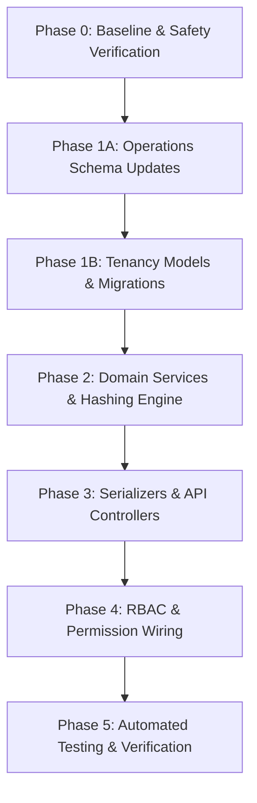

# GLITTERS CORE — Milestone M7-B Implementation Plan: Tenancy Domain & Temporal Lease Engine

**Document Path**: `docs/engineering/M7_B_IMPLEMENTATION_PLAN.md`
**Milestone**: Milestone 7-B (Tenancy Domain & Temporal Occupancy Engine)
**Status**: APPROVED IMPLEMENTATION PLAN (FINAL CONSISTENCY CERTIFICATION)
**Date**: November 12, 2026
**Author**: Principal Software Architect & Senior Backend Engineer
**Repository**: `glitters-core` ([/home/mr-robot/Projects/glitters-core](file:///home/mr-robot/Projects/glitters-core))
**Companion Documents**:
- [M7_B_APPROVED_ARCHITECTURE.md](file:///home/mr-robot/Projects/glitters-core/docs/engineering/M7_B_APPROVED_ARCHITECTURE.md)
- [M7_B_ARCHITECTURE_CHALLENGE.md](file:///home/mr-robot/Projects/glitters-core/docs/engineering/M7_B_ARCHITECTURE_CHALLENGE.md)
- [M7_A_SECURITY_REMEDIATION_REPORT.md](file:///home/mr-robot/Projects/glitters-core/docs/engineering/M7_A_SECURITY_REMEDIATION_REPORT.md)

---

## 1. Executive Summary & Delivery Scope

Milestone **M7-B** implements the tenancy application (`apps.tenancy`) and incorporates all final consistency reconciliations:
1. **Schema Prerequisites**: Migration `operations.0002_add_physical_occupancy_states` adding `OCCUPIED_NORMAL` and `OCCUPIED_HOLDOVER` to `UnitPhysicalProfile` and `can_execute_leases` to `ManagementAgreement`.
2. **`apps.tenancy` Application Skeleton**: 10 cohesive domain models including `LeaseParty` and `LeaseSignatureEvidence`.
3. **PostgreSQL GiST Date-Range Exclusion**: Enforces non-overlapping half-open intervals $[start\_date, effective\_end\_date)$ with support for same-day turnover and open-ended periodic leases.
4. **Dual-Evidence Signature Verification**: Captures both RFC 8785 canonical data hash (`contract_data_hash`) and rendered legal document hash (`rendered_document_hash`).
5. **Deadlock-Free Stale Reservation Expiry**: In-line transactional scan ordered by `id ASC` expiring stale `PENDING_SIGNATURE` proposals before acquiring new GiST slots.
6. **Reconciled Authority Separation**: Platform permissions (`leases.prepare`, `leases.approve`, `leases.execute`) reconciled with underlying legal agency (`can_execute_leases`).
7. **Comprehensive Automated Test Suite**: Targeting $\ge 50$ tests covering all edge cases, multi-party signing, same-day turnover, and holdover decoupling.

---

## 2. Phase-by-Phase Implementation Sequence



---

### Phase 0 — Baseline Verification & Safety Gates

1. Verify git branch: `feature/media-infrastructure`.
2. Verify all M6 and M7-A working-tree modifications and untracked files remain intact.
3. Confirm PostgreSQL extensions: `postgis` and `btree_gist` active.
4. Verify M7-A security invariants:
   - Direct owner provenance (`origin=AccessOrigin.DIRECT`).
   - Real-time agreement expiry (`decide()`, `check_operations_authority()`).
   - Append-only event immutability on `OperationsEvent`.

---

### Phase 1 — Database Migrations & Model Definitions

#### Step 1.1: Operations Schema Prerequisites (`apps.operations`)
1. Update `PhysicalState` in `apps/operations/domain.py`:
   - Add `OCCUPIED_NORMAL = "OCCUPIED_NORMAL"`.
   - Add `OCCUPIED_HOLDOVER = "OCCUPIED_HOLDOVER"`.
   - Update `PHYSICAL_STATE_TRANSITIONS`.
2. Update `ManagementAgreement` in `apps/operations/models.py`:
   - Add `can_execute_leases = models.BooleanField(default=False)`.
3. Create migration `apps/operations/migrations/0002_add_physical_occupancy_states.py`:
   - Update check constraint `operations_physical_state_valid`.
   - Add field `can_execute_leases` to `ManagementAgreement`.
4. Apply migration to local development database.

#### Step 1.2: Register Tenancy Application
Add `"apps.tenancy"` to `LOCAL_APPS` in `config/settings/base.py`.

#### Step 1.3: Tenancy Domain Models (`apps/tenancy/models.py`)
Implement the 10 models:
1. `RentalApplication`
2. `Lease` (with PostgreSQL `ExclusionConstraint` on `btree_gist`)
3. `LeaseParty`
4. `LeaseSignatureEvidence` (storing `contract_data_hash`, `rendered_document_hash`, `rendered_document_uri`)
5. `LeaseAmendment`
6. `RentScheduleEntry`
7. `DepositObligation`
8. `DepositDeduction`
9. `HandoverProtocol`
10. `TenancyEvent` (inheriting `AppendOnlyQuerySet`)

#### Step 1.4: Initial Tenancy Migration (`apps/tenancy/migrations/0001_initial.py`)
- Dependencies:
  ```python
  dependencies = [
      ("core", "0002_enable_btree_gist"),
      ("identity", "0002_identity_authentication"),
      ("organizations", "0001_initial"),
      ("properties", "0002_access_provenance"),
      ("operations", "0002_add_physical_occupancy_states"),
  ]
  ```
- Apply migration; verify GiST constraint in `pg_constraint`.

---

### Phase 2 — Domain Services & Contractual Logic

#### `apps/tenancy/services/authority.py`
- `verify_tenancy_authority(user, property_record, required_action) -> None`:
  - Direct owner / corporate holding officer: full authority.
  - Managing agent with active agreement:
    - If `required_action == "PREPARE"`: requires `leases.prepare`.
    - If `required_action == "APPROVE"`: requires `leases.approve`. (Allowed for standard agent!).
    - If `required_action == "EXECUTE"`: strictly requires `agreement.can_execute_leases == True` AND user holds `leases.execute`. If `can_execute_leases == False`, raises `PermissionDenied("Managing agent does not hold legal lease execution mandate for this property.")`.

#### `apps/tenancy/services/document.py`
- `build_canonical_contract_data(lease) -> dict`: Builds RFC 8785 canonical dictionary covering agreed terms (`start_date`, `term_end_date`, `payment_due_day`, financial amounts, parties), strictly omitting internal engine boundary `effective_end_date`.
- `compute_contract_data_hash(lease) -> str`: RFC 8785 JSON canonicalization + SHA-256. Remains immutable across the lease lifecycle, including after early termination.
- `render_contract_pdf(lease) -> bytes`: Generates visual PDF/A artifact.
- `compute_rendered_document_hash(pdf_bytes) -> str`: SHA-256 over exact document bytes.

#### `apps/tenancy/services/leases.py`
- `create_draft_lease(user, property_id, payload) -> Lease`
- `approve_lease_terms(user, lease_id, deadline_hours=72) -> Lease`:
  - Executes pre-reservation scan: transactional expiry of overlapping stale `PENDING_SIGNATURE` leases ordered by `id ASC`.
  - Generates initial dual hashes: `contract_data_hash` and `rendered_document_hash`.
  - Sets `signature_deadline` and transitions status to `PENDING_SIGNATURE`.
- `sign_lease(user, lease_id, signature_method, ip_address, user_agent) -> Lease`:
  - `select_for_update()` row lock.
  - Evaluates deadline boundary: `if timezone.now() >= lease.signature_deadline: raise ValidationError`.
  - Verifies signatory role and authority.
  - Verifies current dual hashes.
  - Records immutable `LeaseSignatureEvidence`.
  - If all mandatory parties signed: transitions status to `FULLY_EXECUTED`.
- `terminate_lease(user, lease_id, termination_type, effective_date, reason) -> Lease`:
  - Records `actual_termination_date = effective_date`.
  - Truncates database engine interval `effective_end_date = effective_date + 1 day` (preserving original agreed `term_end_date` and `contract_data_hash` unchanged).
  - Transitions status to `TERMINATED_EARLY` (or `TERMINATED_NORMAL`), retaining historical GiST exclusion protection over $[start\_date, effective\_end\_date)$ while immediately releasing subsequent dates for future leasing.
  - Cancels future scheduled rent entries.
  - Updates `UnitPhysicalProfile.physical_state = TURNOVER_PREPARATION`.

#### `apps/tenancy/services/handovers.py`
- `create_move_in_handover(user, lease_id, payload) -> HandoverProtocol`:
  - Precondition: `UnitPhysicalProfile.physical_state == READY_INSPECTED`.
- `sign_move_in_handover(user, protocol_id) -> HandoverProtocol`:
  - Updates `UnitPhysicalProfile.physical_state = OCCUPIED_NORMAL`. Keys delivered!
- `record_move_out_holdover(user, lease_id, notes) -> None`:
  - Updates `UnitPhysicalProfile.physical_state = OCCUPIED_HOLDOVER`.

---

### Phase 3 — REST API Endpoints (`/api/v1/tenancy/`)

Implement controllers in `apps/tenancy/views.py`:
- `GET, POST /api/v1/tenancy/applications/`
- `POST /api/v1/tenancy/applications/<id>/vet/`
- `GET, POST /api/v1/tenancy/leases/`
- `GET, PATCH /api/v1/tenancy/leases/<id>/`
- `POST /api/v1/tenancy/leases/<id>/approve/`
- `POST /api/v1/tenancy/leases/<id>/sign/`
- `POST /api/v1/tenancy/leases/<id>/terminate/`
- `GET /api/v1/tenancy/leases/<id>/schedules/`
- `POST /api/v1/tenancy/leases/<id>/amendments/`
- `GET, POST /api/v1/tenancy/leases/<id>/handovers/`
- `POST /api/v1/tenancy/handovers/<id>/sign/`

---

### Phase 4 — RBAC Wiring (`apps/organizations/domain.py`)

Add to `Permission`:
- `LEASES_VIEW = "leases.view"`
- `LEASES_PREPARE = "leases.prepare"`
- `LEASES_APPROVE = "leases.approve"`
- `LEASES_EXECUTE = "leases.execute"`
- `LEASES_TERMINATE = "leases.terminate"`
- `TENANTS_VET = "tenants.vet"`

Update role matrix:
- `OWNER`, `ADMIN`: Granted all tenancy permissions.
- `MANAGER`: Granted `leases.view`, `leases.prepare`, `leases.approve`, `tenants.vet` (grants `leases.execute` only if organization policy permits).
- `MEMBER`: Granted `leases.view`.

---

### Phase 5 — Automated Test Matrix ($\ge 50$ Tests)

1. **Reconciled Authority Tests**:
   - Standard agent with `leases.approve` can approve terms and dispatch offer.
   - Standard agent without `can_execute_leases` is strictly blocked from executing lease on owner behalf.
   - Owner direct signature succeeds when agent lacks execution mandate.
2. **Dual-Evidence Hashing Tests**:
   - `contract_data_hash` and `rendered_document_hash` are generated and stored on signature evidence.
   - Pre-execution term modification invalidates prior signatures.
   - Post-execution modification blocked by immutability constraints.
3. **Reservation Concurrency Tests**:
   - Pre-reservation scan expires stale overlapping reservations ordered by `id ASC`.
   - Racing signature request against deadline is serialized via row locks.
   - PostgreSQL GiST exclusion constraint blocks overlapping reservations at database kernel level.
4. **Physical Taxonomy & Holdover Tests**:
   - Unit transitions through `READY_INSPECTED` $\to$ `OCCUPIED_NORMAL` $\to$ `OCCUPIED_HOLDOVER` $\to$ `TURNOVER_PREPARATION`.
   - Move-in handover blocked while unit is in `OCCUPIED_HOLDOVER`.
5. **Same-Day Turnover & Renewal Tests**:
   - Consecutive half-open intervals succeed without collision.
   - Renewal replacement lease executes while incumbent is in `UNDER_RENEWAL`.
