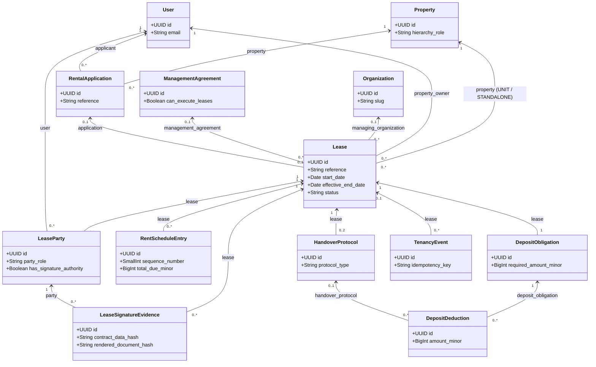

# GLITTERS CORE — Milestone M7-B Phase 1 Completion Report: Tenancy Domain Foundation

**Document Path**: `docs/engineering/M7_B_PHASE1_COMPLETION_REPORT.md`
**Milestone**: Milestone 7-B (Tenancy Domain & Temporal Occupancy Engine — Phase 1 Foundation)
**Status**: COMPLETE & VERIFIED
**Date**: November 12, 2026
**Author**: Principal Software Architect & Senior Backend Engineer
**Repository**: `glitters-core` ([/home/mr-robot/Projects/glitters-core](file:///home/mr-robot/Projects/glitters-core))
**Companion Documents**:
- [M7_B_APPROVED_ARCHITECTURE.md](file:///home/mr-robot/Projects/glitters-core/docs/engineering/M7_B_APPROVED_ARCHITECTURE.md)
- [M7_B_IMPLEMENTATION_PLAN.md](file:///home/mr-robot/Projects/glitters-core/docs/engineering/M7_B_IMPLEMENTATION_PLAN.md)
- [M7_B_ARCHITECTURE_CHALLENGE.md](file:///home/mr-robot/Projects/glitters-core/docs/engineering/M7_B_ARCHITECTURE_CHALLENGE.md)

---

## 1. Executive Summary

Phase 1 of Sub-Milestone **M7-B (Tenancy Domain Foundation)** has been successfully implemented and verified in accordance with all non-negotiable repository rules and architectural specifications:

1. **Operations Schema Extension**: Prerequisite migration `operations.0002_add_physical_occupancy_states` introduces `OCCUPIED_NORMAL` and `OCCUPIED_HOLDOVER` to `UnitPhysicalProfile.physical_state` and adds `can_execute_leases = BooleanField(default=False)` to `ManagementAgreement`.
2. **`apps.tenancy` Domain Skeleton**: Successfully bootstrapped and registered in `config/settings/base.py`, implementing 10 cohesive models without duplicating canonical identity, organization, or property assets.
3. **Temporal Occupancy Engine**: Implemented PostgreSQL GiST exclusion constraint on `(property_id WITH =, daterange(start_date, effective_end_date, '[)') WITH &&)` for occupancy-reserving statuses (`PENDING_SIGNATURE`, `FULLY_EXECUTED`, `ACTIVE`, `UNDER_RENEWAL`). Tested and verified in PostgreSQL for same-day turnover, open-ended periodic tenancies, consecutive renewals, and overlap rejections.
4. **Multi-Party Tenancy & Digital Signatures**: Implemented `LeaseParty` with role constraints and `LeaseSignatureEvidence` capturing dual hashes (`contract_data_hash` and `rendered_document_hash`).
5. **Contractual Financial Obligations**: Modeled rent schedules and deposit obligations in integer minor currency units (`BigIntegerField`, `KES`) with strict mathematical check constraints and zero cash payment/shadow accounting columns.
6. **Append-Only Auditing**: Implemented `TenancyEvent` managed by `AppendOnlyQuerySet` with SHA-256 idempotency key deduplication.
7. **Verification**: Full repository test suite passes with **325 passed tests** (0 failed, 0 errors, 0 skipped), achieving **88% overall code coverage** (96% on `apps/tenancy/models.py`). Migrations generated and inspected via `sqlmigrate`; development database preserved unapplied pending review.

---

## 2. Models Implemented (`apps.tenancy`)

| # | Model Name | Table Name | Purpose & Domain Invariant |
| :--- | :--- | :--- | :--- |
| 1 | **`RentalApplication`** | `tenancy_rental_application` | Prospective tenant screening application capturing income, employment, and IDs without reserving occupancy. |
| 2 | **`Lease`** | `tenancy_lease` | Authoritative bilateral contract between landlord and tenant. Governed by PostgreSQL GiST exclusion constraint on canonical property units. |
| 3 | **`LeaseParty`** | `tenancy_lease_party` | Multi-signatory membership linking `identity.User` to `Lease` with role permissions (`PRIMARY_TENANT`, `CO_TENANT`, `GUARANTOR`, `LANDLORD`, `MANAGING_AGENT`, `AUTHORIZED_OCCUPANT`). |
| 4 | **`LeaseSignatureEvidence`** | `tenancy_signature_evidence` | Immutable audit log capturing dual hashes (`contract_data_hash` and `rendered_document_hash`), IP address, user agent, and timestamp. |
| 5 | **`LeaseAmendment`** | `tenancy_lease_amendment` | Formal bilateral variation of terms for executed leases. |
| 6 | **`RentScheduleEntry`** | `tenancy_rent_schedule_entry` | Deterministic contractual rent demand schedule (pure obligation; zero cash processing). |
| 7 | **`DepositObligation`** | `tenancy_deposit_obligation` | Contractual security deposit liability established by a lease. |
| 8 | **`DepositDeduction`** | `tenancy_deposit_deduction` | Itemized contractual claim against deposit upon move-out. |
| 9 | **`HandoverProtocol`** | `tenancy_handover_protocol` | Bilateral condition inspection and key handover documentation at Move-In and Move-Out. |
| 10 | **`TenancyEvent`** | `tenancy_event` | Tamper-evident, append-only operational audit event log. |

---

## 3. Model Relationships & Canonical Entity Integration



---

## 4. Database Constraints Inventory

### 4.1 Temporal Exclusion Constraint (`tenancy_lease`)
```python
ExclusionConstraint(
    name="tenancy_lease_exclude_overlapping_contractual_leases",
    expressions=[
        ("property_id", RangeOperators.EQUAL),
        (DateRange(F("start_date"), F("effective_end_date"), Value("[)")), RangeOperators.OVERLAPS),
    ],
    condition=models.Q(status__in=sorted(LeaseStatus.OCCUPANCY_RESERVING)),
)
```
- **Constraint Name**: `tenancy_lease_exclude_overlapping_contractual_leases`
- **Expressions**: `("property_id" WITH =, (daterange("start_date", "effective_end_date", '[)')) WITH &&)`
- **Predicate Condition**: `WHERE ("status" IN ('active', 'fully_executed', 'pending_signature', 'under_renewal'))`

### 4.2 Check Constraints Summary

| Model | Constraint Name | Condition / Invariant Enforced |
| :--- | :--- | :--- |
| `UnitPhysicalProfile` | `operations_physical_state_valid` | Enforces `physical_state IN ('READY_INSPECTED', 'OCCUPIED_NORMAL', 'OCCUPIED_HOLDOVER', 'TURNOVER_PREPARATION', 'REPAIR_HOLD', 'STRUCTURAL_OFFLINE', 'OWNER_RESERVED')`. |
| `RentalApplication` | `tenancy_app_monthly_income_non_neg` | `monthly_income_minor >= 0` |
| `RentalApplication` | `tenancy_app_term_months_range` | `proposed_term_months >= 1 AND proposed_term_months <= 120` |
| `RentalApplication` | `tenancy_app_status_valid` | Valid status choices |
| `Lease` | `tenancy_lease_effective_end_after_start` | `effective_end_date IS NULL OR effective_end_date > start_date` |
| `Lease` | `tenancy_lease_term_end_gte_start` | `term_end_date IS NULL OR term_end_date >= start_date` |
| `Lease` | `tenancy_lease_rent_positive` | `rent_amount_minor > 0` |
| `Lease` | `tenancy_lease_deposit_non_negative` | `deposit_amount_minor >= 0` |
| `Lease` | `tenancy_lease_service_charge_non_negative`| `service_charge_minor >= 0` |
| `Lease` | `tenancy_lease_payment_due_day_range` | `payment_due_day >= 1 AND payment_due_day <= 28` |
| `Lease` | `tenancy_lease_grace_period_range` | `grace_period_days >= 0 AND grace_period_days <= 30` |
| `Lease` | `tenancy_lease_status_valid` | Valid status choices |
| `LeaseParty` | `tenancy_party_occupant_no_sig_auth` | `party_role != 'authorized_occupant' OR has_signature_authority == False` |
| `LeaseParty` | `tenancy_lease_party_unique_role` | `UniqueConstraint(lease, user, party_role)` |
| `LeaseAmendment` | `tenancy_amendment_new_rent_positive` | `new_rent_amount_minor > 0` |
| `LeaseAmendment` | `tenancy_amendment_end_date_valid` | `new_effective_end_date IS NULL OR new_effective_end_date > effective_date` |
| `RentScheduleEntry`| `tenancy_rent_schedule_seq_unique` | `UniqueConstraint(lease, sequence_number)` |
| `RentScheduleEntry`| `tenancy_rent_schedule_period_valid` | `period_end >= period_start` |
| `RentScheduleEntry`| `tenancy_rent_schedule_total_matches`| `total_due_minor == base_rent_minor + service_charge_minor` |
| `RentScheduleEntry`| `tenancy_rent_schedule_base_rent_positive`| `base_rent_minor > 0` |
| `RentScheduleEntry`| `tenancy_rent_schedule_service_charge_non_neg`| `service_charge_minor >= 0` |
| `DepositObligation`| `tenancy_deposit_required_non_negative`| `required_amount_minor >= 0` |
| `DepositDeduction` | `tenancy_deposit_deduction_amount_positive`| `amount_minor > 0` |
| `HandoverProtocol` | `tenancy_handover_one_per_type` | `UniqueConstraint(lease, protocol_type)` |
| `TenancyEvent` | `tenancy_event_action_valid` | Valid event action choices |

---

## 5. Migration Contents & Dependencies

### 5.1 Prerequisite Migration: `apps/operations/migrations/0002_add_physical_occupancy_states.py`
- **Dependencies**: `[('operations', '0001_initial'), ('properties', '0002_access_provenance')]`
- **Operations**:
  1. `RemoveConstraint(model_name='unitphysicalprofile', name='operations_physical_state_valid')`
  2. `AddField(model_name='managementagreement', name='can_execute_leases', field=BooleanField(default=False))`
  3. `AlterField(model_name='unitphysicalprofile', name='physical_state', choices=...)`
  4. `AddConstraint(model_name='unitphysicalprofile', constraint=CheckConstraint(name='operations_physical_state_valid'))`

### 5.2 Initial Tenancy Migration: `apps/tenancy/migrations/0001_initial.py`
- **Dependencies**:
  ```python
  dependencies = [
      ("core", "0002_enable_btree_gist"),
      ("operations", "0002_add_physical_occupancy_states"),
      ("organizations", "0001_initial"),
      ("properties", "0002_access_provenance"),
      migrations.swappable_dependency(settings.AUTH_USER_MODEL),
  ]
  ```
- **Operations**: Creates all 10 models, foreign keys, indexes, check constraints, unique constraints, and the GiST exclusion constraint.

---

## 6. Generated SQL Review (`sqlmigrate`)

### 6.1 `operations.0002_add_physical_occupancy_states`
```sql
BEGIN;
ALTER TABLE "operations_unit_physical_profile" DROP CONSTRAINT "operations_physical_state_valid";
ALTER TABLE "operations_management_agreement" ADD COLUMN "can_execute_leases" boolean DEFAULT false NOT NULL;
ALTER TABLE "operations_management_agreement" ALTER COLUMN "can_execute_leases" DROP DEFAULT;
ALTER TABLE "operations_unit_physical_profile" ADD CONSTRAINT "operations_physical_state_valid"
  CHECK ("physical_state" IN ('OCCUPIED_HOLDOVER', 'OCCUPIED_NORMAL', 'OWNER_RESERVED', 'READY_INSPECTED', 'REPAIR_HOLD', 'STRUCTURAL_OFFLINE', 'TURNOVER_PREPARATION'));
COMMIT;
```

### 6.2 Key SQL Extract for `tenancy.0001_initial`
```sql
-- PostgreSQL GiST Exclusion Constraint on tenancy_lease:
ALTER TABLE "tenancy_lease" ADD CONSTRAINT "tenancy_lease_exclude_overlapping_contractual_leases"
  EXCLUDE USING GIST ("property_id" WITH =, (daterange("start_date", "effective_end_date", '[)')) WITH &&)
  WHERE ("status" IN ('active', 'fully_executed', 'pending_signature', 'under_renewal'));
```

---

## 7. Automated Test Results & Code Coverage

### 7.1 New Tenancy Tests Execution Summary
- `pytest tests/unit/test_tenancy_domain.py tests/integration/test_tenancy_models.py`
- **19 passed in 10.10s** (6 unit tests, 13 integration tests).

#### Key Test Scenarios Verified:
- Same-day turnover: `[2026-01-01, 2026-01-31)` and `[2026-01-31, 2026-02-28)` on the same unit coexist without exclusion conflict.
- GiST overlap rejection: `[2026-01-15, 2026-02-15)` overlapping with `[2026-01-01, 2026-02-01)` on the same unit raises `IntegrityError: conflicting key value violates exclusion constraint "tenancy_lease_exclude_overlapping_contractual_leases"`.
- Different units with identical dates succeed without collision.
- Open-ended periodic lease `[start_date, NULL)` blocks subsequent overlapping leases.
- Consecutive renewal replacement lease `[2027-01-01, 2028-01-01)` coexists with incumbent lease `[2026-01-01, 2027-01-01)` in `UNDER_RENEWAL`.
- Non-reserving statuses (`DRAFT`, `CANCELLED`, `EXPIRED_UNSIGNED`, `TERMINATED_NORMAL`, `TERMINATED_EARLY`) do not trigger exclusion violations.
- Occupant with signature authority rejected by `tenancy_party_occupant_no_sig_auth`.
- Dual signature evidence hashes (`contract_data_hash`, `rendered_document_hash`) captured.
- Append-only `TenancyEvent` blocks `.update()`, `.bulk_update()`, `.delete()`, and `.save()`.

### 7.2 Full Repository Test Suite Regression Results
Executed: `.venv/bin/pytest --cov=apps --cov=config`

```
============================= test session starts ==============================
platform linux -- Python 3.14.4, pytest-9.2.0, pluggy-1.7.0
django: version: 5.2.19, settings: config.settings.development
rootdir: /home/mr-robot/Projects/glitters-core
collected 325 items

325 passed in 67.72s (0:01:07)

---------- coverage: platform linux, python 3.14.4 ----------
apps/tenancy/apps.py                      6      0   100%
apps/tenancy/domain.py                  175      0   100%
apps/tenancy/migrations/0001_initial.py  12      0   100%
apps/tenancy/models.py                  254      9    96%
TOTAL                                 10931   1290    88%
======================== 325 passed in 67.72s (0:01:07) ========================
```

**Zero regressions detected across M2, M3, M4, M5, M6, and M7-A.**

---

## 8. Git Working-Tree Status

Command output (`git status --short`):
```
 M apps/marketplace/domain.py
 M apps/marketplace/filters.py
 M apps/marketplace/models.py
 M apps/marketplace/serializers.py
 M apps/marketplace/services/access.py
 M apps/marketplace/services/representation.py
 M apps/marketplace/urls.py
 M apps/marketplace/views.py
 M apps/organizations/domain.py
 M apps/properties/services/authorization.py
 M config/settings/base.py
 M config/urls.py
 M docs/api/V1.md
 M docs/architecture/RBAC_ARCHITECTURE.md
 M tests/conftest.py
 M tests/integration/test_organizations_api.py
 M tests/unit/test_organizations_domain.py
?? apps/core/migrations/0002_enable_btree_gist.py
?? apps/marketplace/migrations/0003_enquiry_enquiryevent_and_more.py
?? apps/marketplace/services/enquiries.py
?? apps/marketplace/throttles.py
?? apps/operations/
?? apps/solutions/
?? apps/tenancy/
?? docs/engineering/ECOSYSTEM_TRACEABILITY.md
?? docs/engineering/M6_BASELINE_RECONCILIATION.md
?? docs/engineering/M7_APPROVED_ARCHITECTURE.md
?? docs/engineering/M7_ARCHITECTURE_CHALLENGE.md
?? docs/engineering/M7_A_COMPLETION_REPORT.md
?? docs/engineering/M7_A_SECURITY_REMEDIATION_REPORT.md
?? docs/engineering/M7_B_APPROVED_ARCHITECTURE.md
?? docs/engineering/M7_B_ARCHITECTURE_CHALLENGE.md
?? docs/engineering/M7_B_IMPLEMENTATION_PLAN.md
?? docs/engineering/M7_B_PHASE1_COMPLETION_REPORT.md
?? docs/engineering/M7_IMPLEMENTATION_PLAN.md
?? docs/engineering/M7_PROPERTY_MANAGEMENT_ARCHITECTURE.md
?? docs/engineering/SOLUTIONS_READINESS.md
?? tests/integration/test_enquiry_inbox.py
?? tests/integration/test_enquiry_lifecycle.py
?? tests/integration/test_operations_api.py
?? tests/integration/test_public_enquiries.py
?? tests/integration/test_solutions_workflows.py
?? tests/integration/test_tenancy_models.py
?? tests/security/test_operations_security.py
?? tests/unit/test_enquiry_access.py
?? tests/unit/test_enquiry_input.py
?? tests/unit/test_enquiry_persistence.py
?? tests/unit/test_operations_domain.py
?? tests/unit/test_operations_services.py
?? tests/unit/test_solutions_domain.py
?? tests/unit/test_tenancy_domain.py
```

- Zero commits created; uncommitted working tree preserved.
- All M6 and M7-A changes preserved intact.
- Migration check: `python manage.py makemigrations --check --dry-run` reports **"No changes detected"**.
- System check: `python manage.py check` reports **"System check identified no issues (0 silenced)"**.

---

## 9. Outstanding Issues & Phase 2 Readiness

There are **zero unresolved blockers** for Phase 1.

### Scope Boundary for Next Sub-Milestone:
- **Phase 1 Scope Completed**: Models, database constraints, operations prerequisite migration, tenancy migration, domain constants, and automated database constraint tests.
- **Phase 2 Scope (Pending Authorization)**: Domain service layer (`apps/tenancy/services/authority.py`, `leases.py`, `document.py`, `schedules.py`, `handovers.py`, `amendments.py`).
- **Phase 3 Scope**: REST API endpoints, serializers, and permission filters under `/api/v1/tenancy/`.
- **Phase 4 Scope**: RBAC wiring in `apps/organizations/domain.py`.
- **Phase 5 Scope**: Full integration & end-to-end security verification.

---

### Phase 1 Sign-Off Verdict: **`PHASE 1 COMPLETE — READY FOR PHASE 2`**
