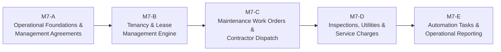

# M7 — Property Management Operating System: Implementation Plan

**Document Path**: `docs/engineering/M7_IMPLEMENTATION_PLAN.md`
**Milestone**: Milestone 7 (Engineering Phasing & Implementation Roadmap)
**Date**: November 12, 2026
**Status**: APPROVED IMPLEMENTATION PLAN
**Author**: Principal Software Architect & Lead Backend Engineer
**Repository**: `glitters-core` ([/home/mr-robot/Projects/glitters-core](file:///home/mr-robot/Projects/glitters-core))
**Companion Specification**: [M7_APPROVED_ARCHITECTURE.md](file:///home/mr-robot/Projects/glitters-core/docs/engineering/M7_APPROVED_ARCHITECTURE.md)
**Implementation Mode**: STRICTLY ARCHITECTURAL SPECIFICATION (No Application Code Modified)

---

## 1. Executive Implementation Phasing

Milestone 7 delivers the **Property Management Operating System (PMOS)** across **five independently testable, sequentially deployed engineering sub-milestones**:

| Sub-Milestone | Primary Domain Application | Core Deliverable | Key Dependencies | Test Target |
|---|---|---|---|---|
| **M7-A** | `apps.core`, `apps.operations` | Btree_gist extension, `ManagementAgreement`, `UnitPhysicalProfile`, two-sided agreement handshake. | `apps.properties`, `apps.organizations` | ~35 new tests |
| **M7-B** | `apps.tenancy` | `RentalApplication`, `Lease`, `RentScheduleEntry`, PostgreSQL exclusion constraint, pre-leasing engine. | M7-A, `apps.identity` | ~50 new tests |
| **M7-C** | `apps.operations` | `MaintenanceRequest`, `WorkOrder`, contractor data minimization DTO, dual-tenant permissions. | M7-A, `apps.organizations` | ~40 new tests |
| **M7-D** | `apps.operations`, `apps.tenancy` | `PropertyInspection`, `InspectionItem`, `UtilityMeter`, `MeterReading`, `ServiceChargeBudget`, `DepositDeduction`. | M7-B, M7-C, `apps.marketplace` (media) | ~40 new tests |
| **M7-E** | `apps.operations`, `apps.tenancy` | Celery Beat automation tasks, contractual arrears reports, portfolio occupancy metrics. | M7-A through M7-D, Celery/Redis | ~25 new tests |

---

## 2. Sub-Milestone M7-A: Management Foundations & Agreements

### 2.1 Scope
Establish the architectural foundations for property operations:
1. Enable the PostgreSQL `btree_gist` extension in `apps.core`.
2. Bootstrap `apps.operations` application skeleton.
3. Implement `ManagementAgreement` supporting bilateral authorization handshakes between property owners and managing organizations.
4. Implement `UnitPhysicalProfile` tracking physical readiness states independently of contractual occupancy.
5. Create append-only `OperationsEvent` audit log with idempotency keys.

### 2.2 Dependencies
- `apps.core` (migration order).
- `apps.properties` (canonical `Property`, `PropertyAccess`).
- `apps.organizations` (`Organization`, `OrganizationMembership`, central RBAC matrix).

### 2.3 Models
- `apps/operations/models.py`:
  - `ManagementAgreement`: Bilateral owner-manager delegation contract (`property`, `managing_organization`, `granting_user`, `spend_limit_minor`, `commission_basis_points`, `valid_from`, `valid_until`, `status`).
  - `UnitPhysicalProfile`: Physical unit readiness (`property`, `physical_state: READY_INSPECTED, TURNOVER_PREPARATION, REPAIR_HOLD, STRUCTURAL_OFFLINE, OWNER_RESERVED`, `target_rent_minor`, `target_currency`).
  - `OperationsEvent`: Append-only operational audit log inheriting `AppendOnlyQuerySet` with unique `idempotency_key`.

### 2.4 Domain Services
- `apps/operations/services/agreements.py`:
  - `propose_agreement(user, property_id, managing_org_id, terms) -> ManagementAgreement`
  - `accept_agreement_as_owner(user, agreement_id) -> ManagementAgreement`
  - `accept_agreement_as_agent(user, agreement_id) -> ManagementAgreement`
  - `terminate_agreement(user, agreement_id, reason) -> ManagementAgreement`
- `apps/operations/services/physical_profiles.py`:
  - `update_physical_state(user, property_id, new_state, notes) -> UnitPhysicalProfile`

### 2.5 API Endpoints
- `GET, POST /api/v1/operations/agreements/`: List and propose management agreements.
- `GET, PATCH /api/v1/operations/agreements/<id>/`: Retrieve detail and draft edits.
- `POST /api/v1/operations/agreements/<id>/accept/`: Cryptographic acceptance by counterparty.
- `POST /api/v1/operations/agreements/<id>/terminate/`: Formal agreement cancellation.
- `GET, PATCH /api/v1/operations/units/<property_id>/physical-profile/`: Retrieve and update physical readiness state.

### 2.6 Permissions & RBAC
- Add to `apps.organizations.domain.Permission`:
  - `OPERATIONS_VIEW = "operations.view"`
  - `OPERATIONS_MANAGE = "operations.manage"`
- Role matrix assignment:
  - `owner`: `operations.view`, `operations.manage`
  - `admin`: `operations.view`, `operations.manage`
  - `manager`: `operations.view`, `operations.manage`
  - `member`: `operations.view`
  - `viewer`: `operations.view`

### 2.7 Automated Test Suite Requirements
- Test `btree_gist` extension installation via Django migrations.
- Test agreement proposal by agent requires verified owner acceptance before `status="ACTIVE"`.
- Test agreement proposal by owner requires agent acceptance.
- Test unauthorized user cannot propose agreement on personal property.
- Test active agreement automatically creates delegated `PropertyAccess(capability="manage", origin="inherited")`.
- Test agreement termination revokes delegated `PropertyAccess`.
- Test `UnitPhysicalProfile` state transitions under row-level locks.
- Test `OperationsEvent` is append-only and blocks updates/deletions.

### 2.8 Acceptance Criteria
- [ ] Database migration `apps.core.0002_enable_btree_gist` applies cleanly.
- [ ] Zero mutation of canonical `Property.management_context`.
- [ ] Unauthorized party claims cannot delegate management authority.
- [ ] 100% test pass rate across all new and existing tests.

---

## 3. Sub-Milestone M7-B: Tenancy, Applications & Lease Engine

### 3.1 Scope
Implement contractual tenancy, rental applications, bilateral lease agreements, and deterministic rent schedule generation:
1. Bootstrap `apps.tenancy` application skeleton.
2. Implement `RentalApplication` with tenant screening workflows.
3. Implement `Lease` governed by PostgreSQL `daterange` GiST exclusion constraints with half-open interval semantics.
4. Implement `RentScheduleEntry` modeling contractual payment obligations (without cash settlement).
5. Create append-only `TenancyEvent` audit log with idempotency keys.

### 3.2 Dependencies
- Sub-Milestone M7-A (`apps.operations`).
- `apps.identity` (`identity.User`).
- `apps.properties` (`Property`).

### 3.3 Models
- `apps/tenancy/models.py`:
  - `RentalApplication`: Tenant screening application (`property`, `applicant`, `monthly_income_minor`, `employment_details`, `status`).
  - `Lease`: Bilateral occupancy agreement (`property`, `managing_organization`, `tenant_user`, `start_date`, `term_end_date`, `effective_end_date`, `rent_amount_minor`, `rent_currency`, `deposit_amount_minor`, `payment_due_day`, `status`).
  - `RentScheduleEntry`: Contractual rent demand (`lease`, `sequence_number`, `period_start`, `period_end`, `due_date`, `base_rent_minor`, `service_charge_minor`, `total_due_minor`, `status: SCHEDULED, BILLED, CANCELLED`).
  - `TenancyEvent`: Append-only tenancy audit log inheriting `AppendOnlyQuerySet`.

### 3.4 Domain Services
- `apps/tenancy/services/applications.py`:
  - `submit_application(user, property_id, payload) -> RentalApplication`
  - `vet_application(user, application_id, decision, notes) -> RentalApplication`
- `apps/tenancy/services/leases.py`:
  - `create_draft_lease(user, property_id, tenant_user_id, terms) -> Lease`
  - `approve_lease_terms(user, lease_id) -> Lease`
  - `sign_lease(user, lease_id, role) -> Lease`
  - `activate_lease(user, lease_id) -> Lease`
  - `terminate_lease(user, lease_id, termination_date, reason) -> Lease`
- `apps/tenancy/services/schedules.py`:
  - `generate_rent_schedules(lease) -> list[RentScheduleEntry]`
  - `cancel_future_schedules(lease, from_date) -> int`

### 3.5 API Endpoints
- `GET, POST /api/v1/tenancy/applications/`: List and submit rental applications.
- `POST /api/v1/tenancy/applications/<id>/vet/`: Approve or reject application.
- `GET, POST /api/v1/tenancy/leases/`: List and draft leases.
- `GET, PATCH /api/v1/tenancy/leases/<id>/`: Retrieve and amend draft leases.
- `POST /api/v1/tenancy/leases/<id>/approve/`: Approve terms; reserve date range.
- `POST /api/v1/tenancy/leases/<id>/sign/`: Digital execution by tenant or landlord.
- `POST /api/v1/tenancy/leases/<id>/activate/`: Activate lease; generate schedules.
- `POST /api/v1/tenancy/leases/<id>/terminate/`: Early or term expiration.
- `GET /api/v1/tenancy/leases/<id>/schedules/`: Retrieve contractual rent demands.

### 3.6 Permissions & RBAC
- Add to `apps.organizations.domain.Permission`:
  - `LEASES_VIEW = "leases.view"`
  - `LEASES_MANAGE = "leases.manage"`
  - `TENANTS_VET = "tenants.vet"`
- Role matrix assignment:
  - `owner`, `admin`, `manager`: `leases.view`, `leases.manage`, `tenants.vet`
  - `member`: `leases.view`
  - `viewer`: No lease permissions
  - Tenant (`identity.User`): Scoped object-level view on their own lease only.

### 3.7 Automated Test Suite Requirements
- Test PostgreSQL exclusion constraint strictly blocks overlapping leases on the same unit.
- Test pre-leasing: Lease B can be executed starting `2027-01-01` while Lease A is active until `2026-12-31`.
- Test same-day turnover: Lease A `[2026-01-01, 2026-07-01)` and Lease B `[2026-07-01, 2027-01-01)` are accepted without collision.
- Test early termination updates `effective_end_date` and releases subsequent dates for pre-leasing.
- Test open-ended periodic lease creates unbounded right range `[start_date, NULL)`.
- Test lease activation verifies unit physical state is `READY_INSPECTED`.
- Test deterministic schedule generation: 12-month lease creates exactly 12 `RentScheduleEntry` rows.
- Test zero payment fields exist on `RentScheduleEntry`.

### 3.8 Acceptance Criteria
- [ ] GiST exclusion constraint active in PostgreSQL.
- [ ] Overlapping active/pending leases are impossible at database engine level.
- [ ] Tenancy models contain zero cash payment or general ledger columns.
- [ ] 100% test pass rate.

---

## 4. Sub-Milestone M7-C: Maintenance, Work Orders & Contractors

### 4.1 Scope
Implement physical asset maintenance, repair requests, triage workflows, contractor work orders, and dual-tenant access controls:
1. Implement `MaintenanceRequest` with trade categorization and SLA priority.
2. Implement `WorkOrder` with contractor organization assignment and scheduling.
3. Implement `ContractorDispatchDTO` enforcing tenant PII data minimization.
4. Implement bilateral state permissions for Client Organizations vs. Vendor Organizations.

### 4.2 Dependencies
- Sub-Milestone M7-A (`apps.operations`).
- `apps.organizations` (`Organization(type="contractor")`).

### 4.3 Models
- `apps/operations/models.py`:
  - `MaintenanceRequest`: Tenant/Manager issue report (`property`, `managing_organization`, `reported_by`, `trade`, `priority`, `title`, `description`, `status`).
  - `WorkOrder`: Dispatched repair job (`maintenance_request`, `managing_organization`, `contractor_organization`, `assigned_technician`, `scheduled_window_start`, `scheduled_window_end`, `estimated_cost_minor`, `actual_cost_minor`, `status`, `on_site_contact_name`, `on_site_contact_phone`).

### 4.4 Domain Services
- `apps/operations/services/maintenance.py`:
  - `report_issue(user, property_id, payload) -> MaintenanceRequest`
  - `triage_request(user, request_id, priority, trade) -> MaintenanceRequest`
  - `authorize_owner_spend(user, request_id) -> MaintenanceRequest`
- `apps/operations/services/work_orders.py`:
  - `dispatch_work_order(user, request_id, contractor_org_id, window, estimated_cost) -> WorkOrder`
  - `accept_work_order(user, work_order_id) -> WorkOrder`
  - `check_in_technician(user, work_order_id) -> WorkOrder`
  - `submit_work_completion(user, work_order_id, actual_cost, notes, media_ids) -> WorkOrder`
  - `sign_off_work_order(user, work_order_id) -> WorkOrder`

### 4.5 API Endpoints
- `GET, POST /api/v1/operations/maintenance/requests/`: Submit and browse repair requests.
- `GET, PATCH /api/v1/operations/maintenance/requests/<id>/`: Triage priority and review.
- `POST /api/v1/operations/maintenance/requests/<id>/owner-approval/`: Owner pre-authorizes expense exceeding spend limit.
- `GET, POST /api/v1/operations/work-orders/`: Dispatch jobs; browse assigned jobs.
- `GET /api/v1/operations/work-orders/<id>/`: Detail view (returns `ContractorDispatchDTO` to vendor).
- `POST /api/v1/operations/work-orders/<id>/accept/`: Contractor accepts job.
- `POST /api/v1/operations/work-orders/<id>/complete/`: Technician submits completion notes and photos.
- `POST /api/v1/operations/work-orders/<id>/sign-off/`: Property manager approves completion; emits `ContractorPayableContract`.

### 4.6 Permissions & RBAC
- Add to `apps.organizations.domain.Permission`:
  - `MAINTENANCE_VIEW = "maintenance.view"`
  - `MAINTENANCE_MANAGE = "maintenance.manage"`
  - `WORKORDERS_ASSIGN = "workorders.assign"`
  - `WORKORDERS_EXECUTE = "workorders.execute"`
- Role matrix assignment:
  - Property Management Org: `maintenance.view`, `maintenance.manage`, `workorders.assign`
  - Contractor Org: `maintenance.view` (scoped to assigned jobs), `workorders.execute`
  - Tenant: Can submit maintenance requests for their leased unit.

### 4.7 Automated Test Suite Requirements
- Test tenant can only submit requests for units with an active lease in their name.
- Test repair estimate exceeding `spend_limit_minor` blocks dispatch until owner signs off.
- Test contractor organization detail view strictly masks tenant email, rent amount, and owner identity.
- Test contractor user holding `workorders.execute` cannot approve their own work order or bill the owner.
- Test work order completion freezes cost fields and emits `ContractorPayableContract` payload.
- Test contractor read access expires 48 hours after scheduled window end.

### 4.8 Acceptance Criteria
- [ ] Work orders enforce dual-tenant isolation (Client Org vs. Vendor Org).
- [ ] Zero tenant PII leaks on contractor endpoints (KDPA compliance).
- [ ] Owner pre-authorization enforced on high-value repairs.
- [ ] 100% test pass rate.

---

## 5. Sub-Milestone M7-D: Inspections, Utilities & Service Charges

### 5.1 Scope
Implement physical asset inspections, utility metering, common area service charges, and move-out deposit deduction assessments:
1. Implement `PropertyInspection` and `InspectionItem` with itemized condition grading.
2. Implement dual digital signature workflow on move-in/move-out reports.
3. Implement `UtilityMeter` and sequential `MeterReading` consumption tracking.
4. Implement `ServiceChargeBudget` and unit area apportionment.
5. Implement `DepositDeduction` linking verified move-out damage to deposit settlements.

### 5.2 Dependencies
- Sub-Milestones M7-A, M7-B, M7-C.
- `apps.marketplace` (`PropertyMedia` upload infrastructure).

### 5.3 Models
- `apps/operations/models.py`:
  - `PropertyInspection`: Condition inspection (`property`, `inspector`, `kind`, `inspection_date`, `overall_condition`, `status`, `tenant_acknowledged_at`).
  - `InspectionItem`: Itemized area checklist (`inspection`, `area_name`, `element`, `condition`, `is_damaged`, `estimated_repair_minor`, `photograph_media_id`).
  - `UtilityMeter`: Physical meter account (`property`, `meter_number`, `utility_type: WATER, POWER, GAS`, `is_submeter`).
  - `MeterReading`: Sequential reading log (`meter`, `reading_value`, `reading_date`, `reader_user`, `photo_media_id`).
  - `ServiceChargeBudget`: Annual operational budget (`property`, `fiscal_year`, `total_budget_minor`, `apportionment_method`).
- `apps/tenancy/models.py`:
  - `DepositDeduction`: Damage deduction claim (`lease`, `inspection_item`, `work_order`, `deduction_amount_minor`, `reason`).

### 5.4 Domain Services
- `apps/operations/services/inspections.py`:
  - `schedule_inspection(user, property_id, kind, date) -> PropertyInspection`
  - `record_inspection_item(user, inspection_id, payload) -> InspectionItem`
  - `sign_inspection(user, inspection_id, role) -> PropertyInspection`
- `apps/operations/services/utilities.py`:
  - `log_meter_reading(user, meter_id, reading_value, photo_id) -> MeterReading`
  - `compute_unit_consumption(meter_id, from_date, to_date) -> Decimal`
- `apps/tenancy/services/deposits.py`:
  - `assess_deposit_deductions(user, lease_id, deduction_items) -> list[DepositDeduction]`
  - `authorize_deposit_refund(user, lease_id) -> DepositRefundAssessmentContract`

### 5.5 API Endpoints
- `GET, POST /api/v1/operations/inspections/`: Schedule and list inspections.
- `GET, PATCH /api/v1/operations/inspections/<id>/`: Inspect/update checklist items.
- `POST /api/v1/operations/inspections/<id>/sign/`: Dual digital sign-off.
- `GET, POST /api/v1/operations/utilities/meters/`: Register meters.
- `POST /api/v1/operations/utilities/readings/`: Log sequential meter reading.
- `POST /api/v1/tenancy/leases/<id>/deposit-deductions/`: Record verified damage deduction.
- `POST /api/v1/tenancy/leases/<id>/deposit-refund-authorization/`: Emit refund assessment.

### 5.6 Permissions & RBAC
- Add to `apps.organizations.domain.Permission`:
  - `INSPECTIONS_VIEW = "inspections.view"`
  - `INSPECTIONS_EXECUTE = "inspections.execute"`
  - `UTILITIES_MANAGE = "utilities.manage"`
  - `SERVICE_CHARGES_MANAGE = "service_charges.manage"`

### 5.7 Automated Test Suite Requirements
- Test move-in inspection requires dual digital signatures before lease activation.
- Test move-out inspection compares items against move-in baseline to identify damage.
- Test meter readings enforce strict sequential monotonically increasing values.
- Test deposit deduction cannot exceed total stored `deposit_amount_minor`.
- Test refund authorization emits `DepositRefundAssessmentContract` payload without moving cash.

### 5.8 Acceptance Criteria
- [ ] Move-in/move-out reports link condition grades directly to deposit deduction assessments.
- [ ] Meter readings reject lower or backward values.
- [ ] 100% test pass rate.

---

## 6. Sub-Milestone M7-E: Automation & Operational Reporting

### 6.1 Scope
Implement asynchronous background processing via Celery Beat and operational reporting endpoints:
1. Register six automated Celery Beat tasks in `config.settings.base`.
2. Implement daily rent demand evaluation and status progression (`SCHEDULED` -> `BILLED`).
3. Implement daily contractual delinquency flagging.
4. Implement lease expiry notification dispatches (90, 60, 30 days).
5. Build portfolio occupancy KPI and contractual delinquency reporting endpoints.

### 6.2 Dependencies
- Sub-Milestones M7-A through M7-D.
- Celery worker, Celery beat, Redis container services.

### 6.3 Celery Tasks Specification
- `apps/tenancy/tasks.py`:
  - `evaluate_rent_due_obligations()`: Finds schedule entries where `due_date <= today + 5 days`. Transitions `SCHEDULED` to `BILLED` and emits `RentDemandContract`.
  - `flag_overdue_obligations()`: Finds `BILLED` schedule entries where `today > due_date + grace_period_days`. Dispatches delinquency alerts.
  - `dispatch_lease_expiry_notices()`: Finds active leases expiring in 90, 60, and 30 days. Emits renewal prompts.
- `apps/operations/tasks.py`:
  - `escalate_stale_maintenance_requests()`: Evaluates open requests against priority SLAs (`EMERGENCY`: 4h, `URGENT`: 24h). Dispatches manager escalations.
  - `dispatch_inspection_reminders()`: Daily reminder for upcoming scheduled inspections.
  - `generate_monthly_occupancy_metrics()`: Computes portfolio turnover and vacancy rates.

### 6.4 API Reporting Endpoints
- `GET /api/v1/operations/reports/occupancy/`: Portfolio physical readiness, vacancy rates, and turnover days.
- `GET /api/v1/tenancy/reports/delinquency/`: Unsettled billed rent demands grouped by aging brackets.

### 6.5 Automated Test Suite Requirements
- Test `evaluate_rent_due_obligations` is idempotent; running twice on same day emits zero duplicate contracts.
- Test `flag_overdue_obligations` respects lease contractual grace period days.
- Test lease expiry task targets only active leases without existing renewal offers.
- Test occupancy report correctly combines physical readiness and contractual occupancy without denormalized columns.

### 6.6 Acceptance Criteria
- [ ] Celery Beat schedule configured and verified in test suite.
- [ ] All automated tasks execute idempotently.
- [ ] Reporting endpoints execute sub-100ms queries using composite indexes.
- [ ] 100% test pass rate across complete repository.

---

## 7. Final Architectural Review & Implementation Readiness

### 7.1 Resolved Architectural Blockers
1. **Lease Overlap & Pre-Leasing**: Resolved via PostgreSQL `daterange` GiST exclusion constraints with half-open intervals `[start_date, effective_end_date)`.
2. **Authority Hijacking**: Resolved via two-sided cryptographic agreement handshake requiring verified owner `PropertyAccess`.
3. **Split-Brain Occupancy**: Resolved by deriving contractual occupancy from `Lease` and reserving `UnitPhysicalProfile` strictly for physical readiness.
4. **Shadow General Ledger**: Resolved by removing payment fields from Tenancy; rent schedules model contractual demands only.
5. **Contractor PII Exposure**: Resolved via data-minimized `ContractorDispatchDTO` and time-bounded token expiration.
6. **M4 Immutability Conflict**: Resolved by preserving canonical `management_context` and delegating operational authority through scoped `PropertyAccess` grants.

### 7.2 Remaining Architectural Risks
1. **Cross-Site Cookie Limitations**: Frontend and backend must reside behind a shared reverse proxy (Nginx) to avoid breaking session cookies (`SameSite=Lax`).
2. **Celery Worker High Availability**: Background tasks must be monitored with dead-letter queue handling in production.
3. **External SMS Gateway Delivery**: Phone verification remains email-routed until SMS gateway adapter is provisioned.

### 7.3 Existing CORE Contracts Preserved
- `identity.User` remains the sole account model.
- Multi-tenancy resides in `OrganizationMembership`.
- Central RBAC registry in `apps.organizations.domain` governs all role permissions.
- Canonical property facts in `apps.properties` remain untouched.
- Minor-unit currency convention (`BigIntegerField` cents) preserved throughout.
- All operational and tenancy audit tables enforce `AppendOnlyQuerySet`.

### 7.4 Database Prerequisites Prior to M7-A
- Prepare migration `apps.core.migrations.0002_enable_btree_gist.py` using `django.contrib.postgres.operations.BtreeGistExtension()`.
- Verify database user holds `SUPERUSER` or extension privileges in test and staging PostgreSQL instances.

### 7.5 Security Prerequisites Prior to M7-A
- Verify `ActiveAccountMiddleware` is applied across all new operations and tenancy routes.
- Verify mandatory staff TOTP MFA is enforced on all management endpoints.

### 7.6 M7-A Implementation Readiness Verdict
The architecture is **100% complete, verified against existing codebase contracts, and approved for execution starting with Sub-Milestone M7-A**.

---
*End of Milestone 7 Implementation Plan.*
