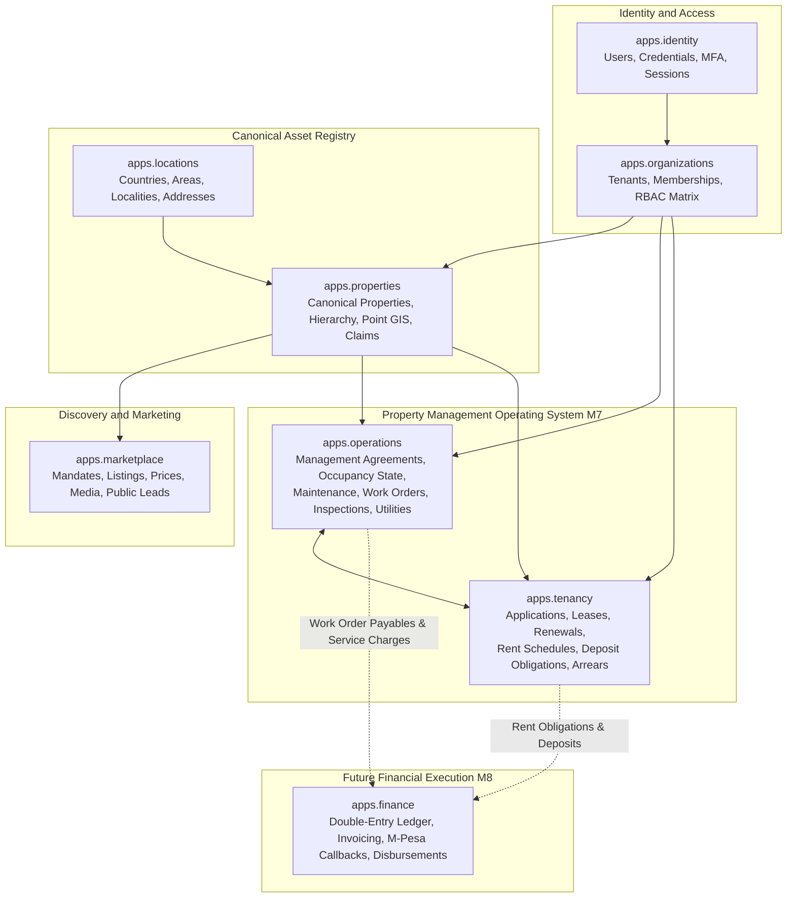
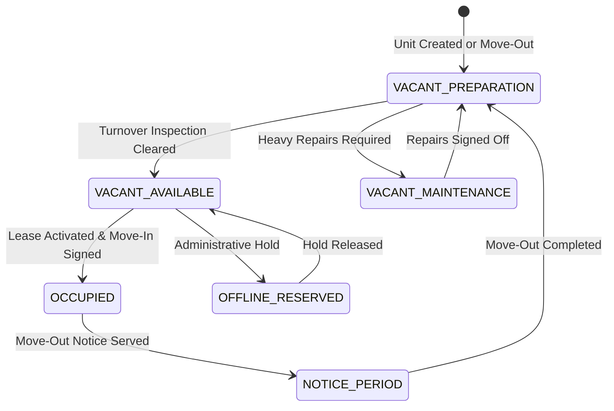
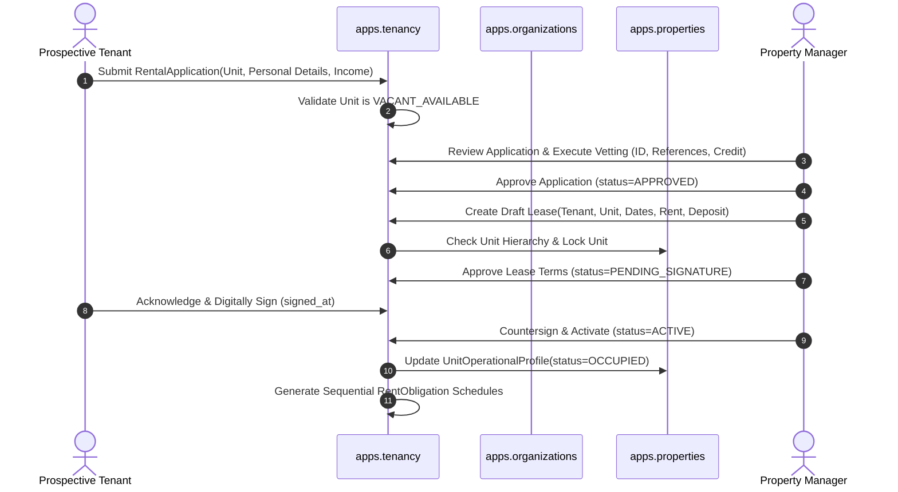
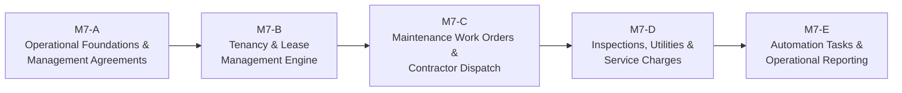

# M7 — Property Management Operating System Architecture

**Document Path**: `docs/engineering/M7_PROPERTY_MANAGEMENT_ARCHITECTURE.md`
**Milestone**: Milestone 7 (M7 Architecture Discovery & Specification)
**Date**: November 12, 2026
**Status**: ARCHITECTURAL SPECIFICATION & SYSTEM DESIGN
**Author**: Principal Software Architect & Lead Backend Engineer
**Repository**: `glitters-core` ([/home/mr-robot/Projects/glitters-core](file:///home/mr-robot/Projects/glitters-core))
**Implementation Mode**: STRICTLY ARCHITECTURAL SPECIFICATION (No Application Code Modified)

---

## 1. Executive Design Summary

Milestone 7 designs the **Property Management Operating System (PMOS)** for GLITTERS CORE. It expands the platform from a property registry and advertising marketplace into a full-lifecycle operational management engine for residential, commercial, and mixed-use real estate portfolios.

The architecture strictly preserves GLITTERS CORE's proven foundations:
1. **Single Account Entity**: `identity.User` remains the sole authentication and credential holder. No distinct user models or tables are created for owners, landlords, managers, or tenants.
2. **Organization-Based Multi-Tenancy**: Operational authority resides in `OrganizationMembership`, where property management companies, landlord businesses, and contractor firms operate as distinct `Organization` tenants.
3. **Canonical Physical Asset Separation**: `apps.properties` remains the authoritative source of physical real estate facts (geography, hierarchy, characteristics, and access grants). Property management operations do **not** mutate physical attributes or collapse canonical assets into leases.
4. **Clean Domain Boundaries**: Property management responsibilities are partitioned into two new dedicated modular domains:
   - `apps.tenancy`: Leases, rental applications, tenant vetting, rent obligation schedules, deposit tracking, and arrears management.
   - `apps.operations`: Owner-management agreements, unit occupancy lifecycles, maintenance requests, contractor work orders, property inspections, utility metering, and service charge budgets.
5. **Decoupled Financial Integration**: All financial events (rent dues, deposit liabilities, contractor payables, service charges) are modeled as business obligations that emit structured integration contracts to the future `apps.finance` domain. Payment processing and double-entry general ledgers remain decoupled in accordance with ADR [0008-defer-channels-payments-and-domain-apps.md](file:///home/mr-robot/Projects/glitters-core/docs/decisions/0008-defer-channels-payments-and-domain-apps.md).

---

## 2. Section 1 — Domain Boundaries

To prevent architectural erosion, circular dependencies, and monolithic sprawl, the responsibilities of the expanded ecosystem are partitioned across six distinct Django applications:



### Domain Boundary Allocations

| Application Domain | Core Responsibilities | Rationale & Invariants |
|---|---|---|
| **`apps.properties`** *(Existing)* | Canonical asset identity, estate/building/unit hierarchy, physical characteristics (sqm, rooms), WGS84 point coordinates, claimed ownership parties (`PropertyParty`), and access grants (`PropertyAccess`). | **Immutable physical reality.** Must not contain tenancy state, lease dates, tenant names, or maintenance tickets. A property exists whether it is rented, managed, or vacant. |
| **`apps.organizations`** *(Existing)* | Multi-tenant company entities (property management companies, landlord businesses, contractors), membership lifecycles, cryptographic invitations, central RBAC permission matrix. | **Tenant governance.** Evaluates whether an actor has authority within a business. Must not hold property rows or lease terms directly. |
| **`apps.marketplace`** *(Existing)* | Advertising mandates, public listings, asking rental/sale prices, verified marketing photographs, public search discovery, and prospect inquiries. | **Public marketing.** A listing is an advertising offer. When a vacancy is filled, the listing closes; the resulting lease belongs to Tenancy. |
| **`apps.operations`** *(New M7)* | Owner-management agreements, operational unit status (vacant/occupied/turnover), maintenance triage, contractor work orders, condition inspections, utility meters/readings, and service charge budgets. | **Physical operations & asset upkeep.** Manages the relationship between asset owners, property managers, maintenance vendors, and physical plant operations. |
| **`apps.tenancy`** *(New M7)* | Rental applications, tenant identity binding, formal lease contracts, move-in/move-out protocols, rent obligation schedules, deposit liabilities, lease renewals, amendments, and arrears tracking. | **Legal & contractual occupancy.** Governs the bilateral contract between landlord/manager and tenant. Decoupled from physical maintenance and cash ledgering. |
| **`apps.finance`** *(Future M8)* | Double-entry general ledgers, chart of accounts, tenant invoices, M-Pesa C2B/B2C callbacks, bank reconciliation, owner disbursement statements, tax retention (KDPA/KRA). | **Financial execution & custody of funds.** Neither `operations` nor `tenancy` directly handles bank APIs or balance calculations. They emit billing demands to Finance. |

---

## 3. Section 2 — Property Operations Workflows

### 2.1 Owner-Management Agreements
Property owners delegate management authority to a property management firm through an **Owner Management Agreement** (`ManagementAgreement`).
- **Parties**: Principal (Property Owner via `PropertyParty` or personal owner) and Managing Agent (`Organization(organization_type="property_manager")`).
- **Terms**: Agreement reference, effective dates (`valid_from`, `valid_until`), commission basis (`percentage_of_rent`, `fixed_monthly_minor`), disbursement schedule, maintenance expenditure threshold (`spend_limit_minor` without owner pre-authorization).
- **Enforcement**: Active agreements automatically establish or validate `Property.managing_organization` and grant operational RBAC permissions to management staff.

### 2.2 Building, Estate, and Unit Operational Hierarchy
While `apps.properties` maintains the canonical physical tree (`estate` -> `building` -> `unit`), `apps.operations` maintains the **Operational Unit Profile** (`UnitOperationalProfile`):
- **Occupancy Lifecycle States**:
  - `VACANT_AVAILABLE`: Clean, ready for tenant placement and marketplace syndication.
  - `VACANT_PREPARATION`: Under turnover cleaning, painting, or inspection post-move-out.
  - `VACANT_MAINTENANCE`: Offline due to major rehabilitation, structural work, or utility outage.
  - `OCCUPIED`: Active tenancy in place.
  - `NOTICE_PERIOD`: Occupied, but tenant has served move-out notice; available for future pre-leasing.
  - `OFFLINE_RESERVED`: Held for owner usage or administrative reservation.



### 2.3 Property Condition Inspections
Inspections (`PropertyInspection`) record standardized physical condition reports across predefined areas (kitchen, bathrooms, living room, electrical, plumbing, structural):
- **Inspection Types**: `MOVE_IN`, `MOVE_OUT`, `ROUTINE_QUARTERLY`, `ANNUAL_COMPLIANCE`, `MAINTENANCE_TRIAGE`.
- **Structure**: Each inspection contains multiple `InspectionItem` records capturing area name, element, condition grade (`EXCELLENT`, `GOOD`, `FAIR`, `POOR`, `DAMAGED`), meter readings, narrative observations, and private media upload links (`PropertyMedia`).
- **Signature & Tamper-Proofing**: Move-in and move-out inspections require digital acknowledgement from both Property Inspector and Tenant (`tenant_acknowledged_at`). Once completed, the inspection is locked and immutable.

### 2.4 Maintenance Requests and Work Order Lifecycle
1. **Intake**: A maintenance issue is logged via `MaintenanceRequest` by a Tenant (`identity.User`), Property Manager, or Inspector.
   - Categorized by trade (`PLUMBING`, `ELECTRICAL`, `HVAC`, `STRUCTURAL`, `CARPENTRY`, `APPLIANCE`, `GENERAL`).
   - Triage Priority assigned: `EMERGENCY` (4-hour SLA), `URGENT` (24-hour SLA), `ROUTINE` (72-hour SLA), `SCHEDULED_PREVENTATIVE`.
2. **Triage & Authorization**:
   - Property manager evaluates estimated cost against the agreement's `spend_limit_minor`.
   - If estimated cost exceeds threshold, the system requires an explicit `OwnerApproval` before dispatching external contractors.
3. **Work Order Dispatch (`WorkOrder`)**:
   - Dispatched either to an internal maintenance technician (`assigned_technician`) or an external vendor (`contractor_organization`).
   - Captures scheduled appointment windows, access instructions, and safety notes.
4. **Execution & Completion**:
   - Contractor/technician logs actual hours, replacement parts, and upload completion photographs.
   - Manager reviews work and triggers `INSPECTION_SIGN_OFF`.
   - Work order status transitions to `COMPLETED`, which freezes the expense record and generates a payable integration payload for `apps.finance`.

### 2.5 Utilities Management
- **Meters (`UtilityMeter`)**: Configured per unit or parent building (Sub-meter vs. Bulk Master Meter). Covers `WATER`, `ELECTRICITY_POSTPAID`, `ELECTRICITY_PREPAID_TOKEN`, `GAS`, `SOLAR`.
- **Readings (`MeterReading`)**: Sequential, append-only logs capturing meter number, current reading integer/decimal, reading timestamp, reader actor, and photograph reference.
- **Consumption & Split**: System computes unit consumption (`current_reading - previous_reading`) and applies the municipal tariff or estate apportionment rule.

### 2.6 Service Charge Budgets and Operating Expenses
- **Budgeting (`ServiceChargeBudget`)**: Annual operational budget established per building/estate covering common area security, cleaning, landscaping, generator fuel, elevator maintenance, and waste collection.
- **Apportionment**: Apportions expenses across units based on relative floor area percentage (`floor_area_sqm / total_building_sqm`) or fixed unit shares.
- **Operating Expenses (`PropertyExpense`)**: Tracks non-recoverable owner expenses (land rates, property insurance, structural repairs).

---

## 4. Section 3 — Tenancy Lifecycle & Lease Workflows

### 3.1 Rental Application & Tenant Vetting


1. **Application Intake**: Prospective tenant submits `RentalApplication` referencing a vacant unit. Includes employment verification, monthly income, previous landlord references, and ID documentation.
2. **Vetting & Screening**: Property Manager evaluates references and changes status to `APPROVED`, `REJECTED`, or `WAITLISTED`.

### 3.2 Lease Creation, Approval, and Lifecycle
- **Entity**: `Lease`.
- **Parties**:
  - `lessor_organization`: The Landlord Business or Property Management Company.
  - `tenant_user`: The authenticated individual tenant (`identity.User`).
  - `property`: The specific rentable `unit` or `standalone` property.
- **Key Financial Fields (Integer Minor Units)**:
  - `rent_amount_minor`: Agreed base rent per period (e.g. 5,000,000 cents = KES 50,000).
  - `rent_currency`: 3-letter currency code (e.g. `KES`).
  - `billing_frequency`: `MONTHLY`, `QUARTERLY`, `BI_ANNUAL`, `ANNUAL`.
  - `deposit_amount_minor`: Security deposit liability (e.g. 10,000,000 cents = 2 months rent).
  - `service_charge_minor`: Fixed monthly service charge obligation.
  - `payment_due_day`: Day of month payment is legally due (e.g., 5th of each month).
  - `grace_period_days`: Days before penalty/arrears status is triggered (e.g., 5 days).
  - `late_fee_minor`: Contractual late penalty fee.
- **Lease State Machine**:
  - `DRAFT`: Initial preparation by property manager.
  - `PENDING_APPROVAL`: Submitted to property owner or head of property management.
  - `PENDING_SIGNATURE`: Approved; waiting for tenant and lessor digital execution.
  - `ACTIVE`: Signed, initial deposit/rent verified; unit marked `OCCUPIED`.
  - `UNDER_RENEWAL`: Renewal negotiations opened (typically 60 days before expiry).
  - `TERMINATED_NORMAL`: Expired at term without renewal; move-out completed.
  - `TERMINATED_EARLY`: Ended prior to term by mutual agreement or break clause.
  - `TERMINATED_EVICTION`: Terminated due to legal eviction for breach or non-payment.
  - `CANCELLED`: Aborted prior to commencement.

### 3.3 Lease Amendments & Renewals
- **Amendments (`LeaseAmendment`)**: Contractual modifications (rent review, service charge adjustment, pet clause permission) execute through immutable, signed amendment documents with explicit `effective_date`.
- **Renewals**: Generating a new `Lease` linked via `supersedes_lease_id`, carrying forward active security deposits without requiring physical cash refunds.

### 3.4 Move-In & Move-Out Handover Protocols
- **Move-In**:
  - Triggered only when `Lease.status == ACTIVE`.
  - Pre-requisite: Comprehensive `PropertyInspection(kind="MOVE_IN")` completed and signed by tenant.
  - Keys, utility meter initial readings, and access cards recorded on `HandoverProtocol`.
- **Move-Out & Deposit Settlement**:
  - `PropertyInspection(kind="MOVE_OUT")` executed comparing item-by-item condition against the move-in inspection.
  - Documented tenant damage is quantified into `DepositDeduction` items (with receipts/work orders).
  - Net deposit refund liability calculated: `Deposit Obligations - Verified Deductions = Net Refund Payable`.

### 3.5 Rent Schedules and Arrears Tracking
- **Rent Schedules (`RentScheduleEntry`)**: Upon lease activation, the system pre-computes the deterministic schedule of future payment obligations:
  - `period_start` and `period_end`.
  - `due_date`.
  - `base_rent_minor`, `service_charge_minor`, `utility_estimate_minor`.
  - `total_due_minor`.
  - `status`: `PENDING`, `DUE`, `PAID`, `PARTIALLY_PAID`, `OVERDUE`, `WAIVED`.
- **Arrears Engine**: Computes tenant balance dynamically:
  $$\text{Current Arrears} = \sum (\text{total\_due\_minor for overdue entries}) - \sum (\text{allocated\_payments\_minor})$$
  - Tracks arrears aging brackets: Current (0–5 days), 30 Days, 60 Days, 90+ Days.

---

## 5. Section 4 — Actor and Permission Matrix

### 5.1 Participant Mapping to Existing Identity & Tenancy Primitives

| # | Participant Role | Primary Identity | Organization Tenancy & Membership | Property Access Grant | Operational Scope |
|---|---|---|---|---|---|
| 1 | **Property Owner** | `identity.User` | Optional (holds personal property or owns `Organization(type="landlord")`). | Holds `PropertyParty(role="owner")` and `PropertyAccess(capability="view"|"manage")`. | Reads portfolio performance, approves major work orders, inspects financial statements. |
| 2 | **Landlord** | `identity.User` | Active member of `Organization(type="landlord")` (Role: `owner` or `admin`). | Managed via Organization or direct personal property grant. | Signs leases, sets rental rates, authorizes tenant applications. |
| 3 | **Property Management Company** | N/A (Tenant) | `Organization(organization_type="property_manager")`. | Holds `Property.managing_organization` linkage. | Full operational execution under agreement. |
| 4 | **Property Manager** | `identity.User` | Active member of Managing Organization (Role: `admin` or `manager`). | Inherits organization management capability on all managed properties. | Manages leases, work orders, inspections, rent schedules, and tenant relations. |
| 5 | **Estate Manager** | `identity.User` | Active member of Managing Organization (Role: `manager` or `member`). | Assigned specific parent `estate` or `building` properties via `PropertyAccess`. | On-site caretaker; handles common areas, security, gate access, utility meters. |
| 6 | **Tenant** | `identity.User` | No organization membership required. | Granted scoped `PropertyAccess(capability="view")` strictly on leased `unit`. | Logs maintenance requests, views rent schedules, reviews move-in/out reports. |
| 7 | **Maintenance Technician** | `identity.User` | Member of Property Management Org (Role: `member`) or independent. | Scoped temporary work order access; no general property read. | Executes repairs, logs labor/materials, updates work order status. |
| 8 | **Contractor** | `identity.User` | Member of `Organization(organization_type="contractor")` (Role: `owner` or `admin`). | No direct property browse. Receives work order payloads for assigned jobs. | Submits repair bids, completes contracted works, submits invoice claims. |
| 9 | **Property Inspector** | `identity.User` | Member of Management Org or Professional Service firm. | Granted temporary `PropertyAccess(capability="view")` during inspection window. | Conducts physical inspections, records condition scores, uploads evidence photos. |
| 10 | **Utility Service Provider** | `identity.User` / Org | `Organization(organization_type="professional_service")` or external utility firm. | Restricted to bulk meter and sub-meter reading endpoints. | Submits sequential meter readings and municipal consumption invoices. |

### 5.2 Required Operational Permissions Registry
The following permission tokens are added to `apps.organizations.domain.Permission` and assigned across the role hierarchy:

```python
class Permission:
    # Existing Property Permissions
    PROPERTY_CREATE = "property.create"
    PROPERTY_UPDATE = "property.update"
    PROPERTY_PUBLISH = "property.publish"
    PROPERTY_ARCHIVE = "property.archive"
    LEADS_VIEW = "leads.view"
    LEADS_MANAGE = "leads.manage"

    # M7 Tenancy Permissions (Promoted from FUTURE_PERMISSIONS)
    LEASES_VIEW = "leases.view"
    LEASES_MANAGE = "leases.manage"
    TENANTS_VET = "tenants.vet"

    # M7 Operations & Maintenance Permissions (Promoted & Expanded)
    OPERATIONS_VIEW = "operations.view"
    OPERATIONS_MANAGE = "operations.manage"
    MAINTENANCE_VIEW = "maintenance.view"
    MAINTENANCE_MANAGE = "maintenance.manage"
    WORKORDERS_ASSIGN = "workorders.assign"
    INSPECTIONS_EXECUTE = "inspections.execute"
    UTILITIES_MANAGE = "utilities.manage"
    SERVICE_CHARGES_MANAGE = "service_charges.manage"
```

### 5.3 Role Permission Matrix for Property Management Organizations

| Permission | Owner | Admin | Manager | Member | Viewer | External Tenant (`User`) |
|---|---|---|---|---|---|---|
| `organization.view` | Yes | Yes | Yes | Yes | Yes | No |
| `property.create` / `update` | Yes | Yes | Yes | No | No | No |
| `leases.view` | Yes | Yes | Yes | Yes | No | Scoped to own lease |
| `leases.manage` | Yes | Yes | Yes | No | No | No |
| `tenants.vet` | Yes | Yes | Yes | No | No | No |
| `operations.view` | Yes | Yes | Yes | Yes | Yes | Scoped to own unit |
| `operations.manage` | Yes | Yes | Yes | No | No | No |
| `maintenance.view` | Yes | Yes | Yes | Yes | No | Scoped to own tickets |
| `maintenance.manage` | Yes | Yes | Yes | No | No | Can log requests |
| `workorders.assign` | Yes | Yes | Yes | No | No | No |
| `inspections.execute` | Yes | Yes | Yes | Yes | No | Can sign own report |
| `utilities.manage` | Yes | Yes | Yes | Yes | No | Reads own meter |
| `service_charges.manage` | Yes | Yes | No | No | No | Reads own charge |

---

## 6. Section 5 — Financial Integration Contract

In accordance with architectural decisions, **`apps.operations` and `apps.tenancy` do not implement general ledgers, payment gateways, or cash reconciliation**. They emit immutable, strongly-typed **Billing Demand Payloads** and **Disbursement Payloads** consumed by the future `apps.finance` domain.

### 6.1 Integration Contracts (Data Transfer Objects)

```
┌────────────────────────────────────────────────────────────────────────────┐
│                    PROPERTY MANAGEMENT & TENANCY (M7)                      │
│                                                                            │
│  [Lease Activated]      [Rent Schedule Due]      [Work Order Completed]    │
└──────────┬───────────────────────┬─────────────────────────┬───────────────┘
           │                       │                         │
           ▼                       ▼                         ▼
┌────────────────────────────────────────────────────────────────────────────┐
│                       FINANCIAL INTEGRATION CONTRACTS                      │
│                                                                            │
│  DepositObligationContract  RentDemandContract    ContractorPayableContract│
│  - lease_id                 - rent_schedule_id    - work_order_id          │
│  - tenant_user_id           - tenant_user_id      - contractor_org_id      │
│  - amount_minor             - amount_minor        - approved_amount_minor  │
│  - currency: "KES"          - due_date            - expense_category       │
└──────────────────────────────────┬─────────────────────────────────────────┘
                                   │
                                   ▼
┌────────────────────────────────────────────────────────────────────────────┐
│                         FUTURE APPS.FINANCE (M8)                           │
│                                                                            │
│  • Double-Entry General Ledger (Debit Accounts Receivable / Credit Revenue)│
│  • Customer Invoicing & Automated M-Pesa STK Push Collection               │
│  • Escrow Deposit Liability Accounts                                       │
│  • Contractor Payouts & Net Owner Disbursement Statement Generation        │
└────────────────────────────────────────────────────────────────────────────┘
```

1. **Rent Due Demand (`RentDemandContract`)**:
   - Emitted when a rent schedule entry enters due window.
   - Fields: `schedule_id`, `lease_id`, `property_id`, `payer_user_id`, `payee_organization_id`, `amount_minor`, `currency`, `due_date`, `grace_period_days`, `breakdown: {base_rent, service_charge, water}`.
2. **Deposit Liability Contract (`DepositObligationContract`)**:
   - Emitted upon lease execution.
   - Fields: `lease_id`, `property_id`, `tenant_user_id`, `deposit_amount_minor`, `currency`, `escrow_type: "SECURITY_DEPOSIT"`.
3. **Deposit Refund Settlement (`DepositRefundSettlementContract`)**:
   - Emitted upon move-out sign-off.
   - Fields: `lease_id`, `tenant_user_id`, `original_deposit_minor`, `verified_deductions_minor`, `deduction_breakdown: [{reason, work_order_id, amount_minor}]`, `net_refund_payable_minor`.
4. **Contractor Payable Contract (`ContractorPayableContract`)**:
   - Emitted when a maintenance work order is marked `COMPLETED` and approved by the manager.
   - Fields: `work_order_id`, `property_id`, `managing_org_id`, `vendor_org_id`, `amount_minor`, `currency`, `tax_pin`, `service_category`, `supporting_document_url`.
5. **Service Charge Recovery (`ServiceChargeAssessmentContract`)**:
   - Emitted when annual or monthly service charge apportionment is billed.
   - Fields: `budget_id`, `unit_property_id`, `payer_user_id`, `share_percentage`, `assessed_amount_minor`.

---

## 7. Section 6 — Event and Audit Architecture

Both `apps.tenancy` and `apps.operations` enforce the repository's strict audit policy: **all mutating operations must append immutable audit event rows using `AppendOnlyQuerySet`**.

### 7.1 Operations Events (`OperationsEvent`)
Tracks all physical operational, agreement, maintenance, and inspection events.
- **Model**: `apps.operations.models.OperationsEvent`.
- **Database Table**: `operations_event`.
- **Event Actions**:
  - `agreement.created`, `agreement.activated`, `agreement.terminated`
  - `occupancy.status_changed`
  - `inspection.scheduled`, `inspection.completed`, `inspection.signed`
  - `maintenance.requested`, `maintenance.triaged`, `maintenance.approved`
  - `work_order.dispatched`, `work_order.started`, `work_order.completed`, `work_order.rejected`
  - `meter.reading_logged`
  - `service_charge.budget_approved`, `service_charge.apportioned`
- **Fields**: `id` (UUID), `actor` (FK `identity.User`, `SET_NULL`), `property` (FK `Property`, `CASCADE`), `organization` (FK `Organization`, `CASCADE`), `action`, `object_type`, `object_id`, `request_id`, `ip_address`, `metadata` (JSONField sanitized), `created_at`.

### 7.2 Tenancy Events (`TenancyEvent`)
Tracks all contractual lease, applicant vetting, and rent schedule transitions.
- **Model**: `apps.tenancy.models.TenancyEvent`.
- **Database Table**: `tenancy_event`.
- **Event Actions**:
  - `application.submitted`, `application.vetted`, `application.approved`, `application.rejected`
  - `lease.created`, `lease.approved`, `lease.signed`, `lease.activated`
  - `lease.amended`, `lease.renewal_offered`, `lease.renewed`, `lease.terminated`
  - `rent_schedule.generated`, `rent_schedule.adjusted`, `rent_schedule.waived`
  - `handover.move_in_completed`, `handover.move_out_completed`
  - `deposit.deduction_assessed`, `deposit.refund_authorized`
- **Sanitization Invariant**: Event metadata strictly strips passwords, raw tokens, credit card / bank account numbers, exact spatial coordinates, and personal medical history.

---

## 8. Section 7 — Proposed Database Design

```
┌────────────────────────────────────────────────────────────────────────────┐
│                    PROPOSED M7 RELATIONAL SCHEMA MAP                       │
├─────────────────────────────────────┬──────────────────────────────────────┤
│ apps.operations                     │ apps.tenancy                         │
├─────────────────────────────────────┼──────────────────────────────────────┤
│ • ManagementAgreement               │ • RentalApplication                  │
│ • UnitOperationalProfile            │ • Lease                              │
│ • PropertyInspection                │ • LeaseAmendment                     │
│ • InspectionItem                    │ • RentScheduleEntry                  │
│ • MaintenanceRequest                │ • DepositDeduction                   │
│ • WorkOrder                         │ • HandoverProtocol                   │
│ • UtilityMeter                      │ • TenancyEvent (Append-only)         │
│ • MeterReading                      │                                      │
│ • ServiceChargeBudget               │                                      │
│ • OperationsEvent (Append-only)     │                                      │
└─────────────────────────────────────┴──────────────────────────────────────┘
```

### 8.1 `apps.operations` Models

#### Model: `ManagementAgreement`
- `id`: UUID (PK)
- `reference`: CharField(16, unique=True) (e.g. `PMA-2026-0001`)
- `property`: ForeignKey(`properties.Property`, on_delete=PROTECT)
- `owner_party`: ForeignKey(`properties.PropertyParty`, on_delete=PROTECT)
- `managing_organization`: ForeignKey(`organizations.Organization`, on_delete=PROTECT)
- `valid_from`: DateField()
- `valid_until`: DateField(null=True, blank=True)
- `commission_rate_basis_points`: PositiveIntegerField() (e.g. 750 = 7.50%)
- `fixed_fee_minor`: BigIntegerField(default=0)
- `spend_limit_minor`: BigIntegerField(default=1000000) (Limit before owner sign-off, e.g. KES 10,000)
- `status`: CharField(choices=[`DRAFT`, `ACTIVE`, `EXPIRED`, `TERMINATED`], default=`DRAFT`)
- `created_at`, `updated_at`: DateTimeField()
- **Constraints**: `CheckConstraint(valid_until__isnull=True | valid_until__gte=valid_from)`, `CheckConstraint(spend_limit_minor__gte=0)`.

#### Model: `UnitOperationalProfile`
- `id`: UUID (PK)
- `property`: OneToOneField(`properties.Property`, on_delete=CASCADE, related_name="operational_profile")
- `occupancy_status`: CharField(choices=[`VACANT_AVAILABLE`, `VACANT_PREPARATION`, `VACANT_MAINTENANCE`, `OCCUPIED`, `NOTICE_PERIOD`, `OFFLINE_RESERVED`], default=`VACANT_PREPARATION`)
- `ready_for_leasing_at`: DateTimeField(null=True, blank=True)
- `target_rent_minor`: BigIntegerField(null=True, blank=True)
- `target_currency`: CharField(max_length=3, default="KES")
- `current_lease_id`: UUIDField(null=True, blank=True) (Weak reference to active Lease)
- `updated_at`: DateTimeField(auto_now=True)

#### Model: `PropertyInspection`
- `id`: UUID (PK)
- `reference`: CharField(16, unique=True)
- `property`: ForeignKey(`properties.Property`, on_delete=PROTECT)
- `inspector`: ForeignKey(settings.AUTH_USER_MODEL, on_delete=PROTECT)
- `kind`: CharField(choices=[`MOVE_IN`, `MOVE_OUT`, `ROUTINE`, `COMPLIANCE`, `MAINTENANCE`])
- `status`: CharField(choices=[`SCHEDULED`, `IN_PROGRESS`, `PENDING_SIGNATURE`, `COMPLETED`, `CANCELLED`], default=`SCHEDULED`)
- `inspection_date`: DateTimeField()
- `overall_condition`: CharField(choices=[`EXCELLENT`, `GOOD`, `FAIR`, `POOR`, `UNINHABITABLE`])
- `tenant_user`: ForeignKey(settings.AUTH_USER_MODEL, null=True, blank=True, on_delete=SET_NULL)
- `tenant_acknowledged_at`: DateTimeField(null=True, blank=True)
- `notes`: TextField(blank=True)
- `created_at`, `updated_at`: DateTimeField()

#### Model: `InspectionItem`
- `id`: UUID (PK)
- `inspection`: ForeignKey(`PropertyInspection`, on_delete=CASCADE, related_name="items")
- `area_name`: CharField(max_length=80) (e.g. `Master Bedroom`, `Kitchen`)
- `element`: CharField(max_length=80) (e.g. `Sink Fixtures`, `Wall Paint`, `Tiles`)
- `condition`: CharField(choices=[`EXCELLENT`, `GOOD`, `FAIR`, `POOR`, `DAMAGED`])
- `is_damaged`: BooleanField(default=False)
- `repair_required`: BooleanField(default=False)
- `estimated_repair_minor`: BigIntegerField(null=True, blank=True)
- `photograph_media_id`: UUIDField(null=True, blank=True)
- `comment`: TextField(blank=True)

#### Model: `MaintenanceRequest`
- `id`: UUID (PK)
- `reference`: CharField(16, unique=True)
- `property`: ForeignKey(`properties.Property`, on_delete=PROTECT)
- `reported_by`: ForeignKey(settings.AUTH_USER_MODEL, on_delete=PROTECT)
- `trade`: CharField(choices=[`PLUMBING`, `ELECTRICAL`, `HVAC`, `STRUCTURAL`, `CARPENTRY`, `APPLIANCE`, `GENERAL`])
- `priority`: CharField(choices=[`EMERGENCY`, `URGENT`, `ROUTINE`, `SCHEDULED`])
- `title`: CharField(max_length=200)
- `description`: TextField()
- `status`: CharField(choices=[`REPORTED`, `TRIAGED`, `OWNER_APPROVAL_REQUIRED`, `WORK_ORDER_DISPATCHED`, `COMPLETED`, `REJECTED`, `CANCELLED`], default=`REPORTED`)
- `created_at`, `updated_at`: DateTimeField()

#### Model: `WorkOrder`
- `id`: UUID (PK)
- `reference`: CharField(16, unique=True)
- `request`: ForeignKey(`MaintenanceRequest`, on_delete=PROTECT, related_name="work_orders")
- `contractor_organization`: ForeignKey(`organizations.Organization`, null=True, blank=True, on_delete=PROTECT)
- `assigned_technician`: ForeignKey(settings.AUTH_USER_MODEL, null=True, blank=True, on_delete=PROTECT)
- `scheduled_start`: DateTimeField()
- `scheduled_end`: DateTimeField(null=True, blank=True)
- `estimated_cost_minor`: BigIntegerField(default=0)
- `actual_cost_minor`: BigIntegerField(null=True, blank=True)
- `currency`: CharField(max_length=3, default="KES")
- `status`: CharField(choices=[`DRAFT`, `ASSIGNED`, `IN_PROGRESS`, `PENDING_INSPECTION`, `COMPLETED`, `REWORK_REQUIRED`, `CANCELLED`], default=`DRAFT`)
- `completion_notes`: TextField(blank=True)
- `completed_at`: DateTimeField(null=True, blank=True)

---

### 8.2 `apps.tenancy` Models

#### Model: `RentalApplication`
- `id`: UUID (PK)
- `reference`: CharField(16, unique=True)
- `property`: ForeignKey(`properties.Property`, on_delete=PROTECT)
- `applicant`: ForeignKey(settings.AUTH_USER_MODEL, on_delete=PROTECT)
- `monthly_income_minor`: BigIntegerField()
- `currency`: CharField(max_length=3, default="KES")
- `proposed_start_date`: DateField()
- `employment_details`: JSONField(default=dict)
- `references_payload`: JSONField(default=list)
- `status`: CharField(choices=[`SUBMITTED`, `UNDER_REVIEW`, `APPROVED`, `REJECTED`, `WITHDRAWN`], default=`SUBMITTED`)
- `vetted_by`: ForeignKey(settings.AUTH_USER_MODEL, null=True, blank=True, on_delete=SET_NULL)
- `vetted_at`: DateTimeField(null=True, blank=True)
- `created_at`, `updated_at`: DateTimeField()

#### Model: `Lease`
- `id`: UUID (PK)
- `reference`: CharField(16, unique=True) (e.g. `LSE-2026-0042`)
- `property`: ForeignKey(`properties.Property`, on_delete=PROTECT, related_name="leases")
- `managing_organization`: ForeignKey(`organizations.Organization`, on_delete=PROTECT, related_name="managed_leases")
- `landlord_party`: ForeignKey(`properties.PropertyParty`, on_delete=PROTECT, related_name="landlord_leases")
- `tenant_user`: ForeignKey(settings.AUTH_USER_MODEL, on_delete=PROTECT, related_name="tenant_leases")
- `lease_type`: CharField(choices=[`RESIDENTIAL_FIXED`, `RESIDENTIAL_PERIODIC`, `COMMERCIAL_TRIPLE_NET`, `COMMERCIAL_GROSS`, `STUDENT_TERM`])
- `start_date`: DateField()
- `end_date`: DateField()
- `rent_amount_minor`: BigIntegerField()
- `rent_currency`: CharField(max_length=3, default="KES")
- `billing_frequency`: CharField(choices=[`MONTHLY`, `QUARTERLY`, `ANNUAL`], default=`MONTHLY`)
- `deposit_amount_minor`: BigIntegerField(default=0)
- `service_charge_minor`: BigIntegerField(default=0)
- `payment_due_day`: PositiveSmallIntegerField(default=1)
- `grace_period_days`: PositiveSmallIntegerField(default=5)
- `status`: CharField(choices=[`DRAFT`, `PENDING_APPROVAL`, `PENDING_SIGNATURE`, `ACTIVE`, `UNDER_RENEWAL`, `TERMINATED_NORMAL`, `TERMINATED_EARLY`, `TERMINATED_EVICTION`, `CANCELLED`], default=`DRAFT`)
- `signed_by_tenant_at`: DateTimeField(null=True, blank=True)
- `signed_by_landlord_at`: DateTimeField(null=True, blank=True)
- `activated_at`: DateTimeField(null=True, blank=True)
- `terminated_at`: DateTimeField(null=True, blank=True)
- `superseded_by_lease`: ForeignKey("self", null=True, blank=True, on_delete=SET_NULL)
- `created_at`, `updated_at`: DateTimeField()
- **Constraints**:
  - `CheckConstraint(end_date__gt=start_date)`
  - `CheckConstraint(rent_amount_minor__gt=0)`
  - `CheckConstraint(deposit_amount_minor__gte=0)`
  - `CheckConstraint(payment_due_day__gte=1, payment_due_day__lte=28)`
  - Partial Unique Constraint: Only one active lease per property at any time:
    `UniqueConstraint(fields=["property"], condition=Q(status="ACTIVE"), name="one_active_lease_per_property")`

#### Model: `RentScheduleEntry`
- `id`: UUID (PK)
- `lease`: ForeignKey(`Lease`, on_delete=PROTECT, related_name="rent_schedules")
- `sequence_number`: PositiveSmallIntegerField()
- `period_start`: DateField()
- `period_end`: DateField()
- `due_date`: DateField()
- `base_rent_minor`: BigIntegerField()
- `service_charge_minor`: BigIntegerField(default=0)
- `total_due_minor`: BigIntegerField()
- `currency`: CharField(max_length=3, default="KES")
- `status`: CharField(choices=[`PENDING`, `DUE`, `PAID`, `PARTIALLY_PAID`, `OVERDUE`, `WAIVED`], default=`PENDING`)
- `paid_amount_minor`: BigIntegerField(default=0)
- `settled_at`: DateTimeField(null=True, blank=True)
- **Constraints**:
  - `UniqueConstraint(fields=["lease", "sequence_number"], name="rent_schedule_seq_unique")`
  - `CheckConstraint(period_end__gte=period_start)`
  - `CheckConstraint(total_due_minor == base_rent_minor + service_charge_minor)`

---

## 9. Section 8 — REST API Design

All endpoints reside under `/api/v1/` and enforce JSON error envelopes with `request_id`.

### 8.1 Property Operations Endpoints (`/api/v1/operations/`)

| Method | Endpoint Route | View / Controller | Required Permission | Description |
|---|---|---|---|---|
| `GET, POST` | `/api/v1/operations/agreements/` | `ManagementAgreementCollectionView` | `operations.view` / `operations.manage` | List/create owner-management contracts. |
| `GET, PATCH`| `/api/v1/operations/agreements/<id>/` | `ManagementAgreementDetailView` | `operations.view` / `operations.manage` | Inspect/amend agreement terms. |
| `GET, PATCH`| `/api/v1/operations/units/<property_id>/profile/` | `UnitOperationalProfileView` | `operations.view` / `operations.manage` | Read/update occupancy status & target rents. |
| `GET, POST` | `/api/v1/operations/inspections/` | `InspectionCollectionView` | `operations.view` / `inspections.execute` | Schedule and list property inspections. |
| `GET, PATCH`| `/api/v1/operations/inspections/<id>/` | `InspectionDetailView` | `operations.view` / `inspections.execute` | Retrieve/update checklist items and grades. |
| `POST` | `/api/v1/operations/inspections/<id>/sign/` | `InspectionSignatureView` | `IsAuthenticated` (Tenant/Inspector) | Digital sign-off and completion freeze. |
| `GET, POST` | `/api/v1/operations/maintenance/requests/` | `MaintenanceRequestCollectionView`| `IsAuthenticated` (Tenant/Manager) | Submit and browse repair requests. |
| `GET, PATCH`| `/api/v1/operations/maintenance/requests/<id>/`| `MaintenanceRequestDetailView`| `maintenance.view` / `manage` | Triage and status progression. |
| `GET, POST` | `/api/v1/operations/work-orders/` | `WorkOrderCollectionView` | `maintenance.view` / `workorders.assign`| Dispatch work orders to contractors. |
| `GET, PATCH`| `/api/v1/operations/work-orders/<id>/` | `WorkOrderDetailView` | `maintenance.view` / Contractor | Update job execution, hours, and materials. |
| `POST` | `/api/v1/operations/work-orders/<id>/complete/`| `WorkOrderCompleteView` | `maintenance.manage` | Manager sign-off and cost settlement. |
| `GET, POST` | `/api/v1/operations/utilities/meters/` | `UtilityMeterCollectionView` | `utilities.manage` | Configure meters on units/buildings. |
| `POST` | `/api/v1/operations/utilities/readings/` | `MeterReadingCreateView` | `utilities.manage` | Sequential meter reading ingestion. |
| `GET` | `/api/v1/operations/reports/occupancy/` | `OccupancyReportView` | `operations.view` | Aggregated vacancy and turnover KPIs. |

### 8.2 Tenancy Endpoints (`/api/v1/tenancy/`)

| Method | Endpoint Route | View / Controller | Required Permission | Description |
|---|---|---|---|---|
| `GET, POST` | `/api/v1/tenancy/applications/` | `RentalApplicationCollectionView` | `IsAuthenticated` / `tenants.vet` | Submit and review rental applications. |
| `POST` | `/api/v1/tenancy/applications/<id>/vet/` | `RentalApplicationVetView` | `tenants.vet` | Approve/reject application. |
| `GET, POST` | `/api/v1/tenancy/leases/` | `LeaseCollectionView` | `leases.view` / `leases.manage` | List/create draft leases. |
| `GET, PATCH`| `/api/v1/tenancy/leases/<id>/` | `LeaseDetailView` | `leases.view` / `leases.manage` | Inspect terms and draft edits. |
| `POST` | `/api/v1/tenancy/leases/<id>/approve/` | `LeaseApproveView` | `leases.manage` | Manager/Landlord term approval. |
| `POST` | `/api/v1/tenancy/leases/<id>/sign/` | `LeaseSignView` | `IsAuthenticated` (Tenant/Lessor) | Cryptographic digital signature execution. |
| `POST` | `/api/v1/tenancy/leases/<id>/activate/` | `LeaseActivateView` | `leases.manage` | Activates lease; generates rent schedules. |
| `POST` | `/api/v1/tenancy/leases/<id>/terminate/`| `LeaseTerminateView` | `leases.manage` | Notice of termination & move-out workflow. |
| `GET` | `/api/v1/tenancy/leases/<id>/schedules/`| `RentScheduleListView` | `leases.view` (Tenant/Manager) | Sequential rent obligations list. |
| `GET` | `/api/v1/tenancy/reports/arrears/` | `ArrearsReportView` | `leases.view` / `operations.view` | Arrears aging report by unit and tenant. |

---

## 10. Section 9 — Automation Readiness (Celery Specifications)

While no application tasks currently exist in the codebase, `apps.operations` and `apps.tenancy` specify six core automated background tasks to be registered in `CELERY_BEAT_SCHEDULE`:

```python
# Specification for future config/settings/base.py registration

CELERY_BEAT_SCHEDULE = {
    "tenancy_evaluate_rent_due_daily": {
        "task": "apps.tenancy.tasks.evaluate_rent_due_obligations",
        "schedule": crontab(hour=0, minute=15),  # Daily at 00:15 EAT
    },
    "tenancy_flag_overdue_arrears_daily": {
        "task": "apps.tenancy.tasks.flag_overdue_arrears",
        "schedule": crontab(hour=1, minute=0),   # Daily at 01:00 EAT
    },
    "tenancy_lease_expiry_notices_daily": {
        "task": "apps.tenancy.tasks.dispatch_lease_expiry_notices",
        "schedule": crontab(hour=7, minute=0),   # Daily at 07:00 EAT
    },
    "operations_escalate_stale_maintenance_hourly": {
        "task": "apps.operations.tasks.escalate_stale_maintenance_requests",
        "schedule": crontab(minute=30),          # Every hour at :30
    },
    "operations_inspection_reminders_daily": {
        "task": "apps.operations.tasks.dispatch_inspection_reminders",
        "schedule": crontab(hour=8, minute=0),   # Daily at 08:00 EAT
    },
    "operations_generate_monthly_occupancy_metrics": {
        "task": "apps.operations.tasks.generate_monthly_occupancy_metrics",
        "schedule": crontab(day_of_month=1, hour=2, minute=0),  # 1st of month
    },
}
```

1. **`evaluate_rent_due_obligations`**: Runs daily; identifies `RentScheduleEntry` records where `due_date <= today + 5 days` and transitions them from `PENDING` to `DUE`. Emits `RentDemandContract` payloads.
2. **`flag_overdue_arrears`**: Runs daily; identifies `RentScheduleEntry` where `status == DUE` and `today > due_date + grace_period_days`. Transitions entry to `OVERDUE` and dispatches notification alerts.
3. **`dispatch_lease_expiry_notices`**: Identifies active leases terminating in exactly 90, 60, or 30 days. Emits renewal prompts to property manager and tenant.
4. **`escalate_stale_maintenance_requests`**: Evaluates open `MaintenanceRequest` entries against their priority SLAs (`EMERGENCY`: 4h, `URGENT`: 24h). Dispatches manager escalations if no work order is assigned.

---

## 11. Section 10 — Milestone Breakdown & Implementation Sequence

Milestone 7 is structured into **5 sequential, independently testable sub-milestones**:



### Sub-Milestone M7-A: Operational Foundations & Agreements
- **Scope**: Create `apps.operations` skeleton. Implement `ManagementAgreement`, `UnitOperationalProfile`, and agreement approval services.
- **Dependencies**: `apps.properties`, `apps.organizations`.
- **Permissions Added**: `operations.view`, `operations.manage`.
- **Acceptance Criteria**: Owner can delegate management to an organization; unit occupancy transitions are validated; 100% test pass rate.

### Sub-Milestone M7-B: Tenancy, Applications & Lease Engine
- **Scope**: Create `apps.tenancy` skeleton. Implement `RentalApplication`, `Lease`, `RentScheduleEntry`, and tenant vetting services.
- **Dependencies**: `apps.operations`, `apps.properties`, `apps.identity`.
- **Permissions Added**: `leases.view`, `leases.manage`, `tenants.vet`.
- **Acceptance Criteria**: Draft leases can be approved and digitally activated; unique constraint prevents overlapping active leases; rent schedule generation is deterministic; 100% test pass rate.

### Sub-Milestone M7-C: Maintenance, Work Orders & Contractors
- **Scope**: Implement `MaintenanceRequest` and `WorkOrder` models and services within `apps.operations`.
- **Dependencies**: `apps.operations`, `apps.organizations`.
- **Permissions Added**: `maintenance.view`, `maintenance.manage`, `workorders.assign`.
- **Acceptance Criteria**: Tenants can report tickets; managers triage by SLA; external contractor organizations receive assigned jobs; completion sign-off freezes costs.

### Sub-Milestone M7-D: Inspections, Utilities & Service Charges
- **Scope**: Implement `PropertyInspection`, `InspectionItem`, `UtilityMeter`, `MeterReading`, and `ServiceChargeBudget` in `apps.operations`. Implement `DepositDeduction` in `apps.tenancy`.
- **Dependencies**: `apps.operations`, `apps.tenancy`, `apps.marketplace` (private media).
- **Permissions Added**: `inspections.execute`, `utilities.manage`, `service_charges.manage`.
- **Acceptance Criteria**: Move-in/move-out reports link damage to deposit deductions; sequential meter readings compute exact consumption; 100% test pass rate.

### Sub-Milestone M7-E: Automation & Operational Reporting
- **Scope**: Register Celery background tasks in `apps.operations.tasks` and `apps.tenancy.tasks`. Build aggregated occupancy and arrears reporting endpoints.
- **Dependencies**: Celery, Redis, `apps.operations`, `apps.tenancy`.
- **Acceptance Criteria**: Rent due evaluation transitions schedules automatically; arrears aging calculations match ledger expectations; 100% test pass rate.

---

## 12. Architectural Conclusions & Review Recommendations

1. **Recommended Domain Boundaries**: Maintain the strict separation between physical assets (`apps.properties`), contractual occupancy (`apps.tenancy`), physical upkeep (`apps.operations`), and financial ledgers (`apps.finance`).
2. **Database Integrity Invariants**: Enforce single active lease per property via partial unique constraints; enforce integer minor-unit pricing throughout; preserve append-only audit querysets on `OperationsEvent` and `TenancyEvent`.
3. **Existing Components to Reuse**: Full reuse of `identity.User`, `OrganizationMembership` RBAC matrix, `Property` hierarchy, and `apps.marketplace` private media storage infrastructure.
4. **Security Enforcement**: Apply `ActiveAccountMiddleware` and mandatory staff MFA across all property management desks; enforce object-level property access checks on all operational endpoints.
5. **Readiness for Milestone 7 Execution**: Architectural specification is complete and verified against existing codebase contracts. System is primed for phased M7-A through M7-E execution.

---
*End of Milestone 7 Architecture Specification.*
